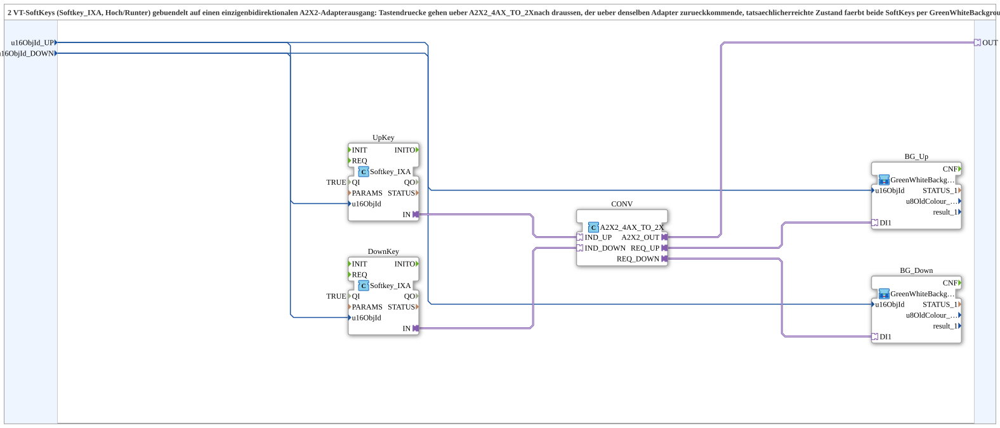

# Softkey2_TO_A2X2_BG

* * * * * * * * * *

## Introduction

`Softkey2_TO_A2X2_BG` is a composite subapplication designed to bundle two ISOagriLib softkey function blocks (one for “UP”, one for “DOWN”) into a single bidirectional A2X2 adapter interface. It also implements visual feedback for the softkeys by colouring them based on the actual state returned via the same adapter. This subapplication encapsulates the logic entirely within the composite, keeping the device resource simple and focused.

## Interface Structure

### **Event Inputs**

- **INIT** (`EInit`): initialization request; starts the init chain at `UpKey.INIT`

### **Event Outputs**

- **INITO** (`EInit`): initialization confirmation; comes from `BG_Down.INITO`, the end of the init chain

### **Data Inputs**

- `QI` (BOOL, initial value `TRUE`): Quality input, enables the service; passed on to `UpKey`, `DownKey`, `BG_Up` and `BG_Down`.
- `u16ObjId_UP` (UINT): Object ID for the “UP” softkey. This ID is used both by the softkey logic and by the background colouring subapplication.
- `u16ObjId_DOWN` (UINT): Object ID for the “DOWN” softkey. This ID is used both by the softkey logic and by the background colouring subapplication.

### **Data Outputs**

- `QO` (BOOL): Quality output, AND combination (`AND_QO`, `AND_BOOL_4`) of the `QO` outputs of `UpKey`, `DownKey`, `BG_Up` and `BG_Down`.

### **Adapters**

- `OUT` (adapter::types::bidirectional::A2X2): A bidirectional adapter that bundles the sending of UP/DOWN key press events and the reception of the actual state feedback from the remote partner (e.g. a virtual terminal).

## Functionality

The subapplication internally instantiates two `Softkey_IXA` function blocks (`UpKey` and `DownKey`) to handle the ISOagriLib softkey semantics. Each softkey receives its object ID from the corresponding data input. The key press events are forwarded via adapter connections to a conversion block (`A2X2_4AX_TO_2X`), which consolidates the two separate softkey streams into a single A2X2 adapter connection.

The same A2X2 adapter also carries the returned state (e.g. which softkey is actually pressed or released at the remote terminal). This state is fed back to two `GreenWhiteBackground1_AX` subapplications (`BG_Up` and `BG_Down`), each associated with one softkey. These subapplications colour the respective softkey background green (active) or white (inactive) based on the feedback received via the adapter.

Initialization and quality: `INIT` → `UpKey.INIT`, `UpKey.INITO` → `DownKey.INIT`, `DownKey.INITO` → `BG_Up.INIT`, `BG_Up.INITO` → `BG_Down.INIT`, `BG_Down.INITO` → `INITO` and `AND_QO.REQ`. `QI` is passed on to `UpKey`, `DownKey`, `BG_Up` and `BG_Down`; their `QO` outputs go in this order to `AND_QO.IN1` to `AND_QO.IN4` (`iec61131::booleanOperators::AND_BOOL_4`), `AND_QO.OUT` → `QO`.

Thus, the entire round trip — sending key presses and receiving state — is done through the single `OUT` adapter, and the visual status is updated accordingly.

## Technical Features

- **Composite bundling**: Encapsulates two independent softkey channels into one adapter interface, reducing the external connection count.
- **ISOagriLib compliance**: Uses standard `Softkey_IXA` blocks, ensuring compatibility with ISO 11783 (ISOBUS) virtual terminal implementations.
- **Bidirectional communication**: The A2X2 adapter supports both sending and receiving, enabling state feedback.
- **Background colouring**: Uses `GreenWhiteBackground1_AX` subapplications to change softkey background based on the acknowledged state.
- **Parameterisable**: Object IDs are provided as inputs, allowing reuse for different softkey identifiers without internal modification.

## State Overview

The subapplication does not maintain a finite state machine of its own. Instead, it relies on the internal `Softkey_IXA` blocks to handle the softkey state transitions (e.g. pressed, released). The `GreenWhiteBackground1_AX` subapplications react to the feedback from the adapter and colour the softkey background accordingly:

- **Green**: The softkey is currently recognised as active/pressed by the remote terminal.
- **White**: The softkey is inactive/released.

The state information flows continuously through the adapter, reflecting the latest acknowledged condition.

## Application Scenarios

- **Agricultural machinery control**: A virtual terminal with multiple softkeys that must be grouped and communicated via a single A2X2 adapter for efficiency.
- **Remote terminal interaction**: When several softkeys need to be bundled into one adapter connection to reduce wiring or complexity in the device resource.
- **Status‑aware softkeys**: Applications where the background colour of the softkey must match the actual operational state received from the remote partner.

## Comparison with Similar Blocks

- **Individual softkey adapters**: Each softkey would require its own adapter connection. `Softkey2_TO_A2X2_BG` consolidates two into one, reducing the number of connections and simplifying the resource design.
- **Non‑feedback softkeys**: Some softkey blocks only send events without receiving state. This subapplication adds bidirectional capability, enabling accurate visual feedback.
- **Hard‑coded softkeys**: In contrast to blocks that hard‑code object IDs, this subapplication accepts them as inputs, making it flexible for reuse in different contexts.

## Conclusion

`Softkey2_TO_A2X2_BG` provides a compact, reusable solution for bundling two ISOagriLib softkeys into a single bidirectional A2X2 adapter while incorporating state‑based background colouring. Its design keeps the device resource clean and reduces the number of external connections, while fully supporting the required communication and visual feedback mechanisms. This subapplication is a valuable building block for ISOBUS‑compliant virtual terminals that need efficient, status‑aware softkey handling.
