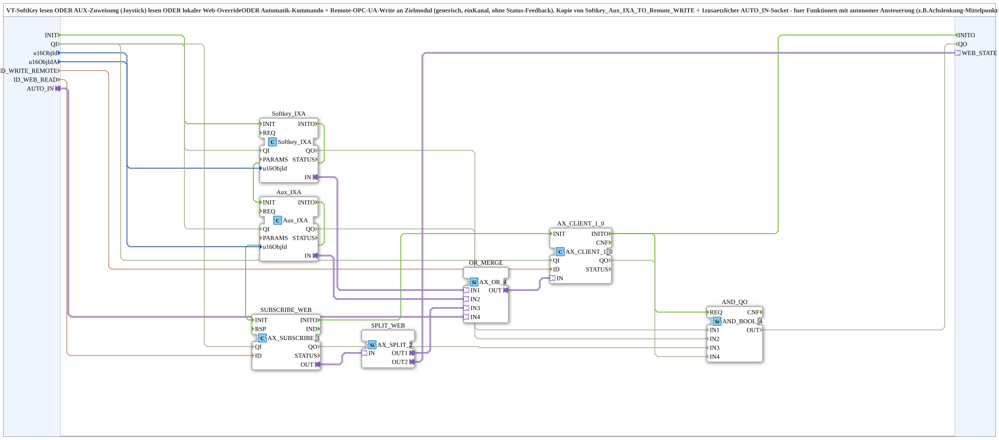

# Softkey_Aux_Auto_IXA_TO_Remote_WRITE

* * * * * * * * * *

## Introduction

`Softkey_Aux_Auto_IXA_TO_Remote_WRITE` reads a **VT SoftKey**, an **AUX assignment (joystick)**, a **local web override** or an **automation command** and writes the result via a remote OPC-UA write to a target module (generic, one channel, without status feedback). The block is a copy of [`Softkey_Aux_IXA_TO_Remote_WRITE`](./Softkey_Aux_IXA_TO_Remote_WRITE.md) with an additional socket `AUTO_IN` for functions with autonomous control (e.g. axle steering centre automation).

There is still exactly **one** publisher per channel on `ID_WRITE_REMOTE`, even though four instead of three sources are merged - no self-latch risk. For status feedback/background colour see the pre-wired combination [`Softkey_Aux_Auto_IXA_TO_Remote_WRITE_BG_OPC`](./Softkey_Aux_Auto_IXA_TO_Remote_WRITE_BG_OPC.md).

## Function Blocks (FBs) Used

### Sub-blocks: Softkey_Aux_Auto_IXA_TO_Remote_WRITE

- **Type**: SubAppType
- **Internal FBs used**:
    - **Softkey_IXA**: `isobus::UT::io::Softkey::Softkey_IXA` (`QI=TRUE`) - SoftKey level
    - **Aux_IXA**: `isobus::UT::io::Auxiliary::IN::Aux_IXA` (`QI=TRUE`) - AUX level
    - **SUBSCRIBE_WEB**: `adapter::net::AX_SUBSCRIBE_1` (`QI=TRUE`) - local subscribe for a web client
    - **SPLIT_WEB**: `adapter::events::unidirectional::AX_SPLIT_2` - distributes the web state to `OR_MERGE` and `WEB_STATE`
    - **OR_MERGE**: `adapter::booleanOperators::AX_OR_4` - OR combination of the four sources
    - **AX_CLIENT_1_0**: `adapter::net::AX_CLIENT_1_0` (`QI=TRUE`) - remote write to the target module
- **Import**: `ID_NULL`

## Interface Structure

### **Event Inputs / Event Outputs**

None - events travel via the adapters.

### **Data Inputs**

- **u16ObjId** (`UINT`, default `ID_NULL`): Object ID of the SoftKey (VT)
- **u16ObjIdA** (`UINT`, default `ID_NULL`): Object ID of the `AuxFunction2` (VT)
- **ID_WRITE_REMOTE** (`WSTRING`): Remote write address to the target module (command, `ACTION=WRITE`, `CLIENT`)
- **ID_WEB_READ** (`WSTRING`): Local subscribe address for a web client (e.g. `vt-ui-mirror`) on the same module, ORed with SoftKey and AUX

### **Data Outputs**

None.

### **Adapters**

- **AUTO_IN** (socket, `adapter::types::unidirectional::AX`): Autonomous command (e.g. axle steering centre automation), ORed with SoftKey/Aux/web
- **WEB_STATE** (plug, `adapter::types::unidirectional::AX`): Web state (= `SUBSCRIBE_WEB.OUT`) passed on to the outside, so that other composite instances can use the same value via a data connection instead of subscribing locally again (only one local OPC-UA subscriber per node is allowed)

## Program Flow and Connections

- `u16ObjId` → `Softkey_IXA.u16ObjId`; `Softkey_IXA.IN` → `OR_MERGE.IN1`
- `u16ObjIdA` → `Aux_IXA.u16ObjId`; `Aux_IXA.IN` → `OR_MERGE.IN2`
- `ID_WEB_READ` → `SUBSCRIBE_WEB.ID`; `SUBSCRIBE_WEB.OUT` → `SPLIT_WEB.IN`
- `SPLIT_WEB.OUT1` → `OR_MERGE.IN3`; `SPLIT_WEB.OUT2` → `WEB_STATE`
- `AUTO_IN` → `OR_MERGE.IN4`
- `OR_MERGE.OUT` → `AX_CLIENT_1_0.IN`; `ID_WRITE_REMOTE` → `AX_CLIENT_1_0.ID`

## Technical Details

- Version 1.2 (2026-09-16): `SPLIT_WEB` (`AX_SPLIT_2`) inserted, since adapter plugs are strictly 1:1 (no fan-out as with data/event connections); two destinations on the same plug caused a FORTE boot error (`INVALID_STATE` on the second `CREATE Connection`)
- Version 1.1 (2026-09-16): plug `WEB_STATE` added; fixes the double self-subscribe on `ID_WEB_READ` (FORTE: "Cannot add another one")
- Version 1.0 (2026-09-11): copy of `Softkey_Aux_IXA_TO_Remote_WRITE` with `AX_OR_4` instead of `AX_OR_3`; use only for channels that need an automation, all other users remain on the original type
- No status feedback and no background colour in this block

## Application Scenarios

- Remote command that can be triggered simultaneously via SoftKey, joystick, web client and autonomous automation (e.g. axle steering centre automation)
- Source of `WEB_STATE` for [`Softkey_Aux_Web_IE`](./Softkey_Aux_Web_IE.md) (override detection)

## Summary

`Softkey_Aux_Auto_IXA_TO_Remote_WRITE` ORs SoftKey, AUX, web override and automation and writes the result to the target module via exactly one publisher.
