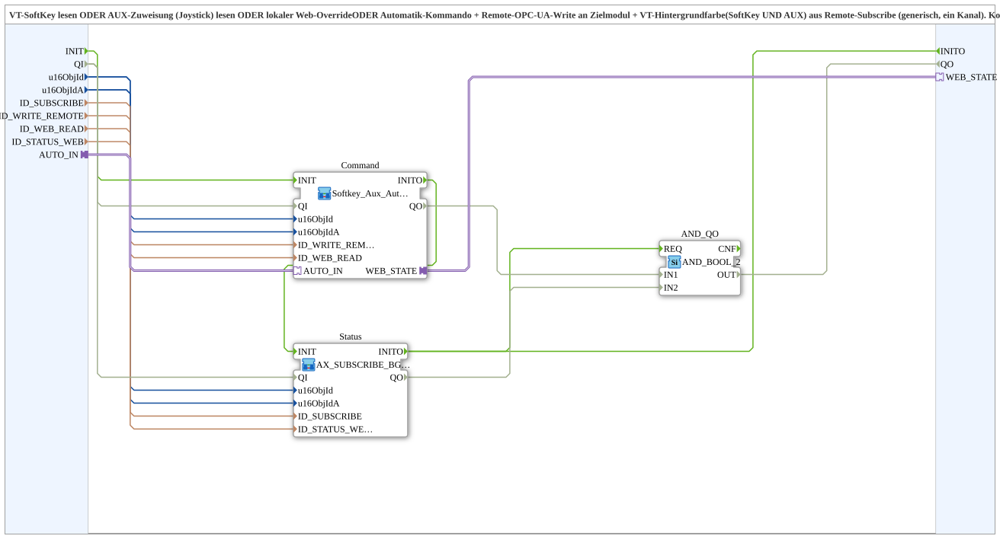

# Softkey_Aux_Auto_IXA_TO_Remote_WRITE_BG_OPC

* * * * * * * * * *

## Introduction

`Softkey_Aux_Auto_IXA_TO_Remote_WRITE_BG_OPC` is a thin wrapper (one channel) that places two SubApps side by side:

- **Command** (`Softkey_Aux_Auto_IXA_TO_Remote_WRITE`): read VT softkey OR read AUX assignment (joystick) OR local web override OR automatic command → remote OPC-UA write to the target module.
- **Status** (`AX_SUBSCRIBE_BG3_WEB_OPC`): VT background color (softkey AND AUX) from a remote subscribe plus local web republish (unchanged).

The block is a copy of `Softkey_Aux_IXA_TO_Remote_WRITE_BG_OPC` that uses `Softkey_Aux_Auto_IXA_TO_Remote_WRITE` instead of `Softkey_Aux_IXA_TO_Remote_WRITE` as its command half. It is intended only for channels with an automatic requirement (currently: axle steering left/right, slope compensation left/right); for all others `Softkey_Aux_IXA_TO_Remote_WRITE_BG_OPC` remains responsible.

## Interface Structure

### **Event Inputs**

- **INIT** (`EInit`): initialization request

The user events still arrive via the adapter socket.

### **Event Outputs**

- **INITO** (`EInit`): initialization confirmation (from `Status.INITO`)

### **Data Inputs**

- **QI** (`BOOL`, default `TRUE`): Quality Input - TRUE enables the service
- **u16ObjId** (`UINT`): Object ID softkey/background (VT)
- **u16ObjIdA** (`UINT`): Object ID AuxFunction2/background (VT)
- **ID_SUBSCRIBE** (`WSTRING`): Remote subscribe address (status/color, `ACTION=SUBSCRIBE`)
- **ID_WRITE_REMOTE** (`WSTRING`): Remote write address to the target module (command, `ACTION=WRITE`, CLIENT)
- **ID_WEB_READ** (`WSTRING`): Local subscribe address for a web client (e.g. `vt-ui-mirror`) on the same module, ORed with softkey and AUX
- **ID_STATUS_WEB** (`WSTRING`): Local publish address (on this module) for the state reported back by the target module, so that a web client can show the same background color as the real VT

### **Data Outputs**

- **QO** (`BOOL`): Quality Output - AND of `Command.QO` and `Status.QO`

### **Adapters**

- **AUTO_IN** (socket, `adapter::types::unidirectional::AX`): Autonomous command (e.g. axle steering center automatic), ORed with softkey/aux/web
- **WEB_STATE** (plug, `adapter::types::unidirectional::AX`): `Command.WEB_STATE` passed through, so that other composite instances can use the same web state without their own local self-subscribe

## Function Blocks (FBs) Used

- **Command**: SubApp `MyLib::sys::Softkey_Aux_Auto_IXA_TO_Remote_WRITE`
- **Status**: SubApp `MyLib::sys::AX_SUBSCRIBE_BG3_WEB_OPC`
- **AND_QO** (`iec61131::booleanOperators::AND_BOOL_2`): combines `Command.QO` and `Status.QO` into `QO`

## Program Flow and Connections

- `u16ObjId`, `u16ObjIdA` → `Command` and `Status`
- `ID_WRITE_REMOTE`, `ID_WEB_READ` → `Command`
- `ID_SUBSCRIBE`, `ID_STATUS_WEB` → `Status`
- `AUTO_IN` → `Command.AUTO_IN`
- `Command.WEB_STATE` → `WEB_STATE`
- `INIT` → `Command.INIT`; `Command.INITO` → `Status.INIT`; `Status.INITO` → `INITO` (and → `AND_QO.REQ`)
- `QI` → `Command.QI` and `Status.QI`
- `Command.QO` → `AND_QO.IN1`; `Status.QO` → `AND_QO.IN2`; `AND_QO.OUT` → `QO`

`Command` and `Status` are not directly connected to each other; the feedback runs via the remote subscribe.

## Technical Details

- `WEB_STATE` (version 1.1 of `Softkey_Aux_Auto_IXA_TO_Remote_WRITE`) is a passed-through fan-out plug.
- Use only for channels with an automatic requirement.

## Application Scenarios

- VT key/AUX/web/automatic that writes a command via OPC-UA to a target module, with background color from the reported-back state (e.g. axle steering, slope compensation)

## Summary

`Softkey_Aux_Auto_IXA_TO_Remote_WRITE_BG_OPC` combines command (incl. automatic) and status feedback of one channel in one SubApp.
