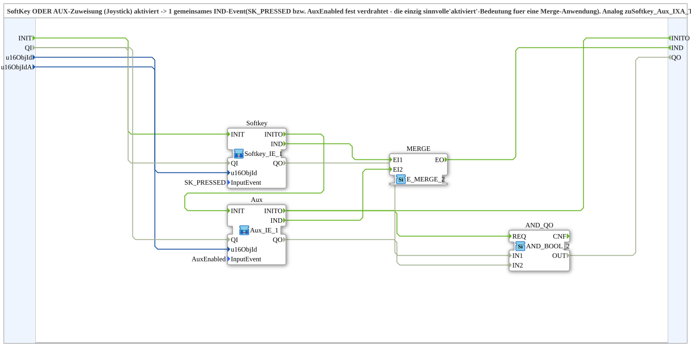

# Softkey_Aux_IE

* * * * * * * * * *

## Introduction

`Softkey_Aux_IE` raises a common `IND` event when a **SoftKey** OR an **AUX assignment (joystick)** is activated. `SK_PRESSED` and `AuxEnabled` are hard-wired, since this is the only sensible "activated" meaning for a merge application. The block is analogous to [`Softkey_Aux_IXA_TO_Remote_WRITE`](./Softkey_Aux_IXA_TO_Remote_WRITE.md) (continuous-state OR), but for the discrete event channel. It therefore does not collide with an already existing `Softkey_IXA`/`Aux_IXA` continuous-state subscription on the same object (two different subscription types).

## Interface Structure

### **Event Inputs**

None.

### **Event Outputs**

- **IND**: fires when the SoftKey (`SK_PRESSED`) OR Aux (`AuxEnabled`) is activated

### **Data Inputs**

- **u16ObjId** (`UINT`): object ID of the SoftKey
- **u16ObjIdA** (`UINT`): object ID of the AuxFunction2

### **Data Outputs**

None.

### **Adapters**

None.

## Function Blocks (FBs) Used

- **`Softkey`** (SubApp `MyLib::sys::Softkey_IE_1`, [Softkey_IE_1](./Softkey_IE_1.md)): parameter `InputEvent = SK_PRESSED`
- **`Aux`** (SubApp `MyLib::sys::Aux_IE_1`, [Aux_IE_1](./Aux_IE_1.md)): parameter `InputEvent = AuxEnabled`
- **`MERGE`** (`iec61499::events::E_MERGE_2`): merges both events

## Functionality

- `u16ObjId` → `Softkey.u16ObjId`; `u16ObjIdA` → `Aux.u16ObjId`
- `Softkey.IND` → `MERGE.EI1`; `Aux.IND` → `MERGE.EI2`
- `MERGE.EO` → `IND`

## Technical Details

- Imports `isobus::UT::io::Softkey::SoftKeyActivationCode::SK_PRESSED` and `isobus::UT::io::Auxiliary::IN::AuxiliaryState::AuxEnabled`
- Works via the discrete event channel, not via the continuous state

## Application Scenarios

- One event from SoftKey or joystick assignment, e.g. for toggle or trigger functions

## Summary

`Softkey_Aux_IE` combines SoftKey and AUX activation into one common `IND` event.

---

### 🌐 Related topic pages on ms-muc-docs.de

- [🌐 Eclipse 4diac IDE & color reference on ms-muc-docs.de](https://www.ms-muc-docs.de/iec-61499/eclipse-4diac/)
