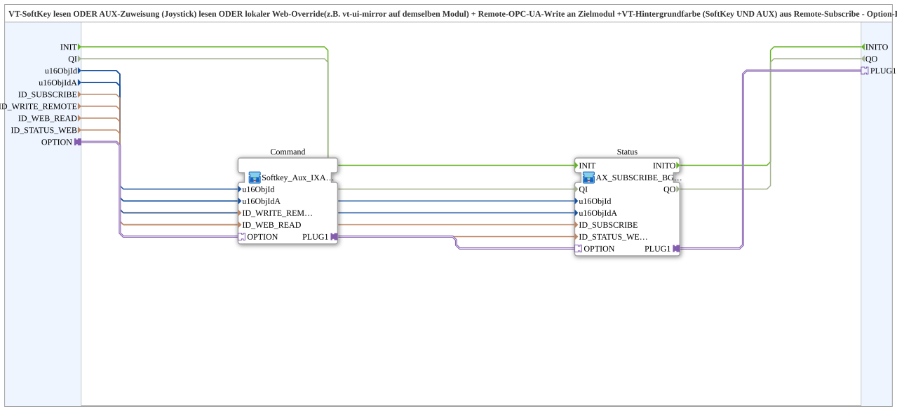

# Softkey_Aux_IXA_TO_Remote_WRITE_BG_Option_OPC

* * * * * * * * * *

## Introduction

`Softkey_Aux_IXA_TO_Remote_WRITE_BG_Option_OPC` is the option-lib variant of [`Softkey_Aux_IXA_TO_Remote_WRITE_BG_OPC`](./Softkey_Aux_IXA_TO_Remote_WRITE_BG_OPC.md): read a VT SoftKey OR an AUX assignment (joystick) OR a local web override, remote OPC-UA write to a target module, and VT background colour (SoftKey and AUX) from a remote subscribe. If the option is not selected, both the command side and the status side are inactive (real `INIT_REQ`/`INIT_CNF`, no VT object binding). The block is a thin wrapper around two sub-blocks that are chained sequentially via the `AOption` adapter.

## Interface Structure

### **Event Inputs**

| Event | Type | Comment |
|-------|------|---------|
| `INIT` | EInit | Initialization request (to `Status.INIT`). |

### **Event Outputs**

| Event | Type | Comment |
|-------|------|---------|
| `INITO` | EInit | Initialization confirm (from `Status.INITO`). |

### **Data Inputs**

| Variable | Type | Default | Comment |
|----------|------|---------|---------|
| `QI` | BOOL | `TRUE` | Quality input, goes to `Status.QI`. |
| `u16ObjId` | UINT | | Object ID SoftKey/background (VT). |
| `u16ObjIdA` | UINT | | Object ID AuxFunction2/background (VT). |
| `ID_SUBSCRIBE` | WSTRING | | Remote subscribe address (status/colour, `ACTION=SUBSCRIBE`). |
| `ID_WRITE_REMOTE` | WSTRING | | Remote write address to the target module (command, `ACTION=WRITE`, CLIENT). |
| `ID_WEB_READ` | WSTRING | | Local subscribe address for a web client on the same module, ORed with SoftKey and AUX. |
| `ID_STATUS_WEB` | WSTRING | | Local publish address for the state reported back by the target module. |

### **Data Outputs**

| Variable | Type | Comment |
|----------|------|---------|
| `QO` | BOOL | Quality output (from `Status.QO`). |

### **Adapters**

| Adapter | Type | Direction | Comment |
|---------|------|-----------|---------|
| `OPTION` | `Option::AOption` | Socket | Drives `INIT`/`QI` of `Command` AND `Status` sequentially; connect e.g. to `AOption_AUI_DEMUX_N.OUTx` or the `PLUG1` of an upstream instance. |
| `PLUG1` | `Option::AOption` | Plug | Passes the activation on to a downstream instance (daisy chain, e.g. a second instance sharing the same option); leave unused if nothing follows. |

## Function Blocks (FBs) Used

### Sub-blocks: Softkey_Aux_IXA_TO_Remote_WRITE_BG_Option_OPC

- **Type**: SubAppType
- **Internal FBs used**:
    - **Command** (SubApp, `MyLib::sys::Softkey_Aux_IXA_TO_Remote_WRITE_Option`): SoftKey OR Aux OR web override -> remote write; see [`Softkey_Aux_IXA_TO_Remote_WRITE_Option`](./Softkey_Aux_IXA_TO_Remote_WRITE_Option.md).
    - **Status** (SubApp, `MyLib::sys::AX_SUBSCRIBE_BG3_WEB_Option_OPC`): remote subscribe -> background colour on SoftKey and Aux plus local web republish; see [`AX_SUBSCRIBE_BG3_WEB_Option_OPC`](./AX_SUBSCRIBE_BG3_WEB_Option_OPC.md).

## Program Flow and Connections

1. Adapter chain: `OPTION` -> `Command.OPTION`; `Command.PLUG1` -> `Status.OPTION`; `Status.PLUG1` -> `PLUG1`. The option thus activates the command side first, then the status side, then a downstream instance.
2. Events: `INIT` -> `Status.INIT`; `Status.INITO` -> `INITO`.
3. `u16ObjId` -> `Command.u16ObjId` and `Status.u16ObjId`; `u16ObjIdA` -> `Command.u16ObjIdA` and `Status.u16ObjIdA`.
4. `ID_WRITE_REMOTE` -> `Command.ID_WRITE_REMOTE`; `ID_WEB_READ` -> `Command.ID_WEB_READ`; `ID_SUBSCRIBE` -> `Status.ID_SUBSCRIBE`; `ID_STATUS_WEB` -> `Status.ID_STATUS_WEB`.
5. `QI` -> `Status.QI`; `Status.QO` -> `QO`.

## Technical Features

- **Command and Status are both option-gated:** All blocks with a real `QI` can be switched off via the `AOption` socket.
- **Sequential chain instead of socket split:** `Command.PLUG1` -> `Status.OPTION` (strictly 1:1), analogous to the daisy-chain style of [`OptionalGroup_001a`](../../MyLib_AX_Option/sys/OptionalGroup_001a.md). The block's own `PLUG1` passes the chain on to further instances sharing the same option.
- As in the original: `ID_WEB_READ` (from `Command`) and `ID_STATUS_WEB` (from `Status`) must point to different local OPC-UA nodes, otherwise feedback arises (see [`Softkey_Aux_IXA_TO_Remote_WRITE_BG_OPC`](./Softkey_Aux_IXA_TO_Remote_WRITE_BG_OPC.md)).

## Application Scenarios

- Optional operator station with SoftKey and Aux assignment for a remote actuator including coloured status display, active only when the option is selected.
- Several instances sharing the same option, chained via `PLUG1`.

## Summary

`Softkey_Aux_IXA_TO_Remote_WRITE_BG_Option_OPC` bundles the command and status sides of a remote channel behind a shared `AOption` socket and passes the activation on via `PLUG1`.

---

### 🌐 Related topic subpages on ms-muc-docs.de

- [🌐 Eclipse 4diac IDE & color reference on ms-muc-docs.de](https://www.ms-muc-docs.de/iec-61499/eclipse-4diac/)
