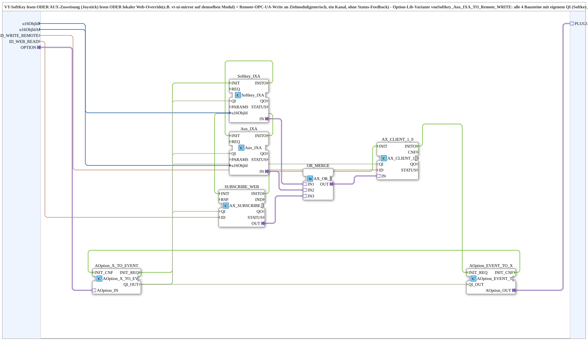

# Softkey_Aux_IXA_TO_Remote_WRITE_Option

* * * * * * * * * *

## Introduction

`Softkey_Aux_IXA_TO_Remote_WRITE_Option` reads a VT SoftKey OR an AUX assignment (joystick) OR a local web override (e.g. `vt-ui-mirror` on the same module) and writes the result via remote OPC-UA write to a target module (generic, one channel, without status feedback). It is the option-lib variant of [`Softkey_Aux_IXA_TO_Remote_WRITE`](./Softkey_Aux_IXA_TO_Remote_WRITE.md): all four blocks with their own `QI` (`Softkey_IXA`, `Aux_IXA`, `SUBSCRIBE_WEB`, `AX_CLIENT_1_0`) are initialized and gated sequentially by a single [`Option::AOption`](../../Option/AOption.md) socket. The plug `PLUG1` passes the activation on to a downstream group (daisy chain).

## Interface Structure

### **Event Inputs / Outputs**

None (initialization runs via the adapter `OPTION`).

### **Data Inputs**

| Variable | Type | Default | Comment |
|----------|------|---------|---------|
| `u16ObjId` | UINT | `ID_NULL` | Object ID SoftKey (VT). |
| `u16ObjIdA` | UINT | `ID_NULL` | Object ID AuxFunction2 (VT). |
| `ID_WRITE_REMOTE` | WSTRING | | Remote write address to the target module (command, `ACTION=WRITE`, CLIENT). |
| `ID_WEB_READ` | WSTRING | | Local subscribe address for a web client (e.g. `vt-ui-mirror`) on the same module, ORed with SoftKey and AUX. |

### **Data Outputs**

None.

### **Adapters**

| Adapter | Type | Direction | Comment |
|---------|------|-----------|---------|
| `OPTION` | `Option::AOption` | Socket | Drives `INIT`/`QI` of `Softkey_IXA`, `Aux_IXA`, `SUBSCRIBE_WEB` and `AX_CLIENT_1_0`; connect e.g. to `AOption_AUI_DEMUX_N.OUTx`. |
| `PLUG1` | `Option::AOption` | Plug | Passes the activation on to a downstream group (daisy chain); leave unused if nothing follows. |

## Function Blocks (FBs) Used

### Sub-blocks: Softkey_Aux_IXA_TO_Remote_WRITE_Option

- **Type**: SubAppType
- **Internal FBs used**:
    - **AOption_X_TO_EVENT** (`Option::conversion::AOption_X_TO_EVENT`): converts the socket `OPTION` into `INIT_REQ`/`QI_OUT`, see [`AOption_X_TO_EVENT`](../../Option/conversion/AOption_X_TO_EVENT.md).
    - **Softkey_IXA** (`isobus::UT::io::Softkey::Softkey_IXA`): reads the SoftKey (`u16ObjId`).
    - **Aux_IXA** (`isobus::UT::io::Auxiliary::IN::Aux_IXA`): reads the AUX assignment (`u16ObjIdA`).
    - **SUBSCRIBE_WEB** (`adapter::net::AX_SUBSCRIBE_1`): reads the local web override (`ID_WEB_READ`).
    - **OR_MERGE** (`adapter::booleanOperators::AX_OR_3`): OR of the three sources.
    - **AX_CLIENT_1_0** (`adapter::net::AX_CLIENT_1_0`): remote write to `ID_WRITE_REMOTE`.
    - **AOption_EVENT_TO_X** (`Option::conversion::AOption_EVENT_TO_X`): passes the activation on to `PLUG1`.

## Program Flow and Connections

1. Sequential initialization: `AOption_X_TO_EVENT.INIT_REQ` -> `Softkey_IXA.INIT`; `Softkey_IXA.INITO` -> `Aux_IXA.INIT`; `Aux_IXA.INITO` -> `SUBSCRIBE_WEB.INIT`; `SUBSCRIBE_WEB.INITO` -> `AX_CLIENT_1_0.INIT`; `AX_CLIENT_1_0.INITO` -> `AOption_EVENT_TO_X.INIT_REQ`; `AOption_EVENT_TO_X.INIT_CNF` -> `AOption_X_TO_EVENT.INIT_CNF`.
2. `AOption_X_TO_EVENT.QI_OUT` -> `QI` of `Softkey_IXA`, `Aux_IXA`, `SUBSCRIBE_WEB`, `AX_CLIENT_1_0` and `AOption_EVENT_TO_X.QI_OUT`.
3. Data: `Softkey_IXA.IN` -> `OR_MERGE.IN1`; `Aux_IXA.IN` -> `OR_MERGE.IN2`; `SUBSCRIBE_WEB.OUT` -> `OR_MERGE.IN3`; `OR_MERGE.OUT` -> `AX_CLIENT_1_0.IN`.
4. Parameters: `u16ObjId` -> `Softkey_IXA.u16ObjId`; `u16ObjIdA` -> `Aux_IXA.u16ObjId`; `ID_WEB_READ` -> `SUBSCRIBE_WEB.ID`; `ID_WRITE_REMOTE` -> `AX_CLIENT_1_0.ID`.
5. Adapters: `OPTION` -> `AOption_X_TO_EVENT.AOption_IN`; `AOption_EVENT_TO_X.AOption_OUT` -> `PLUG1`.

## Technical Features

- **Real `INIT_REQ`/`INIT_CNF` instead of just a `QI` bool:** If the option is not selected, all four blocks stay inactive.
- **Sequential instead of parallel:** Initialization runs as a daisy chain (`Softkey_IXA` -> `Aux_IXA` -> `SUBSCRIBE_WEB` -> `AX_CLIENT_1_0`); `PLUG1` allows further instances sharing the same option to be attached (e.g. a second SoftKey instance) or, as in [`Softkey_Aux_IXA_TO_Remote_WRITE_BG_Option_OPC`](./Softkey_Aux_IXA_TO_Remote_WRITE_BG_Option_OPC.md), the status half.
- The counterpart without option is [`Softkey_Aux_IXA_TO_Remote_WRITE`](./Softkey_Aux_IXA_TO_Remote_WRITE.md).

## Application Scenarios

- Optional operating function that reads SoftKey, Aux and web override only when the option is selected and writes to a target module via remote write.
- Several SoftKeys sharing the same option, chained via `PLUG1`.

## Summary

`Softkey_Aux_IXA_TO_Remote_WRITE_Option` is the option-gated variant of the remote-write command with SoftKey, Aux and web override; its four `QI` blocks are activated via an `AOption` socket and it passes the activation on via `PLUG1`.

---

### 🌐 Related topic subpages on ms-muc-docs.de

- [🌐 Eclipse 4diac IDE & color reference on ms-muc-docs.de](https://www.ms-muc-docs.de/iec-61499/eclipse-4diac/)
