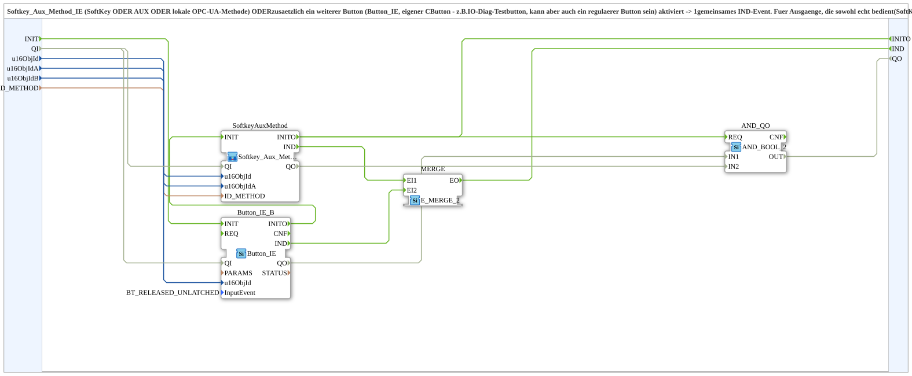

# Softkey_Aux_Method_Button_IE

* * * * * * * * * *

## Introduction

`Softkey_Aux_Method_Button_IE` extends [`Softkey_Aux_Method_IE`](./Softkey_Aux_Method_IE.md) (SoftKey OR AUX OR local OPC-UA method) by **one further button** (`Button_IE`, its own `CButton` - e.g. an IO-diag test button, but it can also be a regular button). If any of these sources is activated, a common `IND` event is produced.

The block serves outputs that are both operated for real (SoftKey/AUX/web/dashboard) and triggered equally via an additional button. The button background is fed separately by the caller from the resulting state; `u16ObjIdB` therefore remains available to the caller.

## Function Blocks (FBs) Used

### Sub-blocks: Softkey_Aux_Method_Button_IE

- **Type**: SubAppType
- **Internal blocks used**:
    - **SoftkeyAuxMethod**: SubApp [`MyLib::sys::Softkey_Aux_Method_IE`](./Softkey_Aux_Method_IE.md) - SoftKey, AUX or local method
    - **Button_IE_B**: `isobus::UT::io::Button::Button_IE` (`InputEvent=BT_RELEASED_UNLATCHED`) - further button
    - **MERGE**: `iec61499::events::E_MERGE_2` - merges both `IND` events
    - **AND_QO**: `iec61131::booleanOperators::AND_BOOL_2` - combines the `QO` of `Button_IE_B` and `SoftkeyAuxMethod`
- **Imports**: `ID_NULL`, `BT_RELEASED_UNLATCHED`

## Interface Structure

### **Event Inputs**

- **INIT** (`EInit`): initialization request; goes to `Button_IE_B.INIT`

### **Event Outputs**

- **INITO** (`EInit`): initialization confirm; comes from `SoftkeyAuxMethod.INITO`
- **IND**: Fires when the SoftKey, AUX, the local method or the additional button is activated/called

### **Data Inputs**

- **QI** (`BOOL`, default `TRUE`): Quality Input - TRUE enables the service; goes to `Button_IE_B` and `SoftkeyAuxMethod`
- **u16ObjId** (`UINT`): Object ID of the SoftKey
- **u16ObjIdA** (`UINT`): Object ID of the `AuxFunction2`
- **u16ObjIdB** (`UINT`, default `ID_NULL`): Object ID of a further button (e.g. IO-diag test button on the outputs diagnostic page; can also be a regular button), equal to SoftKey/AUX/method
- **ID_METHOD** (`WSTRING`): Local method address (`ACTION=CREATE_METHOD`) for the argument-less trigger - called by the web client (`vt-ui-mirror`) and directly by the OPC dashboard

### **Data Outputs**

- **QO** (`BOOL`): Quality Output - TRUE if the service was executed successfully (AND of the `QO` of `Button_IE_B` and `SoftkeyAuxMethod`)

## Program Flow and Connections

- `u16ObjId`, `u16ObjIdA`, `ID_METHOD` → `SoftkeyAuxMethod`
- `u16ObjIdB` → `Button_IE_B.u16ObjId`
- `SoftkeyAuxMethod.IND` → `MERGE.EI1`; `Button_IE_B.IND` → `MERGE.EI2`
- `MERGE.EO` → `IND`
- Initialization: `INIT` → `Button_IE_B.INIT`, `Button_IE_B.INITO` → `SoftkeyAuxMethod.INIT`, `SoftkeyAuxMethod.INITO` → `INITO` and → `AND_QO.REQ`
- Quality: `QI` → `Button_IE_B.QI` and `SoftkeyAuxMethod.QI`; `Button_IE_B.QO` → `AND_QO.IN1`, `SoftkeyAuxMethod.QO` → `AND_QO.IN2`; `AND_QO.OUT` → `QO`

## Technical Details

- Version 1.1 (2026-09-15): `u16ObjId_TEST` renamed to `u16ObjIdB` (`Button_IE_TEST` → `Button_IE_B`), since the additional button is not always an IO-diag test button
- Used, among others, by `AX_SoftkeyToggle_RS_TO_AX` for the toggle branch

## Application Scenarios

- Toggle output that is to be operated equally via SoftKey, joystick, web/dashboard and an additional diagnostic button

## Summary

`Softkey_Aux_Method_Button_IE` supplements `Softkey_Aux_Method_IE` with one more button and provides a common `IND` event.
