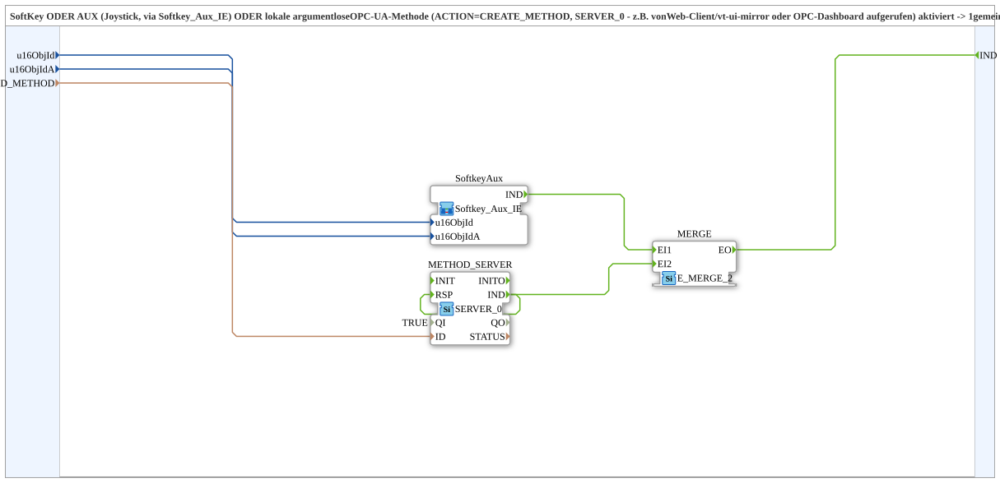

# Softkey_Aux_Method_IE

* * * * * * * * * *

## Introduction

`Softkey_Aux_Method_IE` merges three triggers into **one common `IND` event**: a VT softkey, an AUX function (joystick, via `Softkey_Aux_IE`) or a **local argument-less OPC-UA method** (`ACTION=CREATE_METHOD`, `SERVER_0`) that is called e.g. by the web client (`vt-ui-mirror`) or by the OPC dashboard. The block builds on `Softkey_Aux_IE` and adds the method channel. Unlike `Softkey_Aux_Web_IE` (web via `SUBSCRIBE_R_TRIG` on a written variable), the web/dashboard trigger here is a genuine RPC method call without a shared variable.

## Interface Structure

### **Event Inputs**

*No direct event inputs*

### **Event Outputs**

- **IND**: Fires when the softkey, AUX or the local method is activated/called

### **Data Inputs**

- **u16ObjId** (`UINT`): Object ID of the softkey
- **u16ObjIdA** (`UINT`): Object ID of the AuxFunction2
- **ID_METHOD** (`WSTRING`): Local method address (`ACTION=CREATE_METHOD`) for the argument-less trigger; called by the web client (`vt-ui-mirror`) and directly by the OPC dashboard

### **Data Outputs**

*No data outputs*

### **Adapters**

This function block uses no adapters.

## Function Blocks (FBs) Used

- **SoftkeyAux**: SubApp `MyLib::sys::Softkey_Aux_IE` - softkey or AUX
- **METHOD_SERVER**: `iec61499::net::SERVER_0` (`QI=TRUE`) - local method
- **MERGE**: `iec61499::events::E_MERGE_2` - merges the two triggers

## Program Flow and Connections

- `SoftkeyAux.IND` → `MERGE.EI1`
- `METHOD_SERVER.IND` → `MERGE.EI2`
- `METHOD_SERVER.IND` → `METHOD_SERVER.RSP` (feedback wiring)
- `MERGE.EO` → `IND`
- `u16ObjId`, `u16ObjIdA` → `SoftkeyAux`; `ID_METHOD` → `METHOD_SERVER.ID`

## Technical Details

- **`RSP` must be wired back to `IND`.** The trigger is argument-less and needs no processing; without this connection, FORTE's `onServerMethodCall` blocks the OPC-UA server thread for up to 4 s while holding open62541's global `serviceMutex`, which every `AX_PUBLISH_1` on another FORTE thread also needs (see `Ventilsteuerung/OPC_UA_VERNETZUNG.md`, item 12).

## Application Scenarios

- Key, joystick assignment and web/dashboard call that trigger the same action (e.g. "All off")

## Summary

`Softkey_Aux_Method_IE` combines softkey, AUX and an OPC-UA method call into one common `IND` event.
