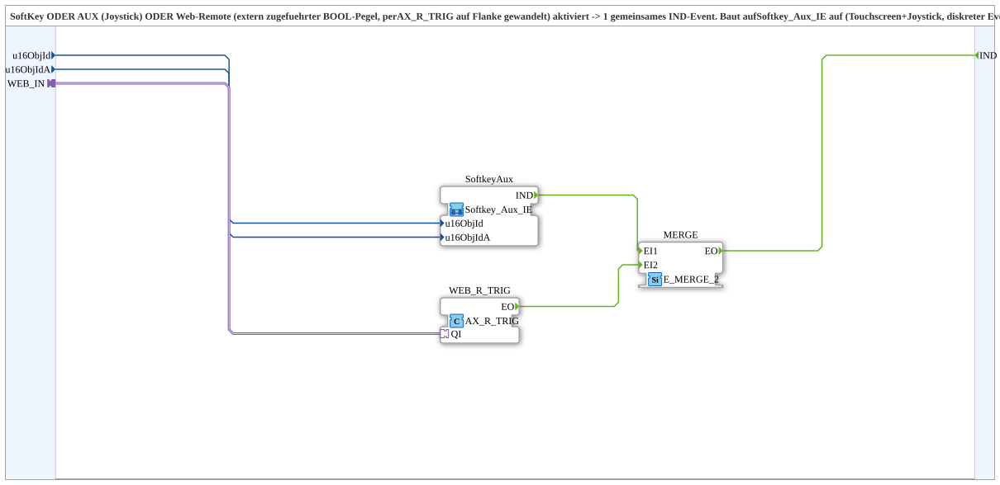

# Softkey_Aux_Web_IE

* * * * * * * * * *

## Introduction

`Softkey_Aux_Web_IE` raises a common `IND` event when **SoftKey OR AUX (joystick) OR web remote** is activated. The web channel is an externally supplied `BOOL` level (`AX`) that is converted into an edge via `AX_R_TRIG`. The block builds on `Softkey_Aux_IE` (touchscreen + joystick, discrete event channel) and additionally merges the web channel - a pattern for "activated from whatever source, one result event", e.g. for override detection.

## Function Blocks (FBs) Used

### Sub-blocks: Softkey_Aux_Web_IE

- **Type**: SubAppType
- **Internal blocks used**:
    - **SoftkeyAux**: SubApp `MyLib::sys::Softkey_Aux_IE` - SoftKey or AUX
    - **WEB_R_TRIG**: `adapter::events::unidirectional::AX_R_TRIG` - converts the web level into a rising edge (`EO`)
    - **MERGE**: `iec61499::events::E_MERGE_2` - merges both events

## Interface Structure

### **Event Inputs**

- **INIT** (`EInit`): initialization request; goes to `SoftkeyAux.INIT`

### **Event Outputs**

- **INITO** (`EInit`): initialization confirm; comes from `SoftkeyAux.INITO`
- **IND**: Fires when SoftKey, Aux or web remote is activated

### **Data Inputs**

- **QI** (`BOOL`, default `TRUE`): Quality Input - TRUE enables the service; goes to `SoftkeyAux.QI`
- **u16ObjId** (`UINT`): Object ID of the SoftKey
- **u16ObjIdA** (`UINT`): Object ID of the `AuxFunction2`

### **Data Outputs**

- **QO** (`BOOL`): Quality Output - TRUE if the service was executed successfully; comes from `SoftkeyAux.QO`

### **Adapters**

- **WEB_IN** (socket, `adapter::types::unidirectional::AX`): Web remote level from outside (e.g. `Softkey_Aux_Auto_IXA_TO_Remote_WRITE.WEB_STATE`) instead of its own local OPC-UA self-subscribe

## Program Flow and Connections

- `u16ObjId` → `SoftkeyAux.u16ObjId`; `u16ObjIdA` → `SoftkeyAux.u16ObjIdA`
- `SoftkeyAux.IND` → `MERGE.EI1`
- `WEB_IN` → `WEB_R_TRIG.QI`; `WEB_R_TRIG.EO` → `MERGE.EI2`
- `MERGE.EO` → `IND`
- Initialization: `INIT` → `SoftkeyAux.INIT`; `SoftkeyAux.INITO` → `INITO`
- Quality: `QI` → `SoftkeyAux.QI`; `SoftkeyAux.QO` → `QO`

## Technical Details

- Version 2.0 (2026-09-16): ID parameter and internal self-subscribe (`SUBSCRIBE_R_TRIG`) removed, replaced by the socket `WEB_IN` plus `AX_R_TRIG`. This fixes the double self-subscribe (FORTE: "Cannot add another one"), because the web node is already subscribed by the command side (`Softkey_Aux_Auto_IXA_TO_Remote_WRITE.WEB_STATE`)
- Only the rising edge of the web level is evaluated
- Version 1.0 (2026-09-11): initial implementation

## Application Scenarios

- Override detection: event as soon as the operator intervenes via SoftKey, joystick or web
- Interplay with [`Softkey_Aux_Auto_IXA_TO_Remote_WRITE`](./Softkey_Aux_Auto_IXA_TO_Remote_WRITE.md) (`WEB_STATE`)

## Summary

`Softkey_Aux_Web_IE` bundles SoftKey, AUX and an externally supplied web level into a single `IND` event.
