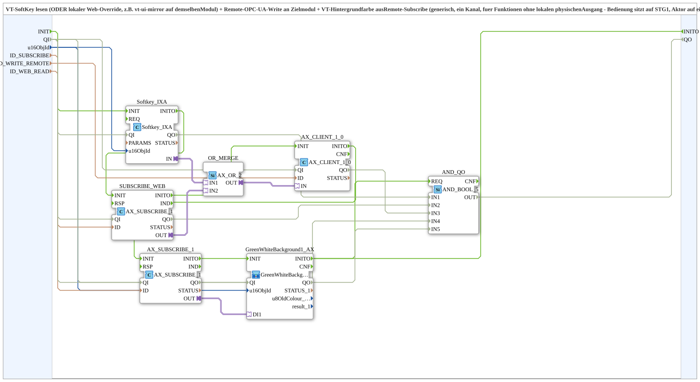
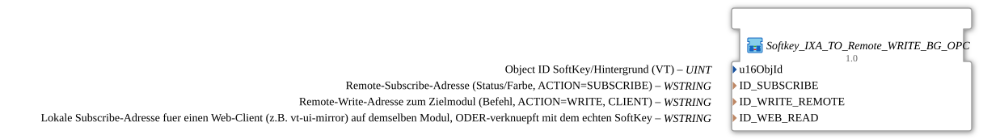

# Softkey_IXA_TO_Remote_WRITE_BG_OPC

* * * * * * * * * *

## Introduction

This subapplication is designed for scenarios where the operator interface is located on a VT (Virtual Terminal) device (STG1), but the actual actuator resides on a different module that does not have direct VT access. The subapplication reads a local softkey, optionally merges it with a web‑based override, sends the resulting command to the remote module via OPC UA, and then receives the actual state back from the remote module to update the softkey background colour accordingly. This creates a closed‑loop feedback mechanism that keeps the operator informed of the real actuator status.

## Interface Structure

The subapplication exposes the initialization events `INIT`/`INITO`, the status ports `QI`/`QO` and data inputs. It has no adapter interfaces at the subapplication level.

### **Event Inputs**

- **INIT** (`EInit`): Initialization Request

### **Event Outputs**

- **INITO** (`EInit`): Initialization Confirm

### **Data Inputs**

| Name          | Type    | Initial Value | Comment |
|---------------|---------|---------------|---------|
| `QI`          | `BOOL`  | `TRUE`        | Quality Input - TRUE enables the service. |
| `u16ObjId`    | `UINT`  | `ID_NULL`     | Object ID of the softkey / background (VT). |
| `ID_SUBSCRIBE` | `WSTRING` | –            | Remote subscribe address (status/colour, `ACTION=SUBSCRIBE`). |
| `ID_WRITE_REMOTE` | `WSTRING` | –          | Remote write address to the target module (command, `ACTION=WRITE`, `CLIENT`). |
| `ID_WEB_READ` | `WSTRING` | –            | Local subscribe address for a web client (e.g. `vt-ui-mirror`) on the same module, OR‑combined with the real softkey. |

### **Data Outputs**

| Name | Type | Comment |
|------|------|---------|
| `QO` | `BOOL` | Quality Output - TRUE if the service executed successfully (AND of `Softkey_IXA`, `SUBSCRIBE_WEB`, `AX_CLIENT_1_0`, `AX_SUBSCRIBE_1` and `GreenWhiteBackground1_AX`). |

### **Adapters**

None.

## Functionality

The internal logic of the subapplication consists of seven blocks:

1. `Softkey_IXA` – reads the local softkey state based on the configured `u16ObjId`.
2. `SUBSCRIBE_WEB` – subscribes to a local web‑based input (e.g. a mirror of the VT display) using the `ID_WEB_READ` address.
3. `OR_MERGE` – an `AX_OR_2` boolean operator that combines the softkey signal and the web override signal using a logical OR.
4. `AX_CLIENT_1_0` – an OPC UA client that writes the merged signal to the remote device via the `ID_WRITE_REMOTE` endpoint.
5. `AX_SUBSCRIBE_1` – an OPC UA subscriber that receives the actual state from the remote device via `ID_SUBSCRIBE`.
6. `GreenWhiteBackground1_AX` – a subapplication that issues a `Q_BackgroundColour` command to change the softkey background colour based on the received state (green for active, white for inactive).
7. `AND_QO` – an `iec61131::booleanOperators::AND_BOOL_5` block that ANDs the `QO` outputs of `Softkey_IXA`, `SUBSCRIBE_WEB`, `AX_CLIENT_1_0`, `AX_SUBSCRIBE_1` and `GreenWhiteBackground1_AX` into the subapplication output `QO`.

Initialization and status: `INIT` → `Softkey_IXA.INIT`, `Softkey_IXA.INITO` → `SUBSCRIBE_WEB.INIT`, `SUBSCRIBE_WEB.INITO` → `AX_CLIENT_1_0.INIT`, `AX_CLIENT_1_0.INITO` → `AX_SUBSCRIBE_1.INIT`, `AX_SUBSCRIBE_1.INITO` → `GreenWhiteBackground1_AX.INIT`, `GreenWhiteBackground1_AX.INITO` → `INITO` and → `AND_QO.REQ`. `QI` → `Softkey_IXA.QI`, `SUBSCRIBE_WEB.QI`, `AX_CLIENT_1_0.QI`, `AX_SUBSCRIBE_1.QI` and `GreenWhiteBackground1_AX.QI`; their `QO` outputs → `AND_QO.IN1`..`IN5`; `AND_QO.OUT` → `QO`.

The overall data flow is:

- The local softkey and the optional web override are OR‑merged.
- The merged signal is written to the remote module via OPC UA.
- The remote module’s actual state is read back via OPC UA subscription.
- The state is used to set the background colour of the softkey, giving immediate visual feedback.

## Technical Features

- ✅ OPC UA client and subscriber functionality built in.
- ✅ Local softkey reading via `Softkey_IXA`.
- ✅ Optional integration with web‑based UI mirroring (`vt-ui-mirror`).
- ✅ OR logic for merging multiple input sources.
- ✅ Remote state feedback with background colour update.
- ✅ Only the initialization handshake (`INIT`/`INITO`) and the aggregated status `QO` are exposed – the subapplication acts as a self‑contained control unit.
- ✅ Configurable via the address/object-ID inputs plus `QI`.

## State Overview

The subapplication does not contain an explicit state machine. It operates purely combinatorially – the current input values determine the output behaviour. The only internal states are those of the individual function blocks (e.g. connection states of the OPC UA client and subscriber), but these are managed internally and are not exposed to the user. The dynamic behaviour is that of a closed‑loop control: the displayed colour always reflects the most recent remote state.

## Application Scenarios

- **Remote actuator control from a VT** – when the operator interface is on STG1 (VT), but the actuator is on another module without VT capabilities.
- **Softkey with web‑override** – when operators may also use a local web‑based mirror to trigger the same function.
- **Visual status feedback** – the softkey background changes to green/white to indicate the actual actuator state, not just the pressed command.
- **Generic single‑channel usage** – suitable for any function that does not have a physical output on the VT itself but requires remote actuation and feedback.

## Comparison with Similar Blocks

- **`Softkey_Aux_IXA_TO_Remote_WRITE_BG_OPC`** – extends this subapplication with a third input source (e.g. an auxiliary function object like a joystick) and uses `GreenWhiteBackground3_AX` instead of `1_AX` for a three‑state background.
- **`Button_IXA_TO_Remote_WRITE_BG_OPC`** – identical functionality but for a VT button instead of a softkey.
- **`Softkey_IXA_TO_Remote_WRITE_BG_OPC`** – the single‑channel version described here, optimised for functions with exactly one operator‑initiated source (plus optional web override).

These variants share the same core architecture but differ in input multiplicity and background colour handling.

## Conclusion

`Softkey_IXA_TO_Remote_WRITE_BG_OPC` provides a robust and reusable solution for bridging VT‑based operator inputs to remote actuators over OPC UA. Its integration of local softkey reading, web override, OR logic, remote write, and remote state subscription ensures reliable operation with clear visual feedback. The simple interface and configurable addresses make it easy to adapt to various modules and use cases, while the underlying design supports extensibility to more complex scenarios.
