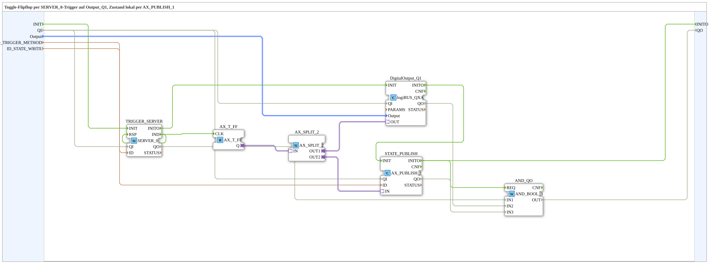

# Toggle_RPC_FROM_Remote_QXA_OPC_LOC

* * * * * * * * * *

## Introduction

`Toggle_RPC_FROM_Remote_QXA_OPC_LOC` is a toggle flip-flop driven by a `SERVER_0` trigger on `Output_Q1`, whose state is published locally via `AX_PUBLISH_1`. It is the local variant of [`Toggle_RPC_FROM_Remote_QXA_OPC`](./Toggle_RPC_FROM_Remote_QXA_OPC.md): instead of writing the state back remotely via `AX_CLIENT_1_0`, it is written locally via `PUBLISH` (no endpoint). The trigger is an argument-less method call on `ID_TRIGGER_METHOD`; each call clocks the toggle flip-flop `AX_T_FF`, switches `DigitalOutput_Q1` and publishes the state at `ID_STATE_WRITE`.

## Interface Structure

### **Event Inputs**

- `INIT` (`EInit`): Initialization Request

### **Event Outputs**

- `INITO` (`EInit`): Initialization Confirm

### **Data Inputs**

| Name | Type | Description |
|------|-----|--------------|
| `QI` | `BOOL` | Quality Input - TRUE to enable the service. Initial value `TRUE`. |
| `Output` | `logiBUS::io::DQ::logiBUS_DO_S` | Identifies the output `Output_Q1..Q8`. Initial value `logiBUS_DO::Invalid`. |
| `ID_TRIGGER_METHOD` | `WSTRING` | Local method address (`ACTION=CREATE_METHOD`) for the argument-less trigger method call, called by device A via `CALL_METHOD`. |
| `ID_STATE_WRITE` | `WSTRING` | Local node address (`BOOL`, `ACTION=WRITE`) for the flip-flop state. |

### **Data Outputs**

| Name | Type | Description |
|------|-----|--------------|
| `QO` | `BOOL` | Quality Output - TRUE if the service was executed successfully. |

### **Adapters**

None.

## Function Blocks (FBs) Used

- **TRIGGER_SERVER** (`iec61499::net::SERVER_0`): receives the trigger method call (`ID_TRIGGER_METHOD`).
- **AX_T_FF** (`adapter::events::unidirectional::AX_T_FF`): toggle flip-flop, clocked via `CLK`.
- **AX_SPLIT_2** (`adapter::events::unidirectional::AX_SPLIT_2`): branches the state to the physical output and the local publish.
- **DigitalOutput_Q1** (`logiBUS::io::DQ::logiBUS_QXA`): physical output.
- **STATE_PUBLISH** (`adapter::net::AX_PUBLISH_1`): writes the state locally at `ID_STATE_WRITE`.
- **AND_QO** (`iec61131::booleanOperators::AND_BOOL_3`): combines the `QO` of `TRIGGER_SERVER`, `DigitalOutput_Q1` and `STATE_PUBLISH`.

## Program Flow and Connections

1. Trigger: `TRIGGER_SERVER.IND` → `AX_T_FF.CLK`; `TRIGGER_SERVER.IND` → `TRIGGER_SERVER.RSP`.
2. Initialization chain: `INIT` → `TRIGGER_SERVER.INIT`; `TRIGGER_SERVER.INITO` → `DigitalOutput_Q1.INIT`; `DigitalOutput_Q1.INITO` → `STATE_PUBLISH.INIT`; `STATE_PUBLISH.INITO` → `INITO` and → `AND_QO.REQ`.
3. State: `AX_T_FF.Q` → `AX_SPLIT_2.IN`; `AX_SPLIT_2.OUT1` → `DigitalOutput_Q1.OUT`; `AX_SPLIT_2.OUT2` → `STATE_PUBLISH.IN`.
4. Data: `Output` → `DigitalOutput_Q1.Output`; `ID_TRIGGER_METHOD` → `TRIGGER_SERVER.ID`; `ID_STATE_WRITE` → `STATE_PUBLISH.ID`.
5. Qualifier: `QI` → `TRIGGER_SERVER.QI`, `DigitalOutput_Q1.QI` and `STATE_PUBLISH.QI`.
6. Quality evaluation: `TRIGGER_SERVER.QO` → `AND_QO.IN1`; `DigitalOutput_Q1.QO` → `AND_QO.IN2`; `STATE_PUBLISH.QO` → `AND_QO.IN3`; `AND_QO.OUT` → `QO`.

## Technical Features

- Compared with the remote variant, `STATE_PUBLISH` (`AX_PUBLISH_1`) replaces `STATE_CLIENT` (`AX_CLIENT_1_0`).
- `TRIGGER_SERVER.IND` is connected directly to `TRIGGER_SERVER.RSP`.

## Application Scenarios

- Local exercise on a single device: a method call toggles an output, the state is published locally.
- Counterpart to [`Input_Toggle_RPC_TO_Remote_QXA_OPC`](./Input_Toggle_RPC_TO_Remote_QXA_OPC.md), which calls the toggle method via a logiBUS pushbutton.

## Summary

`Toggle_RPC_FROM_Remote_QXA_OPC_LOC` toggles `DigitalOutput_Q1` on every trigger method call and publishes the state locally via `AX_PUBLISH_1`.

## 🛠️ Related Exercises

- [Uebung_OPC_L03_AX](https://meisterschulen-am-ostbahnhof-munchen-docs.readthedocs.io/projects/4diac-exercises-docs/en/latest/Uebungen/test_AX/Meins/OPC_UA_Lokal/Uebung_OPC_L03_AX/)
- [Uebung_OPC_L08_AX](https://meisterschulen-am-ostbahnhof-munchen-docs.readthedocs.io/projects/4diac-exercises-docs/en/latest/Uebungen/test_AX/Meins/OPC_UA_Lokal/Uebung_OPC_L08_AX/)

---

### 🌐 Related topic subpages on ms-muc-docs.de

- [🌐 Eclipse 4diac IDE & color reference on ms-muc-docs.de](https://www.ms-muc-docs.de/iec-61499/eclipse-4diac/)
