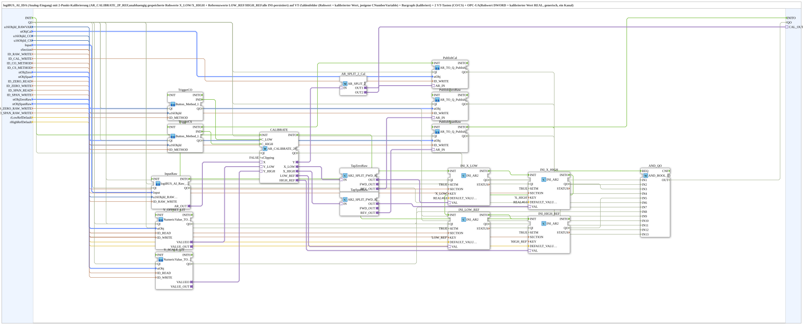

# logiBUS_AI_Calibrate_2P_IDA_OPC

* * * * * * * * * *

## Introduction

`logiBUS_AI_Calibrate_2P_IDA_OPC` connects a physical analog input (`logiBUS_AI_IDA`) to a full VT- and OPC-UA-backed 2-point calibration (`AR_CALIBRATE_2P_REF`) — used by the [AI_Calibrate_2P training sample](https://meisterschulen-am-ostbahnhof-munchen-docs.readthedocs.io/projects/4diac-exercises-docs/en/latest/Uebungen/test_AX/Meins/InputOutputTester/Button_AI_Calibrate_2P_OPC_UA/InputOutputTesterButton_AI_Calibrate_2P_OPC_UA/). The input's raw value is converted into a physically scaled value through the 2-point calibration chain; zero point (`Zero`) and span (`Span`) as well as their measured raw values (`ZeroRaw`/`SpanRaw`) are adjustable and readable via both VT and OPC-UA, and are persisted in an INI file. In partial calibration (only one point calibrated), a clean fallback logic immediately utilizes the available reference value.

## Function blocks used

- **logiBUS_AI_IDA** (`logiBUS::io::AI::logiBUS_AI_IDA`): physical analog input, provides the raw value as an adapter.
- **AR_CALIBRATE_2P_REF** (adapter composite): 2-point calibration (zero/span) with raw value diagnostics (`ZeroRaw`/`SpanRaw`), partial calibration fallback logic, and configurable clipping (`xClipping`).
- **VT and OPC-UA bridges** (analogous to [`NumericValue_TO_AR2_OPC`](./NumericValue_TO_AR2_OPC.md)/[`OPC_TO_AR2`](./OPC_TO_AR2.md) and [`INI_IN_AND_STORE_AR2`](./INI_IN_AND_STORE_AR2.md)): expose `Zero`/`Span` and `ZeroRaw`/`SpanRaw` both via VT input fields/displays and via OPC-UA, and persist calibration values in an INI file.

## Initialization and quality

- Events: `INIT` (EInit, input) and `INITO` (EInit, output, comes from `PublishSpanRaw.INITO`).
- Data input `QI` (BOOL, default `TRUE`) and data output `QO` (BOOL); the internal FBs (`CALIBRATE`, `INI_X_LOW`, `INI_X_HIGH`, `INI_LOW_REF`, `INI_HIGH_REF`) no longer carry a fixed `QI=TRUE`.
- Initialization chain (each `INITO` → `INIT` of the next): `INIT` → `CALIBRATE` → `INI_X_LOW` → `INI_X_HIGH` → `INI_LOW_REF` → `INI_HIGH_REF` → `InputRaw` → `Y_OFFSET_LIT` → `Y_SCALE_LIT` → `TriggerCO` → `TriggerCS` → `PublishCal` → `PublishZeroRaw` → `PublishSpanRaw`; `PublishSpanRaw.INITO` → `INITO` and → `AND_QO.REQ`.
- Quality: `QI` is passed on to all 13 instances of this chain; their `QO` outputs feed `AND_QO.IN1` to `IN13` in exactly this order (a single `iec61131::booleanOperators::AND_BOOL_13`; the former cascade of `AND_QO_A` (`AND_BOOL_5`) and `AND_QO` (`AND_BOOL_9`) is replaced, version 1.12); `AND_QO.OUT` → `QO`.

## Summary

Complete 2-point calibration block for a physical analog input: raw-value acquisition, 2-point calibration with raw-value diagnostics, immediate partial calibration fallback, VT display/input, and OPC-UA connectivity in one composite.

---

### 🌐 Related topic subpages on ms-muc-docs.de

- [🌐 Eclipse 4diac IDE & color reference on ms-muc-docs.de](https://www.ms-muc-docs.de/iec-61499/eclipse-4diac/)
