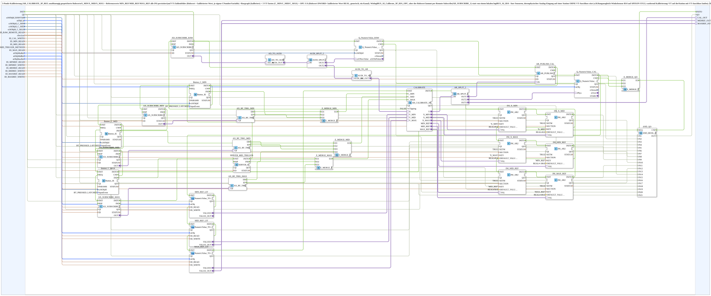

# logiBUS_AI_Calibrate_3P_Remote_IDA_OPC

* * * * * * * * * *

## Introduction

`logiBUS_AI_Calibrate_3P_Remote_IDA_OPC` performs a **3-point calibration** (`AR_CALIBRATE_3P_REF`) for an analog raw value. The raw values `X_MIN`/`X_MID`/`X_MAX` and the reference values `MIN_REF`/`MID_REF`/`MAX_REF` are stored independently and all INI-persisted. The results appear on VT number fields (raw value and calibrated value, each with its own CNumberVariable), three VT buttons (`C_MIN`/`C_MID`/`C_MAX`) trigger the calibration points, and the raw value (DWORD) and the calibrated value (REAL) are provided generically for one channel via OPC-UA. In contrast to `logiBUS_AI_Calibrate_3P_IDA_OPC`, the raw value comes **via remote subscribe** (`AD_SUBSCRIBE_1`) instead of from a local `logiBUS_AI_IDA`; this allows sensors on a station without a VT connection to be calibrated (e.g. slope compensation angle sensor B14 on STG3) while calibration and VT run on the station with the VT connection. The raw value is published there by [`logiBUS_AI_Raw_Publish_OPC`](logiBUS_AI_Raw_Publish_OPC.md).

## Interface Structure

### **Event Inputs**

- **INIT** (`EInit`): initialization request; starts the initialization chain (first link `Q_NumericValue_RAW.INIT`)

### **Event Outputs**

- **INITO** (`EInit`): initialization confirm; comes from `Button_C_MAX.INITO`, the end of the chain

### **Data Inputs**

- **QI** (BOOL): quality input - TRUE enables the service (default `TRUE`); distributed to all 21 inner instances
- **u16ObjId_RAWVAR** (UINT): object ID of the CNumberVariable for the raw value (0-4095, uncalibrated, pure diagnostic display)
- **stObjCal** (`NumericObjectPool_S`): object ID + scale/offset/decimals of the CNumberVariable for the calibrated value (own, independent variable)
- **u16ObjId_C_MIN**, **u16ObjId_C_MID**, **u16ObjId_C_MAX** (UINT): object IDs of the buttons `C_MIN`, `C_MID`, `C_MAX` (move to the position, then press)
- **ID_RAW_REMOTE_READ** (WSTRING): remote subscribe address of the raw value (DWORD 0-4095, `ACTION=SUBSCRIBE`); counterpart to `ID_RAW_WRITE` on the sensor station
- **sSection** (STRING): INI section name for the persistence of `X_MIN`/`X_MID`/`X_MAX`/`MIN_REF`/`MID_REF`/`MAX_REF`; unique per channel, otherwise the channels collide in `settings.ini`
- **ID_CAL_WRITE** (WSTRING): feedback address of the calibrated value (REAL, `ACTION=PUBLISH`)
- **ID_MIN_READ**, **ID_MID_READ**, **ID_MAX_READ** (WSTRING): remote addresses (BOOL, `ACTION=SUBSCRIBE`) for `C_MIN`/`C_MID`/`C_MAX`; every edge (the web client writes the inverted last value on each click) triggers the calibration point like a button press
- **ID_MID_TRIGGER_METHOD** (WSTRING): local method address (`ACTION=CREATE_METHOD`) for the argument-less and return-value-less `C_MID` trigger; called by a local `CLIENT_0` (e.g. `Fahrwerk_Mittelpunkt_Automatik.SUB`) via `CALL_METHOD` and triggers `C_MID` like `Button_C_MID`/`ID_MID_READ`
- **stObjMinRef**, **stObjMidRef**, **stObjMaxRef** (`NumericObjectPool_S`): object ID + scale/offset/decimals of the reference values `MIN_REF`/`MID_REF`/`MAX_REF` (VT input field + OPC-UA)
- **ID_MINREF_READ**, **ID_MIDREF_READ**, **ID_MAXREF_READ** (WSTRING): remote subscribe addresses of the reference values (REAL, `ACTION=SUBSCRIBE`)
- **ID_MINREF_WRITE**, **ID_MIDREF_WRITE**, **ID_MAXREF_WRITE** (WSTRING): remote echo addresses of the reference values (REAL, `ACTION=PUBLISH`)

### **Data Outputs**

- **QO** (BOOL): quality output - TRUE if the service was executed successfully (AND of the `QO` of all 21 inner instances, see section Functionality)

### **Adapters**

- **CAL_OUT** (plug, `AR`): optional; calibrated value (`CALIBRATE.Y`) for external consumers instead of an own local OPC-UA self-subscribe on `ID_CAL_WRITE`
- **MIDREF_OUT** (plug, `AR`): optional; live `MID_REF` reference value (`MID_REF_LIT.VALUE_OUT`, plain AR mirror of the bidirectional `VALUEO`) for external consumers
- **MAXREF_OUT** (plug, `AR`): optional; live `MAX_REF` reference value (`MAX_REF_LIT.VALUE_OUT`) for external consumers

## Functionality

**Raw value**: `AD_SUBSCRIBE_RAW` (`adapter::net::AD_SUBSCRIBE_1`, `QI` from outside, address `ID_RAW_REMOTE_READ`) → `AD_TO_AUDI` → `AUDI_SPLIT_2`. `OUT1` → `Q_NumericValue_RAW.u32NewValue` (`Q_NumericValue_AUDI`, raw value display on `u16ObjId_RAWVAR`); `OUT2` → `AUDI_TO_AR` → `CALIBRATE.X`.

**Calibration**: `CALIBRATE` (`adapter::Engineering::measurements::AR_CALIBRATE_3P_REF`, `xClipping = FALSE`, `QI` from outside) maps the raw value `X` via the three points to `Y`. `Y_MIN`/`Y_MID`/`Y_MAX` come from `MIN_REF_LIT`/`MID_REF_LIT`/`MAX_REF_LIT` (each [`MyLib::sys::NumericValue_TO_AR2_OPC`](NumericValue_TO_AR2_OPC.md); VT input field and OPC-UA, last writer wins).

**Result**: `CALIBRATE.Y` → `AR_SPLIT_2` (`AR_SPLIT_3`): `OUT1` → `AR_PUBLISH_CAL` (`AR_PUBLISH_1`, address `ID_CAL_WRITE`), `OUT2` → `Q_NumericValue_CAL.rPhys` (`Q_NumericValue_PHYSA`, display with `stObjCal`), `OUT3` → `CAL_OUT`. `MID_REF_LIT.VALUE_OUT` → `MIDREF_OUT` and `MAX_REF_LIT.VALUE_OUT` → `MAXREF_OUT`.

**Triggers**: every calibration point has its own event merge. `C_MIN`: `Button_C_MIN.IND` (`Button_IE`, `BT_PRESSED_LATCHED`), `AX_RF_TRIG_MIN.ER` and `.EF` (both edges of the remote subscribe `AX_SUBSCRIBE_MIN`, address `ID_MIN_READ`) → `E_MERGE_MIN` (`E_MERGE_3`) → `CALIBRATE.C_MIN`. `C_MAX` analogously via `Button_C_MAX`, `AX_SUBSCRIBE_MAX`, `AX_RF_TRIG_MAX`, `E_MERGE_MAX` (`E_MERGE_3`). `C_MID` additionally with `SERVER_MID_TRIGGER` (`iec61499::net::SERVER_0`, method `ID_MID_TRIGGER_METHOD`) → `E_MERGE_MID` (`E_MERGE_4`) → `CALIBRATE.C_MID`.

**Persistence**: `CALIBRATE.X_MIN`/`X_MID`/`X_MAX` and `MIN_REF`/`MID_REF`/`MAX_REF` each go to one `INI_AR2` instance (`INI_X_MIN`, `INI_X_MID`, `INI_X_MAX`, `INI_MIN_REF`, `INI_MID_REF`, `INI_MAX_REF`; `SETM = TRUE`, `SECTION` from `sSection`, `KEY` = name). The defaults are `X_MIN`/`X_MID`/`X_MAX` = `REAL#0.0` as well as `MIN_REF = REAL#-100.0`, `MID_REF = REAL#50.0`, `MAX_REF = REAL#100.0`.

**Initialisation**: `INIT` runs as one single chain (each `INITO` → next `INIT`) through `Q_NumericValue_RAW` → `Q_NumericValue_CAL` → `MIN_REF_LIT` → `MID_REF_LIT` → `MAX_REF_LIT` → `CALIBRATE` → `INI_X_MIN` → `INI_X_MID` → `INI_X_MAX` → `INI_MIN_REF` → `INI_MID_REF` → `INI_MAX_REF` → `AD_SUBSCRIBE_RAW` → `AR_PUBLISH_CAL` → `AX_SUBSCRIBE_MIN` → `AX_SUBSCRIBE_MID` → `AX_SUBSCRIBE_MAX` → `SERVER_MID_TRIGGER` → `Button_C_MIN` → `Button_C_MID` → `Button_C_MAX`; `Button_C_MAX.INITO` goes to the event output `INITO` and to `AND_QO.REQ`.

**Quality**: `QI` is passed to all 21 instances of the chain. `QO` is the output of the instance `AND_QO` (`iec61131::booleanOperators::AND_BOOL_21`), which combines the `QO` of these 21 instances in a single block (`IN1`..`IN21`: `Q_NumericValue_RAW`, `Q_NumericValue_CAL`, `MIN_REF_LIT`, `MID_REF_LIT`, `MAX_REF_LIT`, `CALIBRATE`, `INI_X_MIN`, `INI_X_MID`, `INI_X_MAX`, `INI_MIN_REF`, `INI_MID_REF`, `INI_MAX_REF`, `AD_SUBSCRIBE_RAW`, `AR_PUBLISH_CAL`, `AX_SUBSCRIBE_MIN`, `AX_SUBSCRIBE_MID`, `AX_SUBSCRIBE_MAX`, `SERVER_MID_TRIGGER`, `Button_C_MIN`, `Button_C_MID`, `Button_C_MAX`). In addition there is `E_MERGE_QO` (`E_MERGE_3`), which merges `Q_NumericValue_CAL.INITO` and the `CNF` events of `Q_NumericValue_RAW` and `Q_NumericValue_CAL`; its output `EO` triggers `AND_QO.REQ`, so `QO` is re-evaluated on every new `Q_NumericValue_RAW`/`Q_NumericValue_CAL` value (`CNF`) (up to v1.6 `EO` was not connected).

## Technical Details

- The defaults of `X_MID`/`X_MAX` are deliberately `0.0`: with `0.5`/`1.0` the calibrated flags `xMidCal`/`xMaxCal` of `AR_CALIBRATE_3P_REF` latched to TRUE at every restart although MID/MAX were never calibrated (fix in version 1.6)
- `CALIBRATE` has an `INIT`/`QI`/`QO` enable pattern; without `QI = TRUE` the block stays in state START and `REQ` never runs (version 1.5); here `QI` comes from the SubApp input `QI` (default `TRUE`) instead of a fixed parameter
- `MIDREF_OUT`/`MAXREF_OUT` are fed from `VALUE_OUT`, not from the bidirectional `VALUEO`: an `AR_SPLIT_2` directly on an AR2 plug would be a type error (version 1.2)
- The optional plugs `CAL_OUT`/`MIDREF_OUT`/`MAXREF_OUT` allow external consumers to read the already calibrated value via adapter instead of subscribing to the same OPC-UA node locally again (FORTE: 'Cannot add another one'); leave unwired if not needed (e.g. slope compensation channel)
- The merge chains for `C_MIN`/`C_MID`/`C_MAX` are a single `E_MERGE_3`/`E_MERGE_4` each instead of several `E_MERGE_2` (OR is associative, functionally identical); `C_MIN`/`C_MID`/`C_MAX` of `CALIBRATE` are pure event inputs
- Remote triggers fire on **every** edge (rising and falling), since the web client writes the inverted last value on each click
- **`IND` → `RSP`**: `SERVER_MID_TRIGGER` has the self-loop `IND` → `RSP`; the forwarding `IND` → `E_MERGE_MID.EI4` remains alongside it. Rule see [SERVER_0](../../../StandardLibraries/net/SERVER_0.md).

## Application Scenarios

- Calibration of an angle or position sensor (e.g. slope compensation) whose analog input sits on a different station than the VT
- Three-point calibration with min, centre and max position including adjustable reference values and persisted raw values

## ⚖️ Comparison with Similar Blocks

`logiBUS_AI_Calibrate_3P_IDA_OPC` reads the raw value locally from a `logiBUS_AI_IDA`; this remote variant replaces its `logiBUS_AI_IDA` + `AD_SPLIT_2` + `AD_PUBLISH_RAW` with an `AD_SUBSCRIBE_1`. The chain of calibration and VT connection is unchanged. The sensor side is [`logiBUS_AI_Raw_Publish_OPC`](logiBUS_AI_Raw_Publish_OPC.md).

## Conclusion

`logiBUS_AI_Calibrate_3P_Remote_IDA_OPC` calibrates a remotely subscribed analog raw value via three points, persists all calibration data, shows raw and calibrated value on the VT and provides them via OPC-UA.
