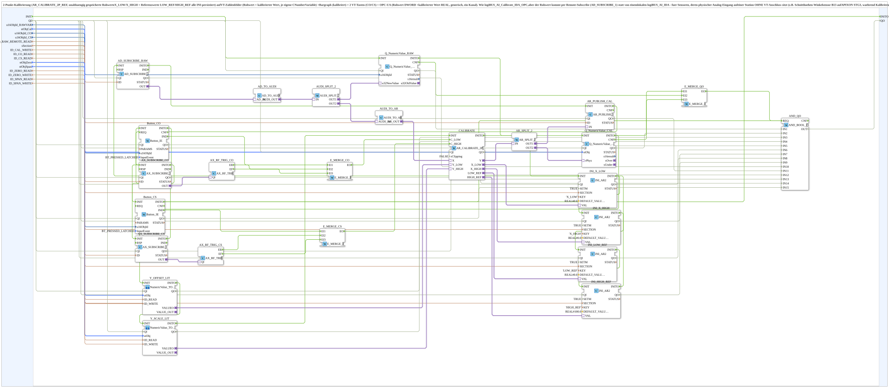

# logiBUS_AI_Calibrate_Remote_IDA_OPC

* * * * * * * * * *

## Introduction

`logiBUS_AI_Calibrate_Remote_IDA_OPC` is a 2-point calibration (`AR_CALIBRATE_2P_REF`, independently stored raw values `X_LOW`/`X_HIGH` and reference values `LOW_REF`/`HIGH_REF`, all INI-persisted) with VT number fields (raw value and calibrated value, each its own `CNumberVariable`), two VT buttons (CO/CS) and OPC-UA (raw value `DWORD`, calibrated value `REAL`, generic, one channel). It corresponds to [`logiBUS_AI_Calibrate_2P_IDA_OPC`](./logiBUS_AI_Calibrate_2P_IDA_OPC.md), but the raw value arrives via **remote subscribe** (`AD_SUBSCRIBE_1`) instead of from a local `logiBUS_AI_IDA`. This is intended for sensors whose physical analog input sits on a station **without a VT connection** (e.g. cutting-height angle sensor B13 on APIXON STG3, while calibration and VT run on the station with the VT connection). The raw value is published there via [`logiBUS_AI_Raw_Publish_OPC`](./logiBUS_AI_Raw_Publish_OPC.md).

## Interface Structure

### **Event Inputs**

- **INIT** (`EInit`): initialization request

### **Event Outputs**

- **INITO** (`EInit`): initialization confirm

### **Data Inputs**

- **QI** (`BOOL`, default `TRUE`): quality input, TRUE enables the service
- **u16ObjId_RAWVAR** (`UINT`): object ID of the `CNumberVariable` (raw value 0..4095, uncalibrated, pure diagnostic display), default `ID_NULL`
- **stObjCal** (`NumericObjectPool_S`): object ID plus scale/offset/decimals of the `CNumberVariable` for the calibrated value (its own, independent variable)
- **u16ObjId_CO** (`UINT`): object ID of button "CO" (calibration zero point: apply reference 1, then press)
- **u16ObjId_CS** (`UINT`): object ID of button "CS" (calibration span: apply reference 2, then press; only possible after CO)
- **ID_RAW_REMOTE_READ** (`WSTRING`): remote subscribe address of the raw value (`DWORD` 0..4095, `ACTION=SUBSCRIBE`), counterpart of `ID_RAW_WRITE` on the sensor station
- **sSection** (`STRING`): INI section name for the persistence of `X_LOW`/`X_HIGH`/`LOW_REF`/`HIGH_REF`; unique per channel, otherwise the channels collide in `settings.ini`
- **ID_CAL_WRITE** (`WSTRING`): feedback address of the calibrated value (`REAL`, `ACTION=PUBLISH`)
- **ID_CO_READ** (`WSTRING`): remote CO address (`BOOL`, `ACTION=SUBSCRIBE`): toggles the calibration zero point trigger like a button press; the web client writes the inverted last value on every click, every edge (rising or falling) triggers CO
- **ID_CS_READ** (`WSTRING`): remote CS address (`BOOL`, `ACTION=SUBSCRIBE`): toggles the calibration span trigger, see `ID_CO_READ`
- **stObjZero** (`NumericObjectPool_S`): `CNumberVariable` of the ZERO reference value (VT input field + OPC-UA)
- **stObjSpan** (`NumericObjectPool_S`): `CNumberVariable` of the SPAN reference value (VT input field + OPC-UA)
- **ID_ZERO_READ** (`WSTRING`): remote subscribe address ZERO reference value (`REAL`, `ACTION=SUBSCRIBE`)
- **ID_ZERO_WRITE** (`WSTRING`): remote echo address ZERO reference value (`REAL`, `ACTION=PUBLISH`)
- **ID_SPAN_READ** (`WSTRING`): remote subscribe address SPAN reference value (`REAL`, `ACTION=SUBSCRIBE`)
- **ID_SPAN_WRITE** (`WSTRING`): remote echo address SPAN reference value (`REAL`, `ACTION=PUBLISH`)

### **Data Outputs**

- **QO** (`BOOL`): quality output, AND combination (`AND_QO`, a single `AND_BOOL_15`) of the `QO` outputs of all 15 inner blocks with `QO`: `Q_NumericValue_RAW`, `Q_NumericValue_CAL`, `Y_OFFSET_LIT`, `Y_SCALE_LIT`, `CALIBRATE`, `INI_X_LOW`, `INI_X_HIGH`, `INI_LOW_REF`, `INI_HIGH_REF`, `AD_SUBSCRIBE_RAW`, `AR_PUBLISH_CAL`, `AX_SUBSCRIBE_CO`, `AX_SUBSCRIBE_CS`, `Button_CO`, `Button_CS`

### **Adapters**

None.

## Function Blocks (FBs) Used

- **`AD_SUBSCRIBE_RAW`** (`adapter::net::AD_SUBSCRIBE_1`): subscribes to the remote raw value
- **`AD_TO_AUDI`**, **`AUDI_SPLIT_2`**, **`AUDI_TO_AR`**: conversion and splitting of the raw value
- **`Q_NumericValue_RAW`** (`isobus::UT::Q::Q_NumericValue_AUDI`): VT raw value display
- **`CALIBRATE`** (`adapter::Engineering::measurements::AR_CALIBRATE_2P_REF`, `xClipping = FALSE`): 2-point calibration
- **`Y_OFFSET_LIT`**, **`Y_SCALE_LIT`** (SubApp `MyLib::sys::NumericValue_TO_AR2_OPC`, [NumericValue_TO_AR2_OPC](./NumericValue_TO_AR2_OPC.md)): ZERO/SPAN reference values as `AR2`
- **`Button_CO`**, **`Button_CS`** (`isobus::UT::io::Button::Button_IE`, `InputEvent = BT_PRESSED_LATCHED`): VT buttons
- **`AX_SUBSCRIBE_CO`**, **`AX_SUBSCRIBE_CS`** (`adapter::net::AX_SUBSCRIBE_1`): remote triggers
- **`AX_RF_TRIG_CO`**, **`AX_RF_TRIG_CS`** (`adapter::events::unidirectional::AX_RF_TRIG`): detect rising and falling edge
- **`E_MERGE_CO`**, **`E_MERGE_CS`** (`iec61499::events::E_MERGE_3`): merge button, rising and falling edge
- **`INI_X_LOW`**, **`INI_X_HIGH`**, **`INI_LOW_REF`**, **`INI_HIGH_REF`** (`eclipse4diac::storage::INI_AR2`, `SETM = TRUE`): persistence; keys `X_LOW`/`X_HIGH`/`LOW_REF`/`HIGH_REF`, defaults `0.0`/`0.0`/`0.0`/`100.0`
- **`AND_QO`** (`iec61131::booleanOperators::AND_BOOL_15`, since v1.5): replaces the former cascade `AND_QO_A` (`AND_BOOL_4`) + `AND_QO_B` (`AND_BOOL_10`) + `AND_QO` (`AND_BOOL_3`) with a single block for all 15 `QO` sources
- **`AR_SPLIT_2`** (`adapter::events::unidirectional::AR_SPLIT_2`), **`AR_PUBLISH_CAL`** (`adapter::net::AR_PUBLISH_1`), **`Q_NumericValue_CAL`** (`isobus::UT::Q::Q_NumericValue_PHYSA`): output of the calibrated value

## Functionality

- Raw value path: `AD_SUBSCRIBE_RAW.OUT` → `AD_TO_AUDI.AD_IN` → `AUDI_SPLIT_2.IN`; `AUDI_SPLIT_2.OUT1` → `Q_NumericValue_RAW.u32NewValue` (VT display); `AUDI_SPLIT_2.OUT2` → `AUDI_TO_AR.AUDI_IN` → `CALIBRATE.X`
- Persistence: `CALIBRATE.X_LOW`/`X_HIGH`/`LOW_REF`/`HIGH_REF` ↔ `INI_X_LOW`/`INI_X_HIGH`/`INI_LOW_REF`/`INI_HIGH_REF.VAL`; `sSection` → `SECTION` of all four
- References: `Y_OFFSET_LIT.VALUEO` → `CALIBRATE.Y_LOW`; `Y_SCALE_LIT.VALUEO` → `CALIBRATE.Y_HIGH`
- Calibrated value: `CALIBRATE.Y` → `AR_SPLIT_2.IN`; `OUT1` → `AR_PUBLISH_CAL.IN`; `OUT2` → `Q_NumericValue_CAL.rPhys`
- CO trigger: `Button_CO.IND` → `E_MERGE_CO.EI1`; `AX_SUBSCRIBE_CO.OUT` → `AX_RF_TRIG_CO.QI`; `AX_RF_TRIG_CO.ER` → `E_MERGE_CO.EI2`, `AX_RF_TRIG_CO.EF` → `E_MERGE_CO.EI3`; `E_MERGE_CO.EO` → `CALIBRATE.C_LOW`
- CS trigger: analogous with `Button_CS`, `AX_SUBSCRIBE_CS`, `AX_RF_TRIG_CS`, `E_MERGE_CS` → `CALIBRATE.C_HIGH`
- Initialisation chain: `INIT` → `Q_NumericValue_RAW.INIT` → `Q_NumericValue_CAL.INIT` → `Y_OFFSET_LIT.INIT` → `Y_SCALE_LIT.INIT` → `CALIBRATE.INIT` → `INI_X_LOW.INIT` → `INI_X_HIGH.INIT` → `INI_LOW_REF.INIT` → `INI_HIGH_REF.INIT` → `AD_SUBSCRIBE_RAW.INIT` → `AR_PUBLISH_CAL.INIT` → `AX_SUBSCRIBE_CO.INIT` → `AX_SUBSCRIBE_CS.INIT` → `Button_CO.INIT` → `Button_CS.INIT`; `Button_CS.INITO` → `INITO` and → `AND_QO.REQ`. In addition `E_MERGE_QO` (`E_MERGE_3`) merges `Q_NumericValue_CAL.INITO` and the `CNF` events of `Q_NumericValue_RAW` and `Q_NumericValue_CAL`; its output `EO` triggers `AND_QO.REQ`, so `QO` is re-evaluated on every new value (from v1.6; previously `EO` was not connected). `QI` is distributed to all inner blocks; their `QO` outputs feed `AND_QO.IN1` to `AND_QO.IN15` in the order of the chain, `AND_QO.OUT` → `QO`. (The former partial chain `AD_SUBSCRIBE_RAW.INITO` → `AR_PUBLISH_CAL.INIT` → `AX_SUBSCRIBE_CO.INIT` → `AX_SUBSCRIBE_CS.INIT` is part of this chain.)

## Technical Details

- **Raw value via remote subscribe:** `logiBUS_AI_IDA`, `AD_SPLIT_2` and `AD_PUBLISH_RAW` of the local variant are replaced by `AD_SUBSCRIBE_1`, the rest of the calibration and VT chain is unchanged.
- **CO/CS without AX sockets:** since v1.1 `C_LOW`/`C_HIGH` of `AR_CALIBRATE_2P_REF` are pure event inputs; the `E_MERGE_3` blocks connect directly via event connections (v1.2: one `E_MERGE_3` instead of two `E_MERGE_2` in series, functionally identical).
- **`QI` on `CALIBRATE`:** since v1.3 `AR_CALIBRATE_2P_REF` has an `INIT`/`QI`/`QO` enable pattern; without `QI = TRUE` the block would stay in state `START` and `REQ` would never run. The `QI` of all inner blocks now comes from the subapp input `QI` (default `TRUE`) instead of fixed parameters.
- **Bugfix v1.4 (code review PR #260):** `INI_X_HIGH.DEFAULT_VALUE` was `REAL#1.0` instead of `0.0`; as a result the calibrated flag `xHighCal` latched TRUE immediately at every boot although HIGH was never calibrated. Affects cutting height, oil temperature and pressure.
- **Web trigger:** CO/CS are triggered by every edge (rising or falling), because the web client writes the inverted last value on every click.
- This type is being superseded by `logiBUS_AI_Calibrated_Subscribe_VT_OPC` (local analog processing); the adjustments keep the file compilable.

## Application Scenarios

- Calibrating a sensor whose analog input sits on a station without a VT connection, with VT operation on another station

## ⚖️ Comparison with Similar Building Blocks

- [`logiBUS_AI_Calibrate_2P_IDA_OPC`](./logiBUS_AI_Calibrate_2P_IDA_OPC.md): raw value from a local `logiBUS_AI_IDA`
- [`logiBUS_AI_Calibrate_3P_Remote_IDA_OPC`](./logiBUS_AI_Calibrate_3P_Remote_IDA_OPC.md): three-point variant with remote raw value

## Summary

`logiBUS_AI_Calibrate_Remote_IDA_OPC` calibrates a remotely published analog raw value in two points, shows raw and calibrated value on the VT and publishes the calibrated value via OPC-UA.

---

### 🌐 Related topic pages on ms-muc-docs.de

- [🌐 Eclipse 4diac IDE & color reference on ms-muc-docs.de](https://www.ms-muc-docs.de/iec-61499/eclipse-4diac/)
