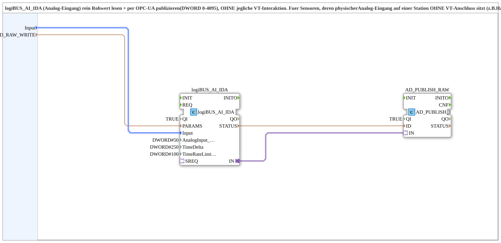

# logiBUS_AI_Raw_Publish_OPC

* * * * * * * * * *

## Introduction

`logiBUS_AI_Raw_Publish_OPC` reads an analog input (`logiBUS_AI_IDA`) as a raw value (DWORD, 0-4095) and publishes it via OPC-UA, **without any VT interaction**. It is intended for sensors whose physical analog input sits on a station without a VT connection (e.g. slope compensation angle sensor B14 on APIXON STG3). Calibration as well as VT buttons and displays then run on the station with a VT connection and are fed by remote subscribe of this raw value (see [`logiBUS_AI_Calibrate_3P_Remote_IDA_OPC`](logiBUS_AI_Calibrate_3P_Remote_IDA_OPC.md)).

## Interface Structure

### **Event Inputs**

The function block has no direct event inputs.

### **Event Outputs**

The function block has no direct event outputs.

### **Data Inputs**

- **Input** (`logiBUS::io::AI::logiBUS_AI_S`): selection of the analog input `AnalogInput_I1`..`I8` (default `logiBUS_AI::Invalid`)
- **ID_RAW_WRITE** (WSTRING): publish address of the raw value (DWORD 0-4095, `ACTION=PUBLISH`), local on this station

### **Data Outputs**

The function block has no direct data outputs.

### **Adapters**

No adapters are used.

## Functionality

The network consists of two blocks:

- `logiBUS_AI_IDA` (`logiBUS::io::AI::logiBUS_AI_IDA`, `QI = TRUE`): reads the selected analog input (`Input` → `logiBUS_AI_IDA.Input`). Parameterised are `AnalogInput_hysteresis = DWORD#50`, `TimeDelta = DWORD#250` and `TimeRateLimit = DWORD#100`.
- `AD_PUBLISH_RAW` (`adapter::net::AD_PUBLISH_1`, `QI = TRUE`): `logiBUS_AI_IDA.IN` → `AD_PUBLISH_RAW.IN`; publishes the raw value to the address `ID_RAW_WRITE` (`ID_RAW_WRITE` → `AD_PUBLISH_RAW.ID`).

## Technical Details

- Raw value half of `logiBUS_AI_Calibrate_3P_IDA_OPC`: calibration does not take place here but on the station with a VT connection
- No event, data or adapter ports apart from the two input variables
- The behaviour of the raw value input (hysteresis, `TimeDelta`, `TimeRateLimit`) is set through the parameters of `logiBUS_AI_IDA`

## Application Scenarios

- Sensors on stations without a VT connection whose calibration and display run on another station

## Conclusion

`logiBUS_AI_Raw_Publish_OPC` provides the raw value of an analog input via OPC-UA and is thus the sensor side of a cross-station calibration.
