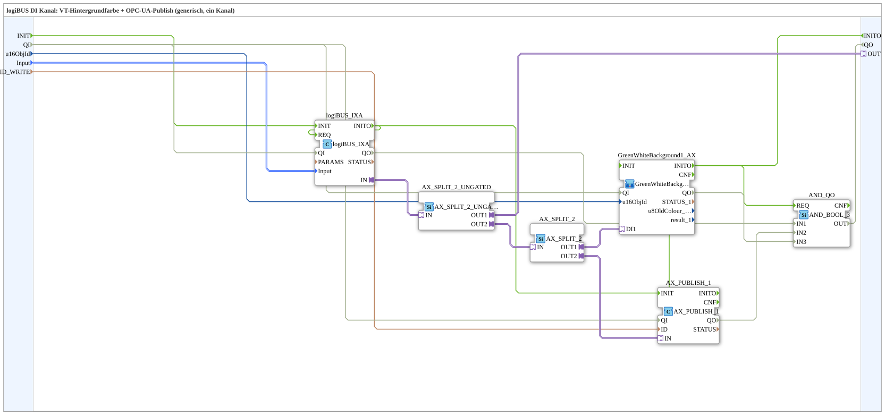

# logiBUS_IXA_BG_OPC_AX

* * * * * * * * * *

## Introduction

`logiBUS_IXA_BG_OPC_AX` is a generic block for **one logiBUS DI channel** with VT background colour and OPC-UA publish. Compared with [`logiBUS_IXA_BG_OPC`](./logiBUS_IXA_BG_OPC.md), it additionally passes the input state on as the `AX` plug `OUT`, so that other blocks can use the level.

## Function Blocks (FBs) Used

### Sub-blocks: logiBUS_IXA_BG_OPC_AX

- **Type**: SubAppType
- **Internal blocks used**:
    - **logiBUS_IXA**: `logiBUS::io::DI::logiBUS_IXA` - digital input; `Input` identifies `Input_I1..I8`
    - **AX_SPLIT_2_UNGATED**: `adapter::events::unidirectional::AX_SPLIT_2_UNGATED` - branches the input state into the plug `OUT` and into the second branch
    - **AX_SPLIT_2**: `adapter::events::unidirectional::AX_SPLIT_2` - branches the second branch into VT display and publish
    - **GreenWhiteBackground1_AX**: SubApp [`MyLib::sys::GreenWhiteBackground1_AX`](./GreenWhiteBackground1_AX.md) - sets the background colour (green/white)
    - **AX_PUBLISH_1**: `adapter::net::AX_PUBLISH_1` - OPC-UA publish
    - **AND_QO**: `iec61131::booleanOperators::AND_BOOL_3` - combines the `QO` outputs of `logiBUS_IXA`, `AX_PUBLISH_1` and `GreenWhiteBackground1_AX` into the SubApp output `QO`
- **Imports**: `ID_NULL`, `logiBUS_DI`, `logiBUS_DI_S`

## Interface Structure

### **Event Inputs / Event Outputs**

- **INIT** (`EInit`, input): initialization request; passed on to `logiBUS_IXA.INIT`
- **INITO** (`EInit`, output): initialization confirmation; comes from `GreenWhiteBackground1_AX.INITO`

The runtime events still travel via the adapter.

### **Data Inputs**

- **QI** (`BOOL`, default `TRUE`): quality input, service enable; passed on to `logiBUS_IXA`, `AX_PUBLISH_1` and `GreenWhiteBackground1_AX`
- **u16ObjId** (`UINT`, default `ID_NULL`): Object ID of the background rectangle (VT); `ID_NULL` = no VT object yet
- **Input** (`logiBUS::io::DI::logiBUS_DI_S`, default `logiBUS_DI::Invalid`): Identifies the input `Input_I1..I8`
- **ID_WRITE** (`WSTRING`): OPC-UA publish key (readable)

### **Data Outputs**

- **QO** (`BOOL`): quality output, `AND` of the `QO` outputs of `logiBUS_IXA`, `AX_PUBLISH_1` and `GreenWhiteBackground1_AX` (via `AND_QO`)

### **Adapters**

- **OUT** (plug): `adapter::types::unidirectional::AX` - input state as a level

## Program Flow and Connections

- `Input` → `logiBUS_IXA.Input`; `logiBUS_IXA.INITO` → `logiBUS_IXA.REQ` (first read after initialisation)
- `logiBUS_IXA.IN` → `AX_SPLIT_2_UNGATED.IN`
- `AX_SPLIT_2_UNGATED.OUT1` → `OUT`
- `AX_SPLIT_2_UNGATED.OUT2` → `AX_SPLIT_2.IN`
- `AX_SPLIT_2.OUT1` → `GreenWhiteBackground1_AX.DI1`; `u16ObjId` → `GreenWhiteBackground1_AX.u16ObjId`
- `AX_SPLIT_2.OUT2` → `AX_PUBLISH_1.IN`; `ID_WRITE` → `AX_PUBLISH_1.ID`
- Initialization: `INIT` → `logiBUS_IXA.INIT`; `logiBUS_IXA.INITO` → `AX_PUBLISH_1.INIT` (in addition to `logiBUS_IXA.INITO` → `logiBUS_IXA.REQ`); `AX_PUBLISH_1.INITO` → `GreenWhiteBackground1_AX.INIT`; `GreenWhiteBackground1_AX.INITO` → `INITO` and → `AND_QO.REQ`
- Quality: `QI` → `logiBUS_IXA.QI`, `AX_PUBLISH_1.QI` and `GreenWhiteBackground1_AX.QI`; their `QO` outputs → `AND_QO.IN1` (`logiBUS_IXA`), `IN2` (`AX_PUBLISH_1`), `IN3` (`GreenWhiteBackground1_AX`); `AND_QO.OUT` → `QO`

## Technical Details

- Two splitters in series, because an adapter plug can be connected to only one destination and three destinations (`OUT`, VT display, publish) are served here
- One-way data flow: a digital input is not written from outside
- Version 1.0 (2023-10-23)

## Application Scenarios

- Digital input with VT status colour and OPC-UA publish whose state should additionally be used by other blocks

## Summary

`logiBUS_IXA_BG_OPC_AX` extends `logiBUS_IXA_BG_OPC` with a passed-through `AX` output `OUT` for the input state.
