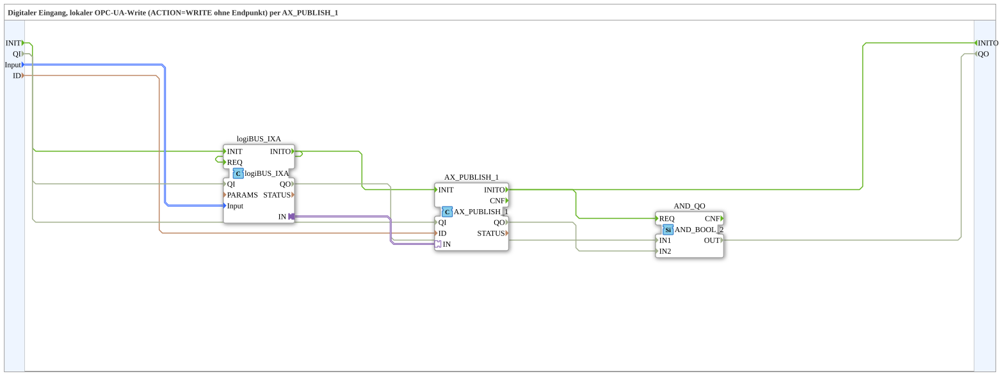

# logiBUS_IXA_TO_PUBLISH_OPC

* * * * * * * * * *

## Introduction

`logiBUS_IXA_TO_PUBLISH_OPC` reads a digital input (`logiBUS_IXA`) and writes the value as a local OPC UA write (`ACTION=WRITE` without endpoint) via `AX_PUBLISH_1`. In contrast to [`logiBUS_IXA_TO_CLIENT_OPC`](./logiBUS_IXA_TO_CLIENT_OPC.md), which actively writes the value to another device via `AX_CLIENT_1_0`, the value stays local here (no endpoint).

## Interface Structure

### **Event Inputs**

- `INIT` (`EInit`): Initialization Request

### **Event Outputs**

- `INITO` (`EInit`): Initialization Confirm

### **Data Inputs**

| Name | Type | Description |
|------|-----|--------------|
| `QI` | `BOOL` | Quality Input - TRUE to enable the service. Initial value `TRUE`. |
| `Input` | `logiBUS::io::DI::logiBUS_DI_S` | Identifies the input `Input_I1..I8`. Initial value `logiBUS_DI::Invalid`. |
| `ID` | `WSTRING` | Local node address (`BOOL`, `ACTION=WRITE`, without endpoint). |

### **Data Outputs**

| Name | Type | Description |
|------|-----|--------------|
| `QO` | `BOOL` | Quality Output - TRUE if the service was executed successfully. |

### **Adapters**

None.

## Function Blocks (FBs) Used

- **logiBUS_IXA** (`logiBUS::io::DI::logiBUS_IXA`): physical digital input, identified via `Input_I1..I8`.
- **AX_PUBLISH_1** (`adapter::net::AX_PUBLISH_1`): writes the adapter value locally to the node address `ID`.
- **AND_QO** (`iec61131::booleanOperators::AND_BOOL_2`): combines `logiBUS_IXA.QO` and `AX_PUBLISH_1.QO` into `QO`.

## Program Flow and Connections

1. Initialization: `INIT` → `logiBUS_IXA.INIT`; `logiBUS_IXA.INITO` → `logiBUS_IXA.REQ` and → `AX_PUBLISH_1.INIT`; `AX_PUBLISH_1.INITO` → `INITO` and → `AND_QO.REQ`.
2. Value: `logiBUS_IXA.IN` → `AX_PUBLISH_1.IN`.
3. Data: `Input` → `logiBUS_IXA.Input`; `ID` → `AX_PUBLISH_1.ID`.
4. Qualifier: `QI` → `logiBUS_IXA.QI` and `AX_PUBLISH_1.QI`.
5. Quality evaluation: `logiBUS_IXA.QO` → `AND_QO.IN1`; `AX_PUBLISH_1.QO` → `AND_QO.IN2`; `AND_QO.OUT` → `QO`.

## Technical Features

- Local counterpart to [`logiBUS_IXA_TO_CLIENT_OPC`](./logiBUS_IXA_TO_CLIENT_OPC.md): `AX_PUBLISH_1` instead of `AX_CLIENT_1_0`, therefore no endpoint in `ID`.

## Application Scenarios

- Providing a digital input as a local OPC UA node (local exercises on a single device).

## Summary

Single-block bridge from a physical digital input to a local OPC UA write via `AX_PUBLISH_1` - local counterpart to [`logiBUS_IXA_TO_CLIENT_OPC`](./logiBUS_IXA_TO_CLIENT_OPC.md).

## 🛠️ Related Exercises

- [Uebung_OPC_L01_AX](https://meisterschulen-am-ostbahnhof-munchen-docs.readthedocs.io/projects/4diac-exercises-docs/en/latest/Uebungen/test_AX/Meins/OPC_UA_Lokal/Uebung_OPC_L01_AX/)
- [Uebung_OPC_L10_AX](https://meisterschulen-am-ostbahnhof-munchen-docs.readthedocs.io/projects/4diac-exercises-docs/en/latest/Uebungen/test_AX/Meins/OPC_UA_Lokal/Uebung_OPC_L10_AX/)
- [Uebung_OPC_L13_AX](https://meisterschulen-am-ostbahnhof-munchen-docs.readthedocs.io/projects/4diac-exercises-docs/en/latest/Uebungen/test_AX/Meins/OPC_UA_Lokal/Uebung_OPC_L13_AX/)
- [Uebung_OPC_L19_AX](https://meisterschulen-am-ostbahnhof-munchen-docs.readthedocs.io/projects/4diac-exercises-docs/en/latest/Uebungen/test_AX/Meins/OPC_UA_Lokal/Uebung_OPC_L19_AX/)

---

### 🌐 Related topic subpages on ms-muc-docs.de

- [🌐 Eclipse 4diac IDE & color reference on ms-muc-docs.de](https://www.ms-muc-docs.de/iec-61499/eclipse-4diac/)
