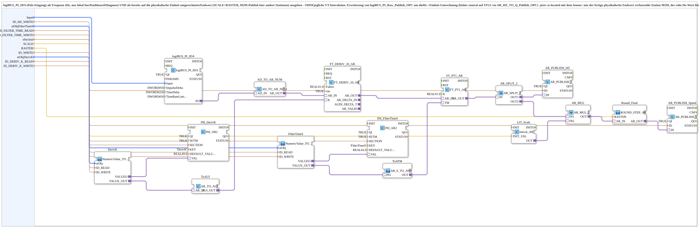

# logiBUS_PI_Speed_Publish_OPC

* * * * * * * * * *

## Introduction

`logiBUS_PI_Speed_Publish_OPC` outputs a pulse input (`logiBUS_PI_IDA`) in two ways: as a **frequency in Hz** (local only, for dashboard/diagnostics) and as a **final value already converted to the physical unit** (SCALE + RASTER, M2M publish for other stations). There is **no** VT interaction. The block extends `logiBUS_PI_Raw_Publish_OPC` with the Hz-to-unit conversion that used to run centrally on STG1 (`AR_HZ_TO_Q_Publish_OPC`) and now sits at the sensor: only the finished physical final value leaves the station via M2M, the raw Hz value stays local.

## Interface Structure

### **Event Inputs**

- **INIT** (`EInit`): Initialization Request

### **Event Outputs**

- **INITO** (`EInit`): Initialization Confirm

### **Data Inputs**

- **QI** (BOOL, default `TRUE`): Quality Input - TRUE to enable the service
- **Input** (`logiBUS::io::PI::logiBUS_PI_S`): selection of the pulse input `PulseInput_I1`..`I9` (default `logiBUS_PI::Invalid`)
- **ID_HZ_WRITE** (WSTRING): frequency publish address (REAL Hz, `ACTION=PUBLISH`), local; dashboard/diagnostics only, no other station should subscribe to it remotely (scope LOC)
- **stObjFilterTimeS** (`NumericObjectPool_S`): object ID + scale/offset/decimals of the CNumberVariable for the PT1 filter time in seconds (VT input field); default `u8Decimals := 1`
- **ID_FILTER_TIME_READ** (WSTRING): remote subscribe address (REAL seconds, `ACTION=SUBSCRIBE`) for a web override of the filter time
- **ID_FILTER_TIME_WRITE** (WSTRING): local echo/republish address (REAL seconds, `ACTION=PUBLISH`) of the current filter time
- **sSection** (STRING): INI section in `settings.ini` for the persisted values (filter time and `DerivK`), unique per sensor instance
- **SCALE** (REAL): scaling factor Hz → physical unit (e.g. `3.6/53` for km/h, `60.0` for rpm at 1 pulse/revolution)
- **RASTER** (REAL): rounding grid of the **finished** physical value (after `SCALE`) in the display unit (e.g. 0.125 for rpm, 0.1 for km/h); placeholder default `0.001` (practically no rounding)
- **ID_WRITE** (WSTRING): publish address of the converted physical final value (REAL, `ACTION=PUBLISH`); other stations subscribe to this address remotely (scope M2M)
- **stObjDerivK** (`NumericObjectPool_S`): object ID + scale/offset/decimals of the CNumberVariable for `FT_DERIV_10_AR.K` (window width 0-9, 0 decimals); stays at `ID_NULL` as long as no VT field is placed (dashboard/INI setting only)
- **ID_DERIV_K_READ** (WSTRING): remote subscribe address (REAL, `ACTION=SUBSCRIBE`) for a web override of `FT_DERIV_10_AR.K`
- **ID_DERIV_K_WRITE** (WSTRING): local echo/republish address (REAL, `ACTION=PUBLISH`) of the current `FT_DERIV_10_AR.K`

### **Data Outputs**

- **QO** (BOOL): Quality Output - TRUE if the service executed successfully (AND of the `QO` of `logiBUS_PI_IDA`, `AR_PUBLISH_HZ`, `AR_PUBLISH_Speed`, `INI_FilterTimeS`, `INI_DerivK`, `FilterTimeS` and `DerivK`; block `AND_QO`, type `iec61131::booleanOperators::AND_BOOL_7`)

### **Adapters**

No adapters are used.

## Functionality

**Measurement chain (frequency)**: `logiBUS_PI_IDA` (`logiBUS::io::PI::logiBUS_PI_IDA`, `QI` from the block input, `ImpulseDelta = DWORD#50`, `TimeDelta = DWORD#250`, `TimeRateLimit = DWORD#50`) → `AD_TO_AR_NUM` → `FT_DERIV_10_AR` (`OSCAT_adapter::Control`, `Faktor = 1.0`, `run = TRUE`) → `FT_PT1_AR` (`K = 1.0`) → `AR_SPLIT_2`.

**Two output paths** from `AR_SPLIT_2`:

- `OUT1` → `AR_PUBLISH_HZ` (`AR_PUBLISH_1`, `QI` from the block input): publishes the frequency in Hz to `ID_HZ_WRITE` (local, unrounded).
- `OUT2` → `AR_MUL.IN1` (`AR_MUL_2`), `LIT_Scale.OUT` → `AR_MUL.IN2` (`LIT_Scale` is an `initval_AR` with `INIT_VAL` from `SCALE`) → `Round_Final` (`OSCAT_adapter::Mathematical::ROUND_STEP_AR`, `RASTER`) → `AR_PUBLISH_Speed` (`AR_PUBLISH_1`, `QI` from the block input): publishes the converted final value, rounded to `RASTER`, to `ID_WRITE`.

**Adjustable PT1 filter time**: `FilterTimeS` ([`MyLib::sys::NumericValue_TO_AR2_OPC`](NumericValue_TO_AR2_OPC.md); `stObjFilterTimeS`, `ID_FILTER_TIME_READ`, `ID_FILTER_TIME_WRITE`) supplies the filter time in seconds. `FilterTimeS.VALUEO` ↔ `INI_FilterTimeS.VAL` (`eclipse4diac::storage::INI_AR2`, `QI` from the block input, `SETM = TRUE`, `KEY = 'FilterTimeS'`, `DEFAULT_VALUE = REAL#2.0`, `SECTION` from `sSection`) persists it. `FilterTimeS.VALUE_OUT` → `ToATM.IN1` ([`MyLib::sys::AR_S_TO_ATM`](AR_S_TO_ATM.md)), `ToATM.OUT` → `FT_PT1_AR.TM`.

**Adjustable derivative window width**: `DerivK` (`NumericValue_TO_AR2_OPC`; `stObjDerivK`, `ID_DERIV_K_READ`, `ID_DERIV_K_WRITE`) supplies `K`. `DerivK.VALUEO` ↔ `INI_DerivK.VAL` (`INI_AR2`, `KEY = 'DerivK'`, `DEFAULT_VALUE = REAL#9.0`, `SECTION` from `sSection`) persists the value. `DerivK.VALUE_OUT` → `ToAUI.AR_IN` (`AR_TO_AUI`), `ToAUI.AUI_OUT` → `FT_DERIV_10_AR.K`.

**Initialization and status**: The initialization chain is `INIT` → `logiBUS_PI_IDA.INIT`, `logiBUS_PI_IDA.INITO` → `AR_PUBLISH_HZ.INIT`, `AR_PUBLISH_HZ.INITO` → `AR_PUBLISH_Speed.INIT`, `AR_PUBLISH_Speed.INITO` → `INI_FilterTimeS.INIT`, `INI_FilterTimeS.INITO` → `INI_DerivK.INIT`, `INI_DerivK.INITO` → `FilterTimeS.INIT`, `FilterTimeS.INITO` → `DerivK.INIT`, `DerivK.INITO` → `INITO` and → `AND_QO.REQ`. `QI` is forwarded to `logiBUS_PI_IDA`, `AR_PUBLISH_HZ`, `AR_PUBLISH_Speed`, `INI_FilterTimeS`, `INI_DerivK`, `FilterTimeS` and `DerivK`; their `QO` outputs → `AND_QO.IN1`..`IN7`, `AND_QO.OUT` → `QO`.

## Technical Details

- The Hz value (`ID_HZ_WRITE`) is deliberately left unrounded and purely local (scope LOC); only `ID_WRITE` is intended for M2M subscribers
- `RASTER` rounds the **finished** physical value after the `SCALE` multiplication (no longer in Hz as `RASTER_HZ` used to do in `logiBUS_PI_Raw_Publish_OPC`), so intuitive values arise directly in the display unit
- Filter time (`FilterTimeS`) and window width (`DerivK`) are adjustable via VT field, web override and INI persistence; `K` of `FT_DERIV_10_AR` is itself an AUI adapter socket, so the earlier unpacking workaround is no longer needed
- The configuration applies automatically to all five pulse sensors that use this common block (pickup B03, hedgehog belt 1/2 B10/B11, PTO B21, saw blade B08)
- Both INI entries share the same `sSection` but have different `KEY`s (`FilterTimeS`, `DerivK`)

## Application Scenarios

- Speed or rotational speed measurement (km/h, rpm) on stations without a VT connection with cross-station provision of the finished value

## ⚖️ Comparison with Similar Blocks

In contrast to `logiBUS_PI_Raw_Publish_OPC`, this block rounds in the display unit grid and additionally supplies the converted final value. The subscribing counterpart is [`AR_M2M_Subscribe_TO_Q_Publish_OPC`](AR_M2M_Subscribe_TO_Q_Publish_OPC.md).

## Conclusion

`logiBUS_PI_Speed_Publish_OPC` covers the complete sensor side of a speed/rotational speed measurement: frequency determination with an adjustable filter, conversion and rounding to the display unit as well as local and M2M publication.
