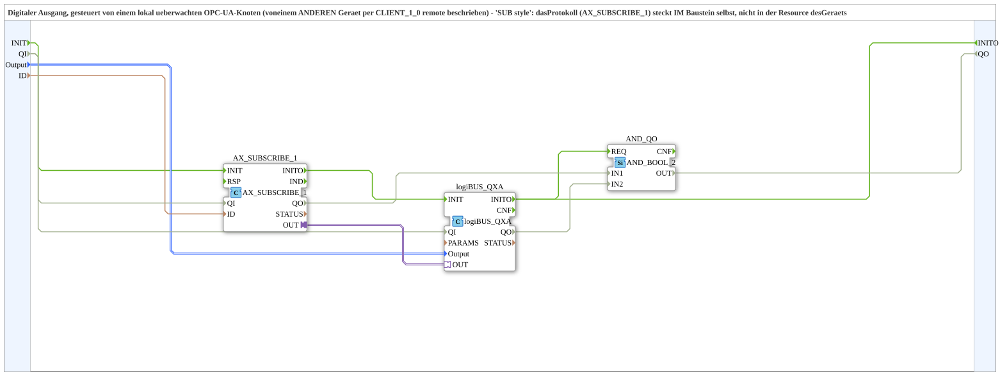

# logiBUS_QXA_FROM_SUBSCRIBE_OPC

* * * * * * * * * *

## Introduction

`logiBUS_QXA_FROM_SUBSCRIBE_OPC` drives a digital output (`logiBUS_QXA`) from a locally-subscribed OPC-UA node that is remotely written by ANOTHER device via `AX_CLIENT_1_0` - "Krauternter style" (per the source comment): the protocol (`AX_SUBSCRIBE_1`) lives INSIDE the block itself, not in the device's resource.

## Function blocks used

- **AX_SUBSCRIBE_1** (`adapter::net::AX_SUBSCRIBE_1`): subscribes to the locally-monitored address `ID` (BOOL, written remotely).
- **logiBUS_QXA** (`logiBUS::io::DQ::logiBUS_QXA`): physical digital output, identified via `Output_Q1..Q8`.
- **AND_QO** (`iec61131::booleanOperators::AND_BOOL_2`): combines `AX_SUBSCRIBE_1.QO` and `logiBUS_QXA.QO` into the SubApp output `QO`.

## Initialization and quality

- Events: `INIT` (EInit, input) and `INITO` (EInit, output, comes from `logiBUS_QXA.INITO`).
- Data input `QI` (BOOL, default `TRUE`) and data output `QO` (BOOL); `AX_SUBSCRIBE_1` and `logiBUS_QXA` no longer carry a fixed `QI=TRUE`.
- Initialization: `INIT` → `AX_SUBSCRIBE_1.INIT`, `AX_SUBSCRIBE_1.INITO` → `logiBUS_QXA.INIT`, `logiBUS_QXA.INITO` → `INITO` and → `AND_QO.REQ`.
- Quality: `QI` → `AX_SUBSCRIBE_1.QI` and `logiBUS_QXA.QI`; `AX_SUBSCRIBE_1.QO` → `AND_QO.IN1`, `logiBUS_QXA.QO` → `AND_QO.IN2`; `AND_QO.OUT` → `QO`.

## Summary

Single-block bridge from a locally-subscribed OPC-UA value to a physical digital output - counterpart to [`logiBUS_IXA_TO_CLIENT_OPC`](./logiBUS_IXA_TO_CLIENT_OPC.md) on the sending side.

---

### 🌐 Related topic subpages on ms-muc-docs.de

- [🌐 Eclipse 4diac IDE & color reference on ms-muc-docs.de](https://www.ms-muc-docs.de/iec-61499/eclipse-4diac/)
