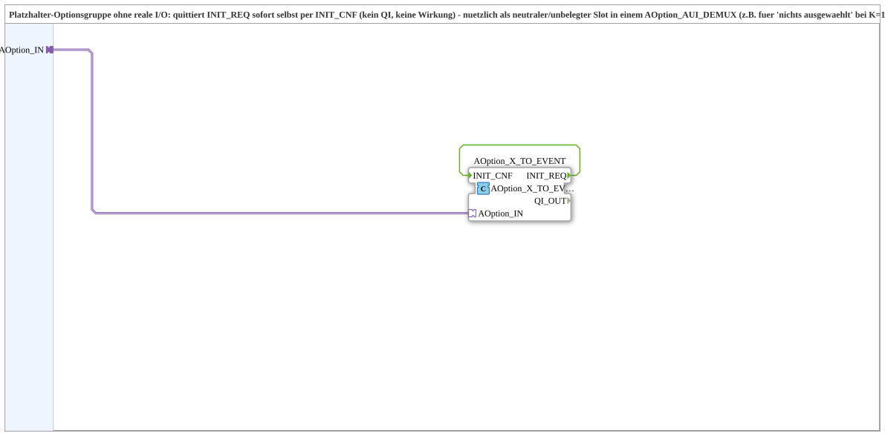

# DummyGroup

* * * * * * * * * *

## Introduction

`DummyGroup` is a placeholder option group without real I/O. It acknowledges `INIT_REQ` immediately by itself with `INIT_CNF` (no `QI` effect, no action). It serves as a neutral, unassigned slot in an `AOption_AUI_DEMUX`, e.g. for "nothing selected" at `K=1` when real options only start at `K=2`. This avoids an override literal for "which number means off".

## Used Function Blocks (FBs)

### Sub-blocks: DummyGroup

- **Type**: SubAppType
- **Interface**: socket `OPTION` of type `Option::AOption`.
- **Internal FBs used**:
    - **AOption_X_TO_EVENT**: `Option::conversion::AOption_X_TO_EVENT`.

## Program Flow and Connections

- `OPTION` -> `AOption_X_TO_EVENT.AOption_IN`
- `AOption_X_TO_EVENT.INIT_REQ` -> `AOption_X_TO_EVENT.INIT_CNF` (self-acknowledgement)

`QI_OUT` remains unused.

## Technical Features

- No I/O blocks, no effect on the application.

## Application Scenarios

- Neutral slot in an option DEMUX, e.g. `AOption_AUI_DEMUX_n`.

## Summary

`DummyGroup` is an option group without effect that acknowledges requests immediately.

## 🛠️ Related Exercises

- [Uebung_094b2_AX](https://meisterschulen-am-ostbahnhof-munchen-docs.readthedocs.io/projects/4diac-exercises-docs/en/latest/Uebungen/test_AX/Uebungen_doc/Uebung_094b2_AX/)
- [Uebung_094b3_AX](https://meisterschulen-am-ostbahnhof-munchen-docs.readthedocs.io/projects/4diac-exercises-docs/en/latest/Uebungen/test_AX/Uebungen_doc/Uebung_094b3_AX/)
- [Uebung_094b3b_AX](https://meisterschulen-am-ostbahnhof-munchen-docs.readthedocs.io/projects/4diac-exercises-docs/en/latest/Uebungen/test_AX/Uebungen_doc/Uebung_094b3b_AX/)

