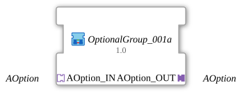

# OptionalGroup_001a

* * * * * * * * * *

## Introduction

`OptionalGroup_001a` is a SubApp (library `MyLib_AX_Option`): option group 1a. Like [`OptionalGroup_001b`](OptionalGroup_001b.md), its digital input `Input_I1` and digital output `Output_Q1` (logiBUS) are enabled via the option adapter. In addition, the group passes the activation on through the plug `PLUG1` to a downstream group - for sequential activation of several groups (first 1a, then 1b).

## Used Function Blocks (FBs)

### Sub-blocks: OptionalGroup_001a

- **Type**: SubAppType
- **Interface**: socket `OPTION` of type `Option::AOption` (adapter input) and plug `PLUG1` of type `Option::AOption` (adapter output).
- **Internal FBs used**:
    - **AOption_X_TO_EVENT**: `Option::conversion::AOption_X_TO_EVENT`, converts the adapter at the socket into `INIT_REQ`/`QI_OUT`/`INIT_CNF`.
    - **DigitalInput_I1**: `logiBUS::io::DI::logiBUS_IXA`, parameter `Input = Input_I1`.
    - **DigitalOutput_Q1**: `logiBUS::io::DQ::logiBUS_QXA`, parameter `Output = Output_Q1`.
    - **AOption_EVENT_TO_X**: `Option::conversion::AOption_EVENT_TO_X`, converts `INIT_REQ`/`QI_OUT` into the adapter at the plug `PLUG1` and reports `INIT_CNF` back.

## Program Flow and Connections

- `OPTION` -> `AOption_X_TO_EVENT.AOption_IN`
- Init chain: `AOption_X_TO_EVENT.INIT_REQ` -> `DigitalInput_I1.INIT`; `DigitalInput_I1.INITO` -> `DigitalOutput_Q1.INIT`; `DigitalOutput_Q1.INITO` -> `AOption_EVENT_TO_X.INIT_REQ`; `AOption_EVENT_TO_X.INIT_CNF` -> `AOption_X_TO_EVENT.INIT_CNF`
- `AOption_X_TO_EVENT.QI_OUT` -> `DigitalInput_I1.QI`, `DigitalOutput_Q1.QI` and `AOption_EVENT_TO_X.QI_OUT`
- `AOption_EVENT_TO_X.AOption_OUT` -> `PLUG1`
- Adapter connection `DigitalInput_I1.IN` -> `DigitalOutput_Q1.OUT`: the input is routed through to the output.

## Technical Features

- `PLUG1` is only triggered once `DigitalOutput_Q1` itself is initialized (`DigitalOutput_Q1.INITO` -> `AOption_EVENT_TO_X.INIT_REQ`).
- Its `INIT_CNF` is reported back to the own socket `OPTION` of the group. The calling DEMUX therefore only sees the group as done once the entire chain (including downstream groups at `PLUG1`) has acknowledged.
- The `QI` of the group is passed on to input, output and the plug `PLUG1`.

## Application Scenarios

- First link of a daisy chain: `PLUG1` is connected to the socket of a downstream group such as [`OptionalGroup_001b`](OptionalGroup_001b.md), so both groups are activated one after the other (first a, then b).

## Summary

`OptionalGroup_001a` bundles `Input_I1` and `Output_Q1` into an option group switchable via `AOption` and passes the activation on to the next group via `PLUG1`.

## 🛠️ Related Exercises

- [Uebung_094b3c_AX](https://meisterschulen-am-ostbahnhof-munchen-docs.readthedocs.io/projects/4diac-exercises-docs/en/latest/Uebungen/test_AX/Uebungen_doc/Uebung_094b3c_AX/)
