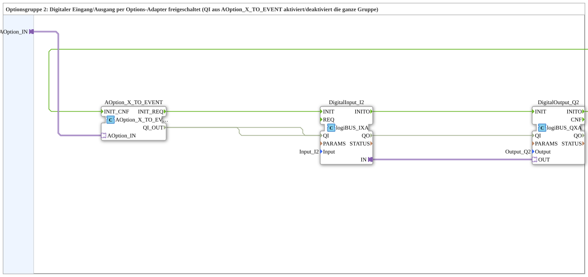
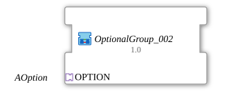

# OptionalGroup_002

* * * * * * * * * *

## Introduction

`OptionalGroup_002` is a SubApp (library `MyLib_AX_Option`): option group 2, whose digital input `Input_I2` and digital output `Output_Q2` (logiBUS) are enabled via the option adapter. The `QI` from [`AOption_X_TO_EVENT`](../../Option/conversion/AOption_X_TO_EVENT.md) activates or deactivates the whole group.

## Used Function Blocks (FBs)

### Sub-blocks: OptionalGroup_002

- **Type**: SubAppType
- **Interface**: socket `OPTION` of type `Option::AOption`.
- **Internal FBs used**:
    - **AOption_X_TO_EVENT**: `Option::conversion::AOption_X_TO_EVENT`, converts the adapter into `INIT_REQ`/`QI_OUT`/`INIT_CNF`.
    - **DigitalInput_I2**: `logiBUS::io::DI::logiBUS_IXA`, parameter `Input = Input_I2`.
    - **DigitalOutput_Q2**: `logiBUS::io::DQ::logiBUS_QXA`, parameter `Output = Output_Q2`.

## Program Flow and Connections

- `OPTION` -> `AOption_X_TO_EVENT.AOption_IN`
- Init chain: `AOption_X_TO_EVENT.INIT_REQ` -> `DigitalInput_I2.INIT`; `DigitalInput_I2.INITO` -> `DigitalOutput_Q2.INIT`; `DigitalOutput_Q2.INITO` -> `AOption_X_TO_EVENT.INIT_CNF`
- `AOption_X_TO_EVENT.QI_OUT` -> `DigitalInput_I2.QI` and `DigitalOutput_Q2.QI`
- Adapter connection `DigitalInput_I2.IN` -> `DigitalOutput_Q2.OUT`: the input is routed through to the output.

## Technical Features

- The initialization (input, then output) is only acknowledged to the plug once both blocks are done.
- The group's `QI` is passed on to the `QI` of input and output.

## Application Scenarios

- Optional digital input/output that is switched on or off by a selection block such as [`AOption_AD_DEMUX_2`](../../Option/selection/AOption_AD_DEMUX_2.md).

## Summary

`OptionalGroup_002` bundles `Input_I2` and `Output_Q2` into an option group that can be switched on and off via `AOption`.

## 🛠️ Related Exercises

- [Uebung_094b2_AX](https://meisterschulen-am-ostbahnhof-munchen-docs.readthedocs.io/projects/4diac-exercises-docs/en/latest/Uebungen/test_AX/Uebungen_doc/Uebung_094b2_AX/)
- [Uebung_094b3_AX](https://meisterschulen-am-ostbahnhof-munchen-docs.readthedocs.io/projects/4diac-exercises-docs/en/latest/Uebungen/test_AX/Uebungen_doc/Uebung_094b3_AX/)
- [Uebung_094b3b_AX](https://meisterschulen-am-ostbahnhof-munchen-docs.readthedocs.io/projects/4diac-exercises-docs/en/latest/Uebungen/test_AX/Uebungen_doc/Uebung_094b3b_AX/)
- [Uebung_094b4_AX](https://meisterschulen-am-ostbahnhof-munchen-docs.readthedocs.io/projects/4diac-exercises-docs/en/latest/Uebungen/test_AX/Uebungen_doc/Uebung_094b4_AX/)
- [Uebung_094b4b_AX](https://meisterschulen-am-ostbahnhof-munchen-docs.readthedocs.io/projects/4diac-exercises-docs/en/latest/Uebungen/test_AX/Uebungen_doc/Uebung_094b4b_AX/)
- [Uebung_094b5_AX](https://meisterschulen-am-ostbahnhof-munchen-docs.readthedocs.io/projects/4diac-exercises-docs/en/latest/Uebungen/test_AX/Uebungen_doc/Uebung_094b5_AX/)
- [Uebung_094b5b_AX](https://meisterschulen-am-ostbahnhof-munchen-docs.readthedocs.io/projects/4diac-exercises-docs/en/latest/Uebungen/test_AX/Uebungen_doc/Uebung_094b5b_AX/)
- [Uebung_094b_AX](https://meisterschulen-am-ostbahnhof-munchen-docs.readthedocs.io/projects/4diac-exercises-docs/en/latest/Uebungen/test_AX/Uebungen_doc/Uebung_094b_AX/)
- [Uebung_094c2_AX](https://meisterschulen-am-ostbahnhof-munchen-docs.readthedocs.io/projects/4diac-exercises-docs/en/latest/Uebungen/test_AX/Uebungen_doc/Uebung_094c2_AX/)
- [Uebung_094c2b_AX](https://meisterschulen-am-ostbahnhof-munchen-docs.readthedocs.io/projects/4diac-exercises-docs/en/latest/Uebungen/test_AX/Uebungen_doc/Uebung_094c2b_AX/)
- [Uebung_094c_AX](https://meisterschulen-am-ostbahnhof-munchen-docs.readthedocs.io/projects/4diac-exercises-docs/en/latest/Uebungen/test_AX/Uebungen_doc/Uebung_094c_AX/)

