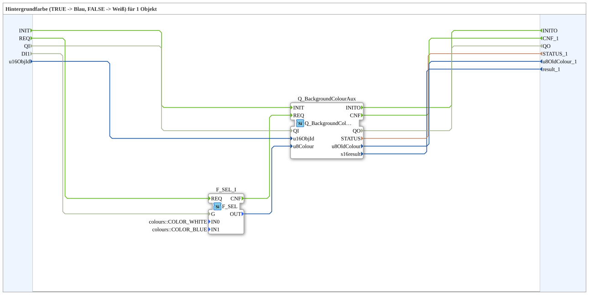

# GreenBlueBackground1_aux

* * * * * * * * * *

## Introduction

`GreenBlueBackground1_aux` switches the VT background color of one object based on a boolean selector signal: `TRUE` → **Blau**, `FALSE` → **Weiß**. The selector signal arrives as a plain `BOOL` data input (`DI1`). The object ID is passed via input `u16ObjId`.

For the general pattern (selector → `AX_SEL`/`F_SEL` → `Q_BackgroundColour`), see [Background Color Blocks (shared pattern)](../../MyLib_AX/sys/Background-Color-Blocks.md).

## Interface: Initialization and Quality

- **INIT** (event input, `EInit`) → `Q_BackgroundColourAux.INIT`; `Q_BackgroundColourAux.INITO` → **INITO** (event output, `EInit`).
- **QI** (data input, `BOOL`, default `TRUE`): Quality Input - `TRUE` enables the service; passed through to `Q_BackgroundColourAux.QI`.
- **QO** (data output, `BOOL`): Quality Output - `TRUE` if the service executed successfully; comes from `Q_BackgroundColourAux.QO`.

## Summary

One of many variants in the background color block family: color pair Blau/Weiß, 1 object, BOOL selector.

---

### 🌐 Related topic subpages on ms-muc-docs.de

- [🌐 Eclipse 4diac IDE & color reference on ms-muc-docs.de](https://www.ms-muc-docs.de/iec-61499/eclipse-4diac/)
