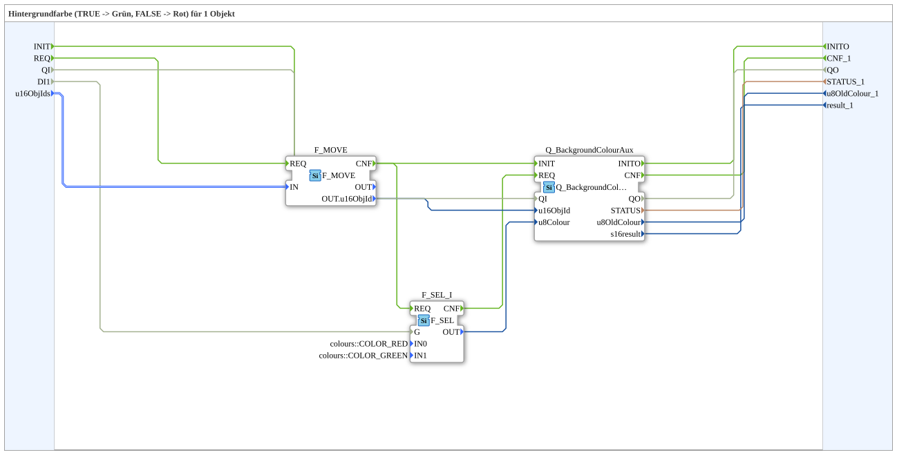

# GreenRedBackground1_auxS

* * * * * * * * * *

## Introduction

`GreenRedBackground1_auxS` switches the VT background color of one object based on a boolean selector signal: `TRUE` → **Grün**, `FALSE` → **Rot**. The selector signal arrives as a plain `BOOL` data input (`DI1`). The object ID is passed via the structured type `s1ObjectID` (`u16ObjIds`).

For the general pattern (selector → `AX_SEL`/`F_SEL` → `Q_BackgroundColour`), see [Background Color Blocks (shared pattern)](../../MyLib_AX/sys/Background-Color-Blocks.md).

**Quality ports:** The block additionally has the event `INIT` (input) and `INITO` (output), the data input `QI` (BOOL, default `TRUE`, "Quality Input - TRUE to enable service") and the data output `QO` (BOOL, "Quality Output - TRUE if service executed successfully"). `INIT` is passed on to `Q_BackgroundColourAux.INIT`, `Q_BackgroundColourAux.INITO` is passed to `INITO`; `QI` is connected to `Q_BackgroundColourAux.QI` and `Q_BackgroundColourAux.QO` to `QO`.

## Summary

One of many variants in the background color block family: color pair Grün/Rot, 1 object, BOOL selector, struct. object ID.

---

### 🌐 Related topic subpages on ms-muc-docs.de

* [🌐 Eclipse 4diac IDE & color reference on ms-muc-docs.de](https://www.ms-muc-docs.de/iec-61499/eclipse-4diac/)
