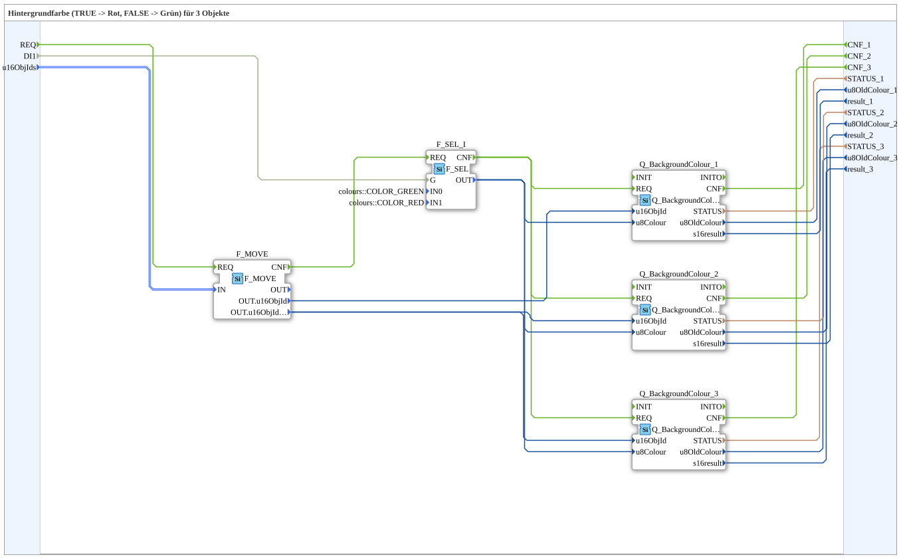

# GreenRedBackground3S

* * * * * * * * * *

## Introduction

`GreenRedBackground3S` switches the VT background color of 3 objects based on a boolean selector signal: `TRUE` → **Rot**, `FALSE` → **Grün**. The selector signal arrives as a plain `BOOL` data input (`DI1`). The object ID is passed via the structured type `s1ObjectID` (`u16ObjIds`).

| Position | Object ID source       | Block                                               |
| -------- | ---------------------- | --------------------------------------------------- |
| 1        | `F_MOVE.OUT.u16ObjId`  | `Q_BackgroundColour` (regular object)               |
| 2        | `F_MOVE.OUT.u16ObjIdA` | `Q_BackgroundColour` (regular object)               |
| 3        | `F_MOVE.OUT.u16ObjIdA` | `Q_BackgroundColourAux` (auxiliary function object) |

**Initialization and quality:** In addition to the previous events, the block has the event input `INIT`, the event output `INITO`, as well as `QI` (BOOL, input, initial value `TRUE`) and `QO` (BOOL, output, AND of all instances). Init chain: `INIT` → `Q_BackgroundColour_1` → `Q_BackgroundColour_2` → `Q_BackgroundColour_3` → `INITO` (each `INITO` → next `INIT`). `QI` is passed on to all `Q_BackgroundColour_n.QI`. `QO` is formed by `AND_QO` (`iec61131::booleanOperators::AND_BOOL_3`): `Q_BackgroundColour_1.QO` → `AND_QO.IN1`, `Q_BackgroundColour_2.QO` → `AND_QO.IN2`, `Q_BackgroundColour_3.QO` → `AND_QO.IN3`, `AND_QO.OUT` → `QO`. `E_MERGE_QO` (`E_MERGE_4`) merges `Q_BackgroundColour_3.INITO` and the `CNF` outputs `Q_BackgroundColour_1.CNF`, `Q_BackgroundColour_2.CNF`, `Q_BackgroundColour_3.CNF`; `E_MERGE_QO.EO` triggers `AND_QO.REQ`.

For the general pattern (selector → `AX_SEL`/`F_SEL` → `Q_BackgroundColour`), see [Background Color Blocks (shared pattern)](../../MyLib_AX/sys/Background-Color-Blocks.md).

## Summary

One of many variants in the background color block family: color pair Rot/Grün, 3 objects, BOOL selector, struct. object ID.

---

### 🌐 Related topic subpages on ms-muc-docs.de

* [🌐 Eclipse 4diac IDE & color reference on ms-muc-docs.de](https://www.ms-muc-docs.de/iec-61499/eclipse-4diac/)
