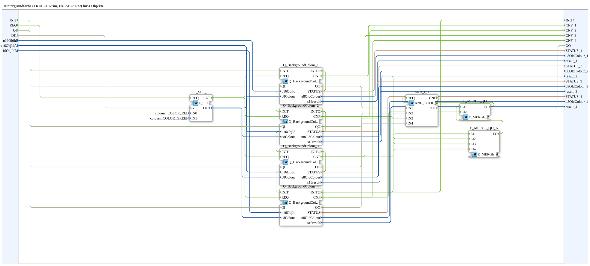

# GreenRedBackground4

* * * * * * * * * *

## Introduction

`GreenRedBackground4` switches the VT background color of 4 objects based on a boolean selector signal: `TRUE` → **Grün**, `FALSE` → **Rot**. The selector signal arrives as a plain `BOOL` data input (`DI1`). The object ID is passed via inputs `u16ObjId, u16ObjIdA, u16ObjIdB`.

| Position | Object ID source | Block                                               |
| -------- | ---------------- | --------------------------------------------------- |
| 1        | `u16ObjId`       | `Q_BackgroundColour` (regular object)               |
| 2        | `u16ObjIdA`      | `Q_BackgroundColour` (regular object)               |
| 3        | `u16ObjIdA`      | `Q_BackgroundColourAux` (auxiliary function object) |
| 4        | `u16ObjIdB`      | `Q_BackgroundColour` (regular object)               |

For the general pattern (selector → `AX_SEL`/`F_SEL` → `Q_BackgroundColour`), see [Background Color Blocks (shared pattern)](../../MyLib_AX/sys/Background-Color-Blocks.md).

## Initialization and Quality

- **Event input `INIT`** (`EInit`) and **event output `INITO`** (`EInit`): initialization is chained through the `Q_BackgroundColour` instances: `INIT` → `Q_BackgroundColour_1.INIT`; `Q_BackgroundColour_1.INITO` → `Q_BackgroundColour_2.INIT`; `Q_BackgroundColour_2.INITO` → `Q_BackgroundColour_3.INIT`; `Q_BackgroundColour_3.INITO` → `Q_BackgroundColour_4.INIT`; `Q_BackgroundColour_4.INITO` → `INITO`.
- **Data input `QI`** (`BOOL`, default `TRUE`) is distributed to `.QI` of all instances (`Q_BackgroundColour_1`, `Q_BackgroundColour_2`, `Q_BackgroundColour_3`, `Q_BackgroundColour_4`).
- **Data output `QO`** (`BOOL`): AND of all instances via `AND_QO` (`iec61131::booleanOperators::AND_BOOL_4`): `Q_BackgroundColour_1.QO` → `AND_QO.IN1`, `Q_BackgroundColour_2.QO` → `AND_QO.IN2`, `Q_BackgroundColour_3.QO` → `AND_QO.IN3`, `Q_BackgroundColour_4.QO` → `AND_QO.IN4`; `AND_QO.OUT` → `QO`.
- `E_MERGE_QO_A` (`iec61499::events::E_MERGE_4`) merges `Q_BackgroundColour_4.INITO` and the `CNF` events of instances 1 to 3; `E_MERGE_QO` (`iec61499::events::E_MERGE_2`) merges its output `E_MERGE_QO_A.EO` with `Q_BackgroundColour_4.CNF` and thereby triggers `AND_QO.REQ`.

## Summary

One of many variants in the background color block family: color pair Grün/Rot, 4 objects, BOOL selector.

---

### 🌐 Related topic subpages on ms-muc-docs.de

- [🌐 Eclipse 4diac IDE & color reference on ms-muc-docs.de](https://www.ms-muc-docs.de/iec-61499/eclipse-4diac/)
