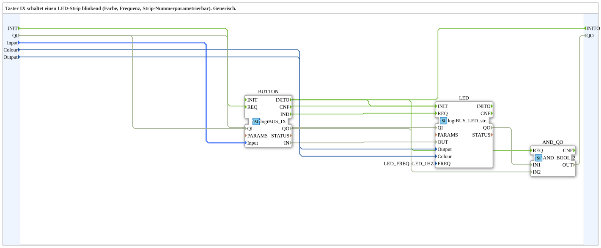

# IX_TO_logiBUS_LED_strip_QX

***

## Introduction

The `IX_TO_logiBUS_LED_strip_QX` is a generic subapplication that connects a logiBUS pushbutton input to a blinking LED strip output. It is designed for applications where a physical button should switch an LED strip on and off in a blinking mode. The color, the used input, and the target strip can be parameterized through the subapplication interface; initialization is exposed via `INIT`/`INITO` and the status via `QI`/`QO`.

The subapplication encapsulates the event handling and data routing, so it can be reused easily in larger 4diac-ide projects.

## Interface Structure

### **Event Inputs**

- `INIT` (`EInit`): Initialization Request

Apart from `INIT`, the subapplication does not expose any event inputs. The trigger is generated internally by the encapsulated pushbutton function block.

### **Event Outputs**

- `INITO` (`EInit`): Initialization Confirm

### **Data Inputs**

| Name | Type | Initial Value | Description |
|------|------|---------------|-------------|
| `QI` | `BOOL` | `TRUE` | Quality Input - TRUE enables the service. |
| `Input` | `logiBUS::io::DI::logiBUS_DI_S` | `logiBUS::io::DI::logiBUS_DI::Invalid` | Identifies the physical input, e.g. `Input_I1` to `Input_I8`. |
| `Colour` | `UINT` | `LED_COLOURS::LED_GREEN` | Identifies the color of the LED strip. |
| `Output` | `USINT` | — | Identifies the output number of the LED strip. |

### **Data Outputs**

- `QO` (`BOOL`): Quality Output - TRUE if the service executed successfully (AND of `LED.QO` and `BUTTON.QO`, via the `AND_QO` block of type `iec61131::booleanOperators::AND_BOOL_2`).

### **Adapters**

There are no adapters.

## Functionality

The subapplication contains two internal function blocks:

- `BUTTON` of type `logiBUS::io::DI::logiBUS_IX`
- `LED` of type `logiBUS::io::DO_LED::logiBUS_LED_strip_QX`

The `BUTTON` block monitors the selected physical input. When this input detects a signal change, the event output `IND` triggers the event input `REQ` of the `LED` block.

The data flow is as follows:

- The subapplication input `Input` selects the physical input for `BUTTON.Input`.
- The button value `BUTTON.IN` is forwarded to `LED.OUT`.
- The subapplication input `Output` selects the target LED strip via `LED.Output`.
- The subapplication input `Colour` sets the color via `LED.Colour`.

Initialization runs as a chain `INIT` → `LED.INIT`, `LED.INITO` → `BUTTON.INIT`, `BUTTON.INITO` → `INITO` (and additionally → `AND_QO.REQ`). `QI` is forwarded to `LED.QI` and `BUTTON.QI`; `LED.QO` and `BUTTON.QO` are ANDed into `QO`.

The internal LED block is configured with `FREQ = LED_FREQ::LED_1HZ`, so the selected LED strip blinks at a frequency of 1 Hz when triggered.

## Technical Features

- Generic subapplication for button-controlled blinking LED strips.
- Input selection via `logiBUS_DI_S`, with `Invalid` as a safe default.
- Color selection through `UINT` constants from `LED_COLOURS`.
- Output selection via `USINT`.
- Internal event connection: `BUTTON.IND -> LED.REQ`.
- Internal data forwarding is hidden in the subapplication network.
- Both internal blocks receive `QI` from the subapplication's `QI` input (default `TRUE`).
- Fixed blink frequency of 1 Hz.
- No external event wiring required apart from the optional `INIT`/`INITO` initialization chain.

## State Overview

The subapplication itself does not define an explicit state machine. Its behavior is determined by the encapsulated function blocks and the event connection between them.

At the subapplication level, the control flow can be described conceptually:

- **Idle state:** The button input is monitored; no LED request is active.
- **Trigger state:** A button event occurs at `BUTTON.IND` and triggers `LED.REQ`.
- **Return state:** After the request is processed, the subapplication returns to the idle state.

This simple event-driven behavior makes the subapplication easy to understand and integrate.

## Application Scenarios

Typical use cases include:

- Controlling blinking LED strips with standard pushbutton inputs.
- Reusing the same logic for multiple inputs and outputs by parameterizing `Input` and `Output`.
- Setting different LED colors by using constants from `LED_COLOURS`.
- Building modular logiBUS-based lighting control applications in 4diac-ide.
- Encapsulating frequently used button-to-LED logic in a clean, reusable subapplication.

## Comparison with Similar Blocks

| Approach | Characteristics |
|---------|-----------------|
| Direct wiring of `logiBUS_IX` to `logiBUS_LED_strip_QX` | More wiring effort, manual event connection, no encapsulation. |
| Subapplication with exposed event inputs | Allows external triggering, but requires additional event handling. |
| Subapplication with adjustable frequency input | Offers configurable blink frequency, but has a larger interface. |
| `IX_TO_logiBUS_LED_strip_QX` | Self-contained button-triggered blinking LED strip with fixed 1 Hz frequency and configurable input, color, and output. |

## Conclusion

The `IX_TO_logiBUS_LED_strip_QX` subapplication provides a compact, generic solution for button-controlled blinking LED strips. It hides the internal event and data wiring, exposes only the necessary parameters, and can be reused in multiple places within a logiBUS-based automation project. It is especially useful when a simple pushbutton should reliably trigger a configurable LED strip output.
