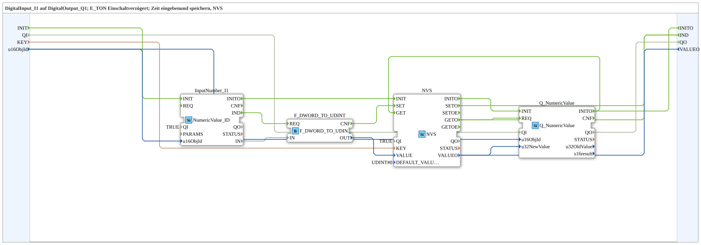

# NVS_IN_AND_STORE_UDINT

* * * * * * * * * *

## Introduction

`NVS_IN_AND_STORE_UDINT` persistently stores a UDINT value entered via the VT in ESP32 flash (NVS) instead of an INI file — otherwise identical to [`INI_IN_AND_STORE_UDINT`](./INI_IN_AND_STORE_UDINT.md).

For the general pattern, see [INI_IN_AND_STORE / NVS_IN_AND_STORE (shared pattern)](../../MyLib_AX/sys/INI-NVS-Storage-Blocks.md).

**Quality ports:** The block additionally has the data input `QI` (BOOL, default `TRUE`, "Quality Input - TRUE to enable service") and the data output `QO` (BOOL, "Quality Output - TRUE if service executed successfully"). `QI` is passed through to `Q_NumericValue.QI`, `InputNumber_I1.QI` and `NVS.QI` (the internal FBs no longer carry a fixed `QI=TRUE`). `QO` is the `AND` (`AND_QO`, `AND_BOOL_3`) of the `QO` outputs of `Q_NumericValue` (`IN1`), `InputNumber_I1` (`IN2`) and `NVS` (`IN3`); `AND_QO.REQ` is triggered by `Q_NumericValue.INITO` (in addition to `Q_NumericValue.INITO` → `INITO`).

## Summary

NVS counterpart to `INI_IN_AND_STORE_UDINT` (MyLib_B).

---

### 🌐 Related topic subpages on ms-muc-docs.de

* [🌐 Eclipse 4diac IDE & color reference on ms-muc-docs.de](https://www.ms-muc-docs.de/iec-61499/eclipse-4diac/)
