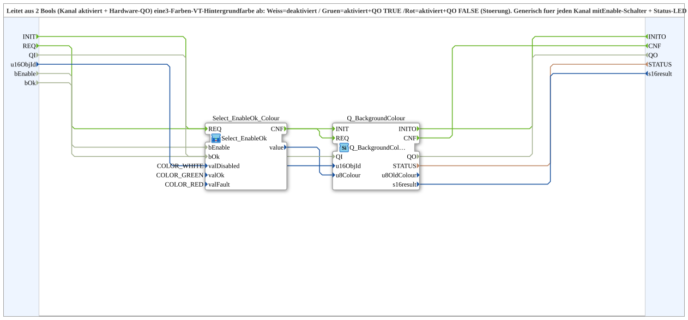

# Q_BackgroundColour_EnableOk

* * * * * * * * * *

## Introduction

`Q_BackgroundColour_EnableOk` derives a 3-color VT background color from 2 bools (channel enabled + hardware QO): white = disabled, green = enabled and QO TRUE, red = enabled and QO FALSE (fault). Generic for any channel with an enable switch + status LED (PWM, PI, ...). The pure selection logic now lives in [`Select_EnableOk`](./Select_EnableOk.md); this block just instantiates it with the 3 colors as parameters and attaches `Q_BackgroundColour`.

**Quality ports:** The block additionally has the event `INIT` (input) and `INITO` (output), the data input `QI` (BOOL, default `TRUE`, "Quality Input - TRUE to enable service") and the data output `QO` (BOOL, "Quality Output - TRUE if service executed successfully"). `INIT` is passed on to `Q_BackgroundColour.INIT`, `Q_BackgroundColour.INITO` is passed to `INITO`; `QI` is connected to `Q_BackgroundColour.QI` and `Q_BackgroundColour.QO` to `QO`.

## Function blocks used

- **Select_EnableOk_Colour** (SubApp, type `MyLib::sys::Select_EnableOk`): `valDisabled=COLOR_WHITE`, `valOk=COLOR_GREEN`, `valFault=COLOR_RED`.
- **Q_BackgroundColour** (`isobus::UT::Q::Q_BackgroundColour`): writes the computed color to `u16ObjId`.

## Summary

Ready-parameterized color logic (white/green/red) for enable+ok status displays, built on the generic `Select_EnableOk` selection.

---

### 🌐 Related topic subpages on ms-muc-docs.de

- [🌐 Eclipse 4diac IDE & color reference on ms-muc-docs.de](https://www.ms-muc-docs.de/iec-61499/eclipse-4diac/)
