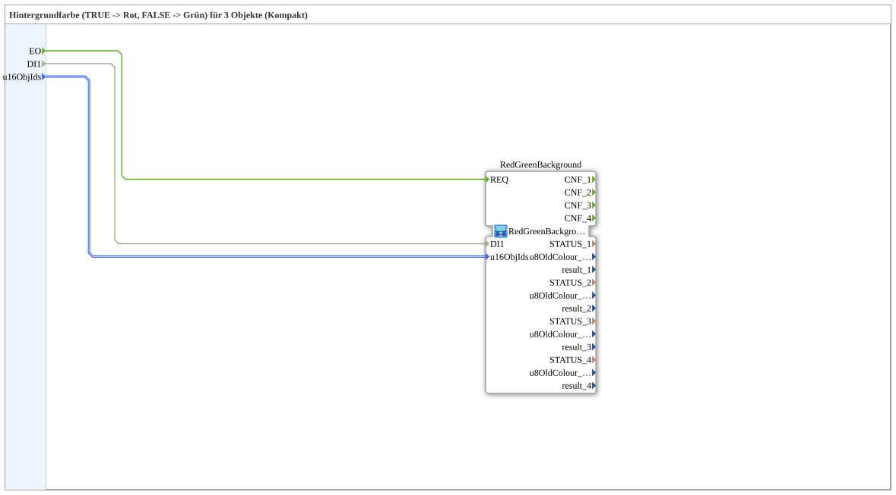

# RedGreenBackground4SC

* * * * * * * * * *

## Introduction

`RedGreenBackground4SC` is a **compact wrapper** around [`RedGreenBackground4S`](RedGreenBackground4S.md) — passes `u16ObjId`s and the selector straight through, without exposing the `CNF` event outputs and diagnostic values (`STATUS_n`, `u8OldColour_n`, `result_n`).

Interface (quality pattern): The wrapper additionally has the event input `INIT` and the event output `INITO` (each `EInit`) as well as the data input `QI` (`BOOL`, default `TRUE`) and the data output `QO` (`BOOL`). They are passed straight through to the inner instance `RedGreenBackground`: `INIT` → `RedGreenBackground.INIT`, `RedGreenBackground.INITO` → `INITO`, `QI` → `RedGreenBackground.QI`, `RedGreenBackground.QO` → `QO`.

For the shared pattern, see [Background Color Blocks (shared pattern)](../../MyLib_AX/sys/Background-Color-Blocks.md).

## Summary

A pure pass-through to `RedGreenBackground4S` for the common case where the diagnostic values aren't needed.

---

### 🌐 Related topic subpages on ms-muc-docs.de

* [🌐 Eclipse 4diac IDE & color reference on ms-muc-docs.de](https://www.ms-muc-docs.de/iec-61499/eclipse-4diac/)
