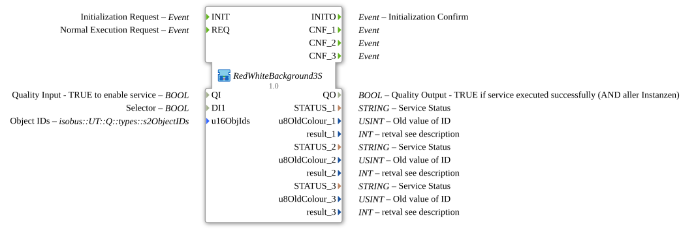

# RedWhiteBackground3S

* * * * * * * * * *

## Introduction

`RedWhiteBackground3S` switches the VT background color of 3 objects based on a boolean selector signal: `TRUE` → **Rot**, `FALSE` → **Weiß**. The selector signal arrives as a plain `BOOL` data input (`DI1`). The object ID is passed via the structured type `s2ObjectIDs` (`u16ObjIds`).

| Position | Object ID source       | Block                                               |
| -------- | ---------------------- | --------------------------------------------------- |
| 1        | `F_MOVE.OUT.u16ObjId`  | `Q_BackgroundColour` (regular object)               |
| 2        | `F_MOVE.OUT.u16ObjIdA` | `Q_BackgroundColour` (regular object)               |
| 3        | `F_MOVE.OUT.u16ObjIdA` | `Q_BackgroundColourAux` (auxiliary function object) |

For the general pattern (selector → `AX_SEL`/`F_SEL` → `Q_BackgroundColour`), see [Background Color Blocks (shared pattern)](../../MyLib_AX/sys/Background-Color-Blocks.md).

**Initialization and quality:** The SubApp has `INIT`/`INITO` and `QI`/`QO`. `INIT` → `Q_BackgroundColour_1.INIT` → `Q_BackgroundColour_2.INIT` → `Q_BackgroundColour_3.INIT` (each via `INITO`), `Q_BackgroundColour_3.INITO` → `INITO`. `QI` goes to all three instances. `QO` is the `AND` (`AND_QO`, `AND_BOOL_3`) of the three `QO` outputs; `AND_QO.REQ` is triggered via `E_MERGE_QO` (`E_MERGE_4`: `Q_BackgroundColour_3.INITO`, `Q_BackgroundColour_1.CNF`, `_2.CNF`, `_3.CNF`).

## Summary

One of many variants in the background color block family: color pair Rot/Weiß, 3 objects, BOOL selector, struct. object ID.

---

### 🌐 Related topic subpages on ms-muc-docs.de

* [🌐 Eclipse 4diac IDE & color reference on ms-muc-docs.de](https://www.ms-muc-docs.de/iec-61499/eclipse-4diac/)
