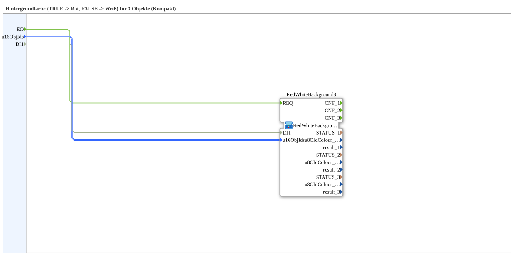

# RedWhiteBackground3SC

* * * * * * * * * *

## Introduction

`RedWhiteBackground3SC` is a **compact wrapper** around [`RedWhiteBackground3S`](RedWhiteBackground3S.md) — passes `u16ObjId`s and the selector straight through, without exposing the `CNF` event outputs and diagnostic values (`STATUS_n`, `u8OldColour_n`, `result_n`).

In addition, initialization and quality are passed through: `INIT` → `RedWhiteBackground3.INIT`, `RedWhiteBackground3.INITO` → `INITO`, `QI` (initial value `TRUE`) → `RedWhiteBackground3.QI` and `RedWhiteBackground3.QO` → `QO`.

For the shared pattern, see [Background Color Blocks (shared pattern)](../../MyLib_AX/sys/Background-Color-Blocks.md).

## Summary

A pure pass-through to `RedWhiteBackground3S` for the common case where the diagnostic values aren't needed.

---

### 🌐 Related topic subpages on ms-muc-docs.de

* [🌐 Eclipse 4diac IDE & color reference on ms-muc-docs.de](https://www.ms-muc-docs.de/iec-61499/eclipse-4diac/)
