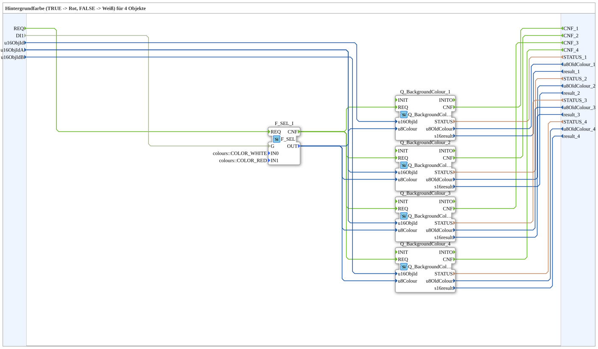
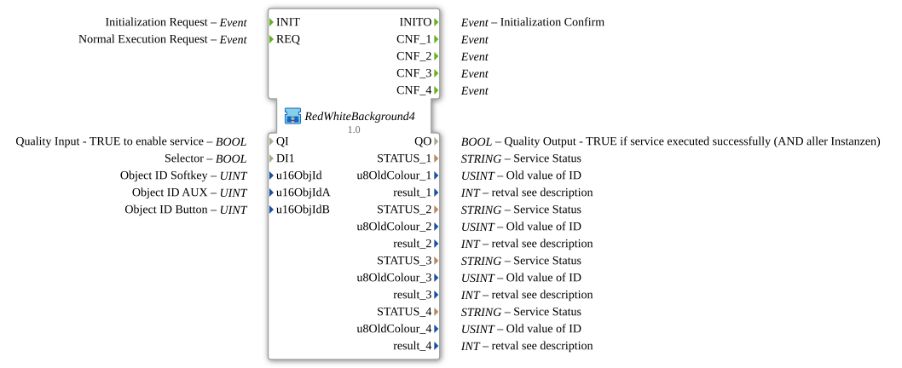

# RedWhiteBackground4

* * * * * * * * * *

## Introduction

`RedWhiteBackground4` switches the VT background color of 4 objects based on a boolean selector signal: `TRUE` → **Rot**, `FALSE` → **Weiß**. The selector signal arrives as a plain `BOOL` data input (`DI1`). The object ID is passed via inputs `u16ObjId, u16ObjIdA, u16ObjIdB`.

| Position | Object ID source | Block                                               |
| -------- | ---------------- | --------------------------------------------------- |
| 1        | `u16ObjId`       | `Q_BackgroundColour` (regular object)               |
| 2        | `u16ObjIdA`      | `Q_BackgroundColour` (regular object)               |
| 3        | `u16ObjIdA`      | `Q_BackgroundColourAux` (auxiliary function object) |
| 4        | `u16ObjIdB`      | `Q_BackgroundColour` (regular object)               |

For the general pattern (selector → `AX_SEL`/`F_SEL` → `Q_BackgroundColour`), see [Background Color Blocks (shared pattern)](../../MyLib_AX/sys/Background-Color-Blocks.md).

In addition, the block has the initialization and quality interface: event input `INIT`, event output `INITO`, data input `QI` (`BOOL`, initial value `TRUE`) and data output `QO` (`BOOL`). `INIT` → `Q_BackgroundColour_1.INIT`, `Q_BackgroundColour_1.INITO` → `Q_BackgroundColour_2.INIT`, `Q_BackgroundColour_2.INITO` → `Q_BackgroundColour_3.INIT`, `Q_BackgroundColour_3.INITO` → `Q_BackgroundColour_4.INIT`, `Q_BackgroundColour_4.INITO` → `INITO` (so the four instances are initialized one after another). `QI` is passed to `QI` of all four instances. `QO` is the output of the instance `AND_QO` (`iec61131::booleanOperators::AND_BOOL_4`), which combines the `QO` of the four instances. Its `REQ` is triggered by `E_MERGE_QO` (`E_MERGE_2`), which merges the output of `E_MERGE_QO_A` (`E_MERGE_4`: `Q_BackgroundColour_4.INITO` and the `CNF` of `Q_BackgroundColour_1` to `_3`) and `Q_BackgroundColour_4.CNF`.

## Summary

One of many variants in the background color block family: color pair Rot/Weiß, 4 objects, BOOL selector.

---

### 🌐 Related topic subpages on ms-muc-docs.de

* [🌐 Eclipse 4diac IDE & color reference on ms-muc-docs.de](https://www.ms-muc-docs.de/iec-61499/eclipse-4diac/)
