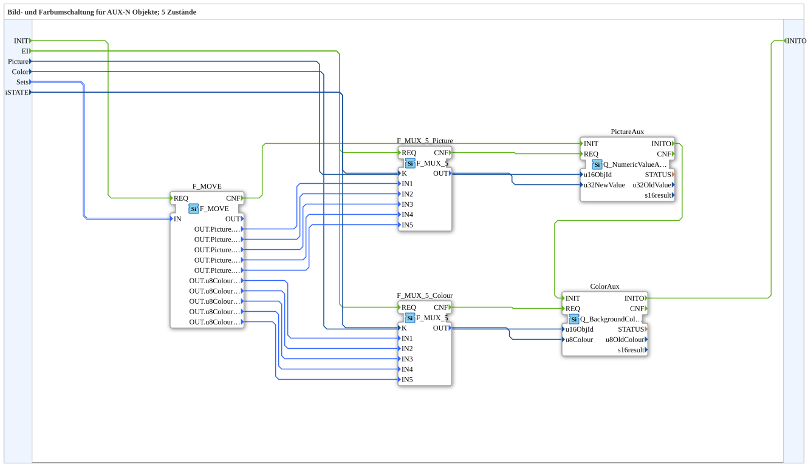

# SwitchPicCol_5_1_aux

* * * * * * * * * *

## Introduction

`SwitchPicCol_5_1_aux` switches both a picture and a background color between 5 states — like [`SwitchPicCol_5_1`](./SwitchPicCol_5_1.md), but exclusively for **auxiliary function** objects (`Q_NumericValueAux`/`Q_BackgroundColourAux`) instead of regular VT objects.

**Initialization and quality:** The SubApp has the event inputs `INIT` and `EI`, the event output `INITO` as well as `QI` (BOOL, initial value `TRUE`) and `QO` (BOOL). Init chain: `INIT` → `F_MOVE.REQ`, `F_MOVE.CNF` → `PictureAux.INIT`, `PictureAux.INITO` → `ColorAux.INIT`, `ColorAux.INITO` → `INITO`. `QI` is passed on to `PictureAux.QI` and `ColorAux.QI`; their `QO` outputs go to `AND_QO.IN1` and `AND_QO.IN2` respectively (`iec61131::booleanOperators::AND_BOOL_2`), `AND_QO.OUT` → `QO`. `AND_QO.REQ` is triggered by `E_MERGE_QO` (`E_MERGE_3`), which merges `ColorAux.INITO`, `PictureAux.CNF` and `ColorAux.CNF`.

For the general pattern, see [SwitchPic(Col) Blocks (shared pattern)](./SwitchPic-Blocks.md).

## Summary

AUX counterpart to [`SwitchPicCol_5_1`](./SwitchPicCol_5_1.md).

---

### 🌐 Related topic subpages on ms-muc-docs.de

* [🌐 Eclipse 4diac IDE & color reference on ms-muc-docs.de](https://www.ms-muc-docs.de/iec-61499/eclipse-4diac/)
