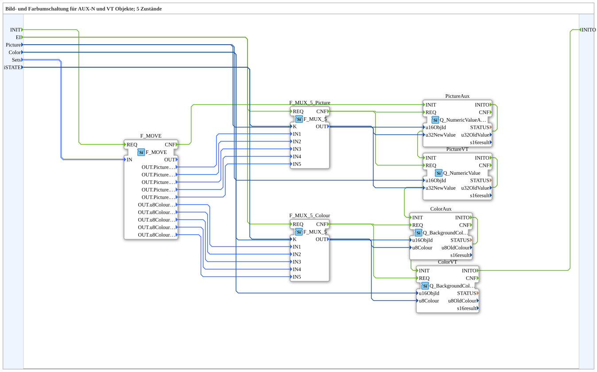

# SwitchPicCol_5_2

* * * * * * * * * *

## Introduction

`SwitchPicCol_5_2` switches both picture and background color between 5 states — on **four** targets at once: a regular picture object (`PictureVT`), an AUX picture object (`PictureAux`), a regular color object (`ColorVT`), and an AUX color object (`ColorAux`), all driven by the same two `F_MUX_5` multiplexers (picture/color).

For the general pattern, see [SwitchPic(Col) Blocks (shared pattern)](./SwitchPic-Blocks.md).

## Initialization and quality

The block has the event input `INIT`, the event output `INITO` (both `EInit`), the data input `QI` (`BOOL`, default `TRUE`) and the data output `QO` (`BOOL`). Initialization runs as a chain: `INIT` → `F_MOVE.REQ`, `F_MOVE.CNF` → `PictureAux.INIT`, `PictureAux.INITO` → `PictureVT.INIT`, `PictureVT.INITO` → `ColorAux.INIT`, `ColorAux.INITO` → `ColorVT.INIT`, `ColorVT.INITO` → `INITO`. `QI` is passed to `PictureAux`, `PictureVT`, `ColorAux` and `ColorVT`. `QO` is the output of the instance `AND_QO` (`iec61131::booleanOperators::AND_BOOL_4`), which combines their four `QO`. Its `REQ` is triggered by `E_MERGE_QO` (`E_MERGE_2`), which merges the output of `E_MERGE_QO_A` (`E_MERGE_4`, merges the `CNF` of `PictureAux`, `PictureVT`, `ColorAux` and `ColorVT`) and `ColorVT.INITO`.

## Summary

Extends [`SwitchPicCol_5_1`](./SwitchPicCol_5_1.md) with the AUX objects for both picture and color at once — the most extensive variant in the `SwitchPicCol` series.

---

### 🌐 Related topic subpages on ms-muc-docs.de

* [🌐 Eclipse 4diac IDE & color reference on ms-muc-docs.de](https://www.ms-muc-docs.de/iec-61499/eclipse-4diac/)
