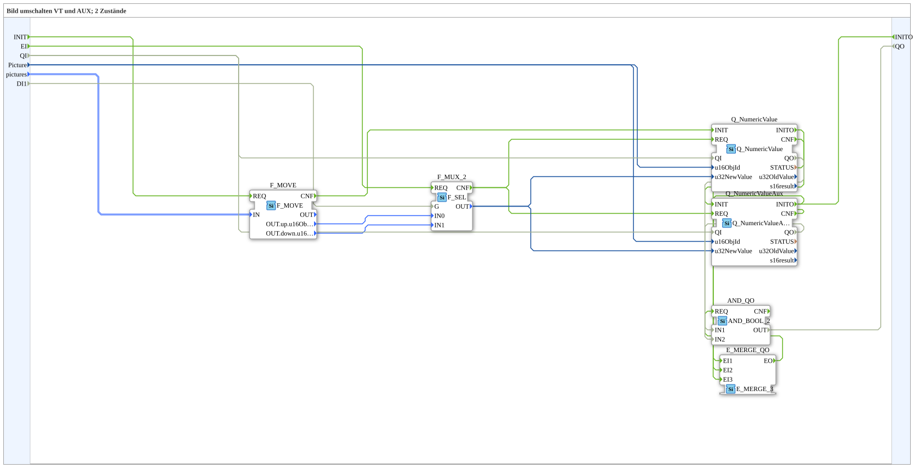

# SwitchPic_2_2

* * * * * * * * * *

## Introduction

`SwitchPic_2_2` switches a VT picture between 2 states (`up`/`down`) based on a boolean selector (`DI1`) — on both a regular VT object (`Picture`, `Q_NumericValue`) and simultaneously an **auxiliary function** object (`Q_NumericValueAux`), both sharing the same object ID (`Picture`).

For the general pattern, see [SwitchPic(Col) Blocks (shared pattern)](./SwitchPic-Blocks.md).

## Initialization and Quality

- **Event inputs** `INIT` (`EInit`) and `EI` (switch request); **event output** `INITO` (`EInit`).
- **Data input `QI`** (`BOOL`, default `TRUE`) → `Q_NumericValue.QI` and `Q_NumericValueAux.QI`; **data output `QO`** (`BOOL`): AND of `Q_NumericValue.QO` and `Q_NumericValueAux.QO` (`AND_QO`, `iec61131::booleanOperators::AND_BOOL_2`).
- Initialization: `INIT` → `F_MOVE.REQ`; `F_MOVE.CNF` → `Q_NumericValue.INIT`; `Q_NumericValue.INITO` → `Q_NumericValueAux.INIT`; `Q_NumericValueAux.INITO` → `INITO`.
- The `AND_QO.REQ` trigger comes from `E_MERGE_QO` (`iec61499::events::E_MERGE_3`), which merges `Q_NumericValueAux.INITO`, `Q_NumericValue.CNF` and `Q_NumericValueAux.CNF`.

## Summary

Variant "2" (regular object + AUX object) of the 2-state picture switch.

---

### 🌐 Related topic subpages on ms-muc-docs.de

- [🌐 Eclipse 4diac IDE & color reference on ms-muc-docs.de](https://www.ms-muc-docs.de/iec-61499/eclipse-4diac/)
