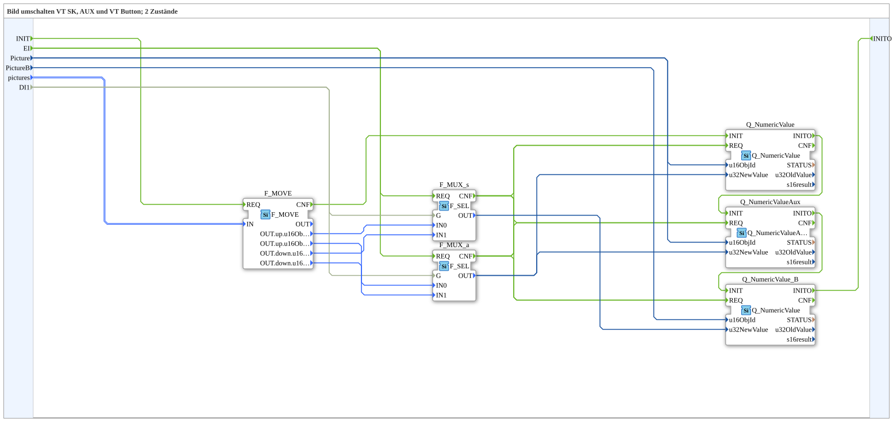

# SwitchPic_2_3

* * * * * * * * * *

## Introduction

`SwitchPic_2_3` switches a VT picture between 2 states (`up`/`down`) based on a boolean selector (`DI1`) — on three targets at once: a regular softkey object (`Picture`), an AUX object (same ID `Picture`), and a second, independent regular object ("button", `PictureB`, its own object-ID sub-field `u16ObjIdA` in the structure).

Interface (quality pattern): the data input `QI` (`BOOL`, default `TRUE`) is distributed to `Q_NumericValue`, `Q_NumericValueAux` and `Q_NumericValue_B`; the data output `QO` (`BOOL`) is the AND combination (`AND_QO`: `iec61131::booleanOperators::AND_BOOL_3`) of the `QO` outputs of these three instances (`IN1` to `IN3` in this order). The trigger `AND_QO.REQ` is supplied by `E_MERGE_QO` (`E_MERGE_4`), which merges `Q_NumericValue_B.INITO` and the `CNF` of `Q_NumericValue`, `Q_NumericValueAux` and `Q_NumericValue_B`.

For the general pattern, see [SwitchPic(Col) Blocks (shared pattern)](./SwitchPic-Blocks.md).

## Summary

Variant "3" (regular softkey object + AUX object + second regular button object) of the 2-state picture switch — the most extensive variant in the `SwitchPic_2_*` series.

---

### 🌐 Related topic subpages on ms-muc-docs.de

* [🌐 Eclipse 4diac IDE & color reference on ms-muc-docs.de](https://www.ms-muc-docs.de/iec-61499/eclipse-4diac/)
