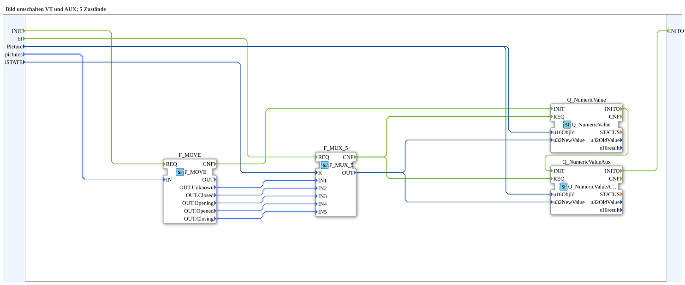

# SwitchPic_5_2

* * * * * * * * * *

## Introduction

`SwitchPic_5_2` switches a VT picture between 5 states (slide-valve animation) based on an `iSTATE` value — on both a regular VT object (`Picture`) and simultaneously an AUX object (same ID `Picture`).

For the general pattern, see [SwitchPic(Col) Blocks (shared pattern)](./SwitchPic-Blocks.md).

## Initialization and Status (INIT/INITO, QI/QO)

- **Event input** `INIT` (`EInit`) and **event output** `INITO` (`EInit`)
- **Data input** `QI` (`BOOL`, default `TRUE`, Quality Input) is forwarded to `Q_NumericValue.QI` and `Q_NumericValueAux.QI`
- **Data output** `QO` (`BOOL`, Quality Output): AND (`AND_QO`, type `iec61131::booleanOperators::AND_BOOL_2`) of the `QO` outputs of `Q_NumericValue` and `Q_NumericValueAux`
- **Initialization chain**: `INIT` → `F_MOVE.REQ`, `F_MOVE.CNF` → `Q_NumericValue.INIT`, `Q_NumericValue.INITO` → `Q_NumericValueAux.INIT`, `Q_NumericValueAux.INITO` → `INITO`
- `E_MERGE_QO` (type `iec61499::events::E_MERGE_3`) merges `Q_NumericValueAux.INITO`, `Q_NumericValue.CNF` and `Q_NumericValueAux.CNF` and triggers `AND_QO.REQ`

## Summary

5-state counterpart to [`SwitchPic_2_2`](./SwitchPic_2_2.md).

---

### 🌐 Related topic subpages on ms-muc-docs.de

- [🌐 Eclipse 4diac IDE & color reference on ms-muc-docs.de](https://www.ms-muc-docs.de/iec-61499/eclipse-4diac/)
