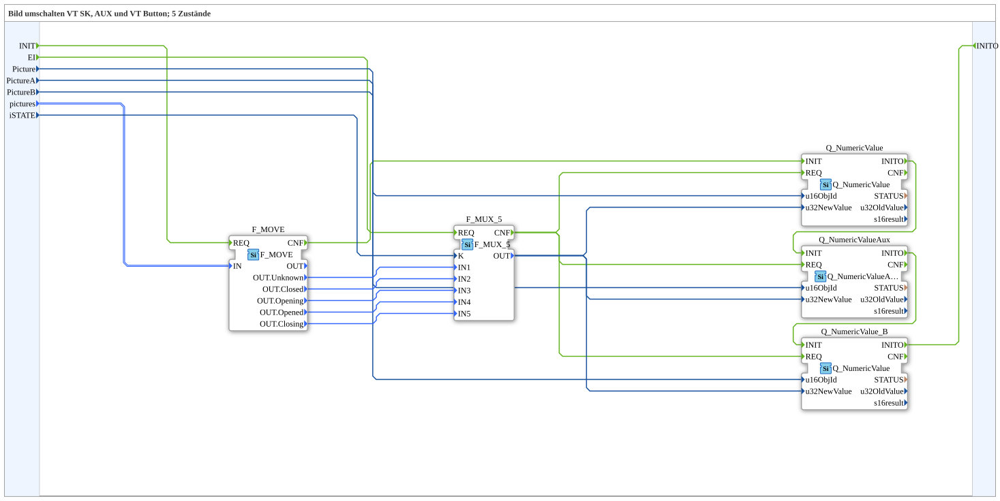

# SwitchPic_5_3

* * * * * * * * * *

## Introduction

`SwitchPic_5_3` switches a VT picture between 5 states (slide-valve animation) based on an `iSTATE` value — on three independent targets at once: a regular softkey object (`Picture`), an AUX object (`PictureA`), and a second regular button object (`PictureB`), each with its own object ID.

For the general pattern, see [SwitchPic(Col) Blocks (shared pattern)](./SwitchPic-Blocks.md).

**Initialization and quality:** `INIT` → `F_MOVE.REQ`; `F_MOVE.CNF` → `Q_NumericValue.INIT` → `Q_NumericValueAux.INIT` → `Q_NumericValue_B.INIT` (each via `INITO`); `Q_NumericValue_B.INITO` → `INITO`. New are `QI` (`BOOL`, default `TRUE`), which goes to all three `Q_NumericValue` instances, and `QO` (`BOOL`): `AND` (`AND_QO`, `AND_BOOL_3`) of the three `QO` outputs. `AND_QO.REQ` is triggered via `E_MERGE_QO` (`E_MERGE_4`: `Q_NumericValue_B.INITO`, `Q_NumericValue.CNF`, `Q_NumericValueAux.CNF`, `Q_NumericValue_B.CNF`).

## Summary

5-state counterpart to [`SwitchPic_2_3`](./SwitchPic_2_3.md) — the most extensive variant in the `SwitchPic_5_*` series.

---

### 🌐 Related topic subpages on ms-muc-docs.de

* [🌐 Eclipse 4diac IDE & color reference on ms-muc-docs.de](https://www.ms-muc-docs.de/iec-61499/eclipse-4diac/)
