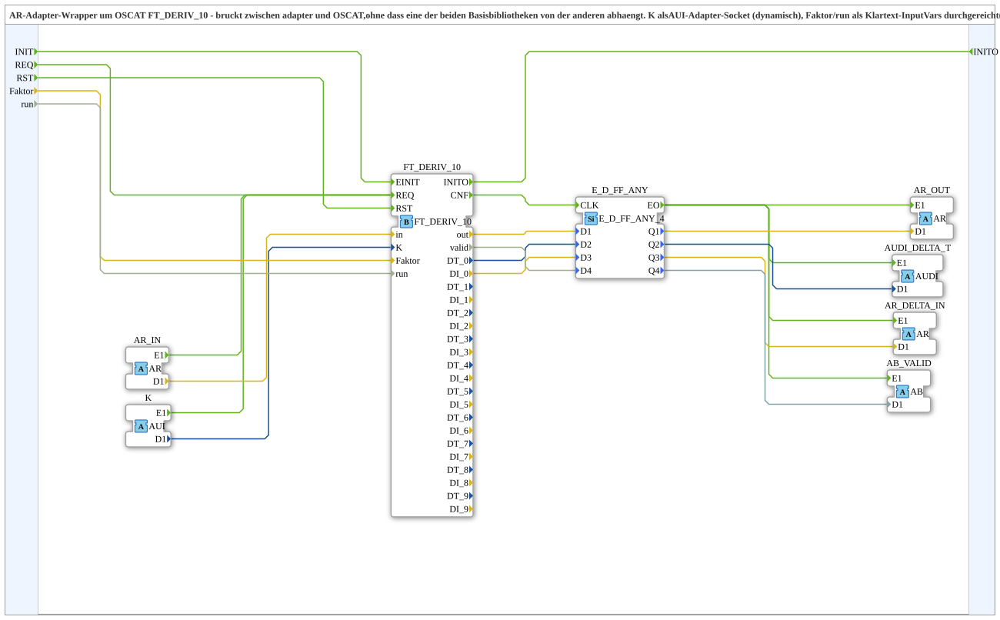

# FT_DERIV_10_AR

* * * * * * * * * *

## Introduction

`FT_DERIV_10_AR` is an AR adapter wrapper around the OSCAT block `OSCAT::Basic::POUs::Engineering::Control::FT_DERIV_10` (derivative with a selectable window of 1 to 10 periods). It bridges adapters and OSCAT without either base library depending on the other. Compared to [`FT_DERIV_AR`](./FT_DERIV_AR.md), the window `K` is a dynamic `AUI` adapter socket. `Faktor` and `run` remain plain input variables.

## Interface Structure

### **Event Inputs**

- **INIT** (`EInit`): Service initialization (passed through to `FT_DERIV_10.EINIT`)
- **REQ**: explicit execution request (passed through to `FT_DERIV_10.REQ`, in addition to `AR_IN.E1`/`K.E1`)
    - **Associated data**: `Faktor`, `run`
- **RST**: Reset of the derivative history (passed through to `FT_DERIV_10.RST`)

### **Event Outputs**

- **INITO** (`EInit`): Initialization confirmation (from `FT_DERIV_10.INITO`)

### **Data Inputs**

- **Faktor** (`REAL`, initial value `1.0`): Multiplication factor (passed through to `FT_DERIV_10.Faktor`)
- **run** (`BOOL`, initial value `TRUE`): Calculation active (passed through to `FT_DERIV_10.run`)

### **Data Outputs**

None. All result values are output via adapter plugs.

### **Adapters**

| Interface | Direction | Adapter type | Data type | Description |
| :--- | :--- | :--- | :--- | :--- |
| `AR_IN` | Socket | `AR` | `REAL` | Input signal |
| `K` | Socket | `AUI` | `UINT` | Window select (dynamic): 0 = 1 period, 9 = 10 periods |
| `AR_OUT` | Plug | `AR` | `REAL` | Calculated derivative (`FT_DERIV_10.out`, based on `K`) |
| `AR_DELTA_IN` | Plug | `AR` | `REAL` | Input signal difference over 1 period (`DI_0`) |
| `AUDI_DELTA_T` | Plug | `AUDI` | `UDINT` | Time difference in microseconds over 1 period (`DT_0`) |
| `AB_VALID` | Plug | `AB` | `BOOL` | Measurement validity (`FT_DERIV_10.valid`) |

## Function Blocks (FBs) Used

- **`FT_DERIV_10`** (`OSCAT::Basic::POUs::Engineering::Control::FT_DERIV_10`): derivative calculation, see [FT_DERIV_10](./FT_DERIV_10.md)
- **`E_D_FF_ANY`** (`iec61499::events::E_D_FF_ANY_4`): four-channel change filter/synchronisation of the results

## How it works

- `AR_IN.E1`, `K.E1` and `REQ` all lead to `FT_DERIV_10.REQ`
- `AR_IN.D1` → `FT_DERIV_10.in`; `K.D1` → `FT_DERIV_10.K`; `Faktor` → `FT_DERIV_10.Faktor`; `run` → `FT_DERIV_10.run`
- `INIT` → `FT_DERIV_10.EINIT`; `FT_DERIV_10.INITO` → `INITO`; `RST` → `FT_DERIV_10.RST`
- `FT_DERIV_10.CNF` → `E_D_FF_ANY.CLK`; the results `out`, `DT_0`, `DI_0`, `valid` go to `E_D_FF_ANY.D1` to `D4`
- `E_D_FF_ANY.Q1`…`Q4` → `AR_OUT.D1`, `AUDI_DELTA_T.D1`, `AR_DELTA_IN.D1`, `AB_VALID.D1`; `E_D_FF_ANY.EO` triggers `E1` of all four plugs

## Technical Details

- **Pure adapter boundary**: All main outputs of `FT_DERIV_10` are output as dedicated adapters; no plain event/data leaves the block (except `INITO`)
- **`K` as adapter** (version 1.2, 2026-10-03): `K.E1` triggers a calculation just like `AR_IN.E1`, `K.D1` supplies the value; `K` is therefore no longer bound to `REQ` via `With`
- **Explicit `REQ`** (version 1.1, 2026-09-20): bugfix so that `Faktor` and `run` are read reliably via a `With` binding (per IEC 61499, unbound variables are not read reliably); it also allows manual or periodic execution
- `FT_DERIV_10` is a pure OSCAT function without an adapter interface; the bridge lives in the third library project `OSCAT_adapter`

## Application Scenarios

- Frequency/speed calculation from a pulse counter value (`AR_IN`, e.g. from `AD_TO_AR_NUM.AR_OUT`) with a window selectable at runtime
- Passing the derivative on, e.g. to `CTRL_PID_AR.AR_ACT`

## Summary

`FT_DERIV_10_AR` encapsulates `FT_DERIV_10` behind a pure adapter interface with a dynamically selectable window `K` and provides derivative, input difference, time difference and validity as adapters.

## 🛠️ Related Exercises

- [Uebung_152_AX](https://meisterschulen-am-ostbahnhof-munchen-docs.readthedocs.io/projects/4diac-exercises-docs/en/latest/Uebungen/test_AX/Uebungen_doc/Uebung_152_AX/)
- [Uebung_153_AX](https://meisterschulen-am-ostbahnhof-munchen-docs.readthedocs.io/projects/4diac-exercises-docs/en/latest/Uebungen/test_AX/Uebungen_doc/Uebung_153_AX/)
