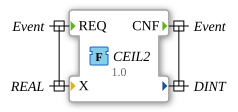

# CEIL2

* * * * * * * * * *

## Introduction

`CEIL2` is a rounding function from the OSCAT Basic library: it returns the smallest integer that is greater than or equal to `X` (rounding up). Compared with `CEIL`, the result is a `DINT`, so the function also works outside the `INT` range. Examples: `CEIL2(3.14) = 4`, `CEIL2(-3.14) = -3`. Ported from `OSCAT_basic CEIL2.TcPOU`.

## Interface Structure

### **Event Inputs**

- **REQ**: calculation request (associated with `X`)

### **Event Outputs**

- **CNF**: calculation confirmation (associated with the function result)

### **Data Inputs**

- **X** (REAL): value to be rounded

### **Data Outputs**

- **(function result)** (DINT): smallest integer `>= X`, limited to the `DINT` range

### **Adapters**

No adapters are used.

## Functionality

The function is implemented in Structured Text:

1. If `X >= 2147483647.0`, `2147483647` is returned.
2. If `X <= -2147483648.0`, `-2147483648` is returned.
3. Otherwise `CEIL2 := REAL_TO_DINT(X)` is calculated; if `DINT_TO_REAL(CEIL2) < X`, the result is increased by 1 (`CEIL2 := CEIL2 + 1`).

## Technical Details

- The range check protects against `DINT` overflow: values outside the `DINT` range are limited to the boundary values
- Pure function without state; integrated into the event network as a function block with `REQ`/`CNF`
- The output has no name of its own but is the return value of the function

## Application Scenarios

- Rounding up a measured or calculated quantity to the next integer, also for large magnitudes

## ⚖️ Comparison with Similar Blocks

[`FLOOR2`](FLOOR2.md) is the counterpart for rounding down (largest integer `<= X`).

## Conclusion

`CEIL2` rounds a `REAL` value up to the next integer and returns the result as a `DINT` with overflow protection.
