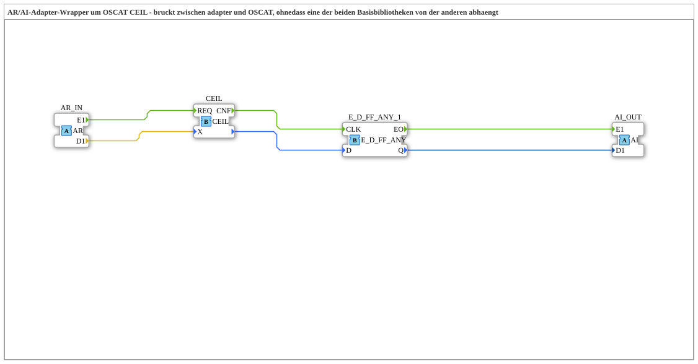

# CEIL_AR

* * * * * * * * * *

## Introduction

`CEIL_AR` is an adapter wrapper around `OSCAT::Basic::POUs::Mathematical::CEIL`. It connects the `AR` adapter with the OSCAT function `CEIL` and outputs the result as an `AI` adapter (smallest integer greater than or equal to X (INT)). The wrapper bridges the adapter and OSCAT libraries without either base library depending on the other.

## Interface Structure

### **Event Inputs**

No direct event inputs - events arrive via the adapter `AR_IN`.

### **Event Outputs**

No direct event outputs - events leave via the adapter `AI_OUT`.

### **Data Inputs**

None.

### **Data Outputs**

None.

### **Adapters**

- **AR_IN** (socket, `adapter::types::unidirectional::AR`): input signal (`REAL`)
- **AI_OUT** (plug, `adapter::types::unidirectional::AI`): smallest integer greater than or equal to X (INT)

## Function Blocks (FBs) Used

- **`CEIL`** (`OSCAT::Basic::POUs::Mathematical::CEIL`): rounding function, see [CEIL](./CEIL.md)
- **`E_D_FF_ANY_1`** (`iec61499::events::E_D_FF_ANY`): change filter

## Functionality

- `AR_IN.E1` → `CEIL.REQ`; `AR_IN.D1` → `CEIL.X`
- `CEIL.CNF` → `E_D_FF_ANY_1.CLK`; return value of `CEIL` → `E_D_FF_ANY_1.D`
- `E_D_FF_ANY_1.EO` → `AI_OUT.E1`; `E_D_FF_ANY_1.Q` → `AI_OUT.D1`

## Technical Details

- `E_D_FF_ANY_1` (standard library `events-3.0.0`) filters changes: `AI_OUT.E1` only fires when the result actually changed since the last call. Same pattern as the `FT_DERIV_AR`/`CTRL_PI_AR` wrappers.
- **Why a separate wrapper?** `CEIL` is a pure OSCAT `Function` without an adapter interface. `adapter` should not depend on `OSCAT` (and vice versa); the bridge therefore lives in the third library project `OSCAT_adapter`, which depends on both.

## Application Scenarios

- Rounding an `AR` signal in an adapter chain to an integer (`INT`)

## Summary

`CEIL_AR` rounds an `AR` value with `CEIL` and outputs the result as an `AI` adapter only when it changes.
