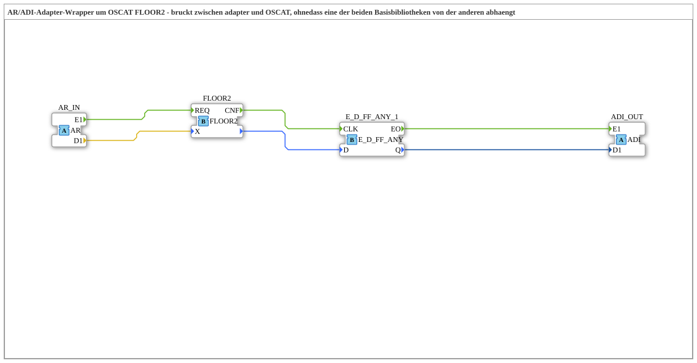

# FLOOR2_AR

* * * * * * * * * *

## Introduction

`FLOOR2_AR` is an AR/ADI adapter wrapper around the OSCAT function [`OSCAT::Basic::POUs::Mathematical::FLOOR2`](FLOOR2.md) (largest integer `<= X`, `DINT` variant of `FLOOR` for values outside the `INT` range). It bridges between adapters and OSCAT without either base library depending on the other.

## Interface Structure

### **Event Inputs**

The function block has no direct event inputs.

### **Event Outputs**

The function block has no direct event outputs.

### **Data Inputs**

The function block has no direct data inputs.

### **Data Outputs**

The function block has no direct data outputs.

### **Adapters**

- **AR_IN** (socket, `adapter::types::unidirectional::AR`): input signal (REAL)
- **ADI_OUT** (plug, `adapter::types::unidirectional::ADI`): largest integer `<= X` (DINT)

## Functionality

- `AR_IN.E1` → `FLOOR2.REQ` and `AR_IN.D1` → `FLOOR2.X`: every new input signal starts the calculation.
- `FLOOR2.CNF` → `E_D_FF_ANY_1.CLK`; the function result goes to `E_D_FF_ANY_1.D`.
- `E_D_FF_ANY_1` ([`iec61499::events::E_D_FF_ANY`](../../../../../StandardLibraries/events/E_D_FF_ANY.md)) filters changes: `E_D_FF_ANY_1.EO` → `ADI_OUT.E1` and `E_D_FF_ANY_1.Q` → `ADI_OUT.D1`, but only if the result has actually changed since the last call.

## Technical Details

- Change filter: `ADI_OUT.E1` fires only on an actual value change (same pattern as `CTRL_PI_AR`/`FT_DERIV_AR`)
- `FLOOR2` is a pure OSCAT function without an adapter interface; `adapter` should not depend on `OSCAT` (and vice versa), so the bridge lives in the third library project `OSCAT_adapter`

## Application Scenarios

- Rounding down an adapter-based REAL value to an integer (DINT) in an adapter network

## ⚖️ Comparison with Similar Blocks

`ROUND_AR` rounds to decimal places (REAL output); `FLOOR2_AR` returns the rounded-down integer as a DINT.

## Conclusion

`FLOOR2_AR` provides `FLOOR2` as an adapter block from `AR` to `ADI` and outputs the result only on change.
