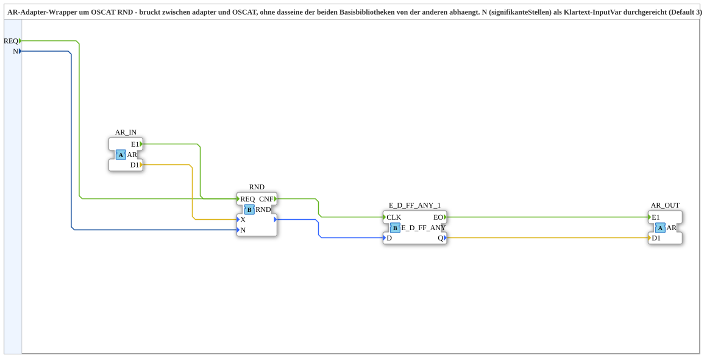

# RND_AR

* * * * * * * * * *

## Introduction

`RND_AR` is an AR adapter wrapper around the OSCAT function `OSCAT::Basic::POUs::Mathematical::RND` (rounds `X` to `N` **significant digits**, not to decimal places). It bridges adapters and OSCAT without either base library depending on the other. `N` is passed through as a plain input variable (default 3).

## Interface Structure

### **Event Inputs**

- **REQ**: explicit execution request (passed through to `RND.REQ`, in addition to `AR_IN.E1`)
    - **Associated data**: `N`

### **Event Outputs**

The function block has no direct event outputs.

### **Data Inputs**

- **N** (`INT`): Total significant digits, not decimal places (passed through to `RND.N`); placeholder default 3, no functional requirement, can be overridden via parameter

### **Data Outputs**

The function block has no direct data outputs.

### **Adapters**

- **AR_IN** (socket, `adapter::types::unidirectional::AR`): Input signal (`REAL`)
- **AR_OUT** (plug, `adapter::types::unidirectional::AR`): Value rounded to `N` significant digits (`REAL`)

## Function Blocks (FBs) Used

- **`RND`** (`OSCAT::Basic::POUs::Mathematical::RND`): rounding function, see [RND](./RND.md)
- **`E_D_FF_ANY_1`** ([`iec61499::events::E_D_FF_ANY`](../../../../../StandardLibraries/events/E_D_FF_ANY.md)): change filter

## How it works

- `AR_IN.E1` → `RND.REQ` and `AR_IN.D1` → `RND.X`; `N` → `RND.N`.
- `REQ` also leads to `RND.REQ`, in parallel to `AR_IN.E1`.
- `RND.CNF` → `E_D_FF_ANY_1.CLK`; the function result goes to `E_D_FF_ANY_1.D`.
- `E_D_FF_ANY_1.EO` → `AR_OUT.E1` and `E_D_FF_ANY_1.Q` → `AR_OUT.D1`, but only if the rounded result has actually changed since the last call.

## Technical Details

- The explicit `REQ` with `With N` was added as a bugfix in version 1.1 (2026-09-20): previously `N` was only passed to `RND` via a data connection and triggered solely via `AR_IN.E1`; since the wrapper had no event input, there was no `With` binding (per IEC 61499, unbound variables are not read reliably). `REQ` allows manual or periodic execution in addition to automatic triggering via `AR_IN.E1`
- Change filter: `AR_OUT.E1` fires only when the rounded value actually changes (same pattern as `CTRL_PI_AR`/`FT_DERIV_AR`, there using `E_D_FF_ANY_3`/`_4` for several values at once)
- `RND` is a pure OSCAT function without an adapter interface; `adapter` should not depend on `OSCAT` (and vice versa), so the bridge lives in the third library project `OSCAT_adapter`
- Difference to [`ROUND_AR`](./ROUND_AR.md): `RND_AR` rounds to significant digits, `ROUND_AR` to decimal places

## Application Scenarios

- Rounding an `AR` signal to a fixed number of significant digits in an adapter chain, e.g. for display values

## Summary

`RND_AR` rounds an `AR` value to `N` significant digits with `RND` and outputs the result as an `AR` adapter only when it changes.
