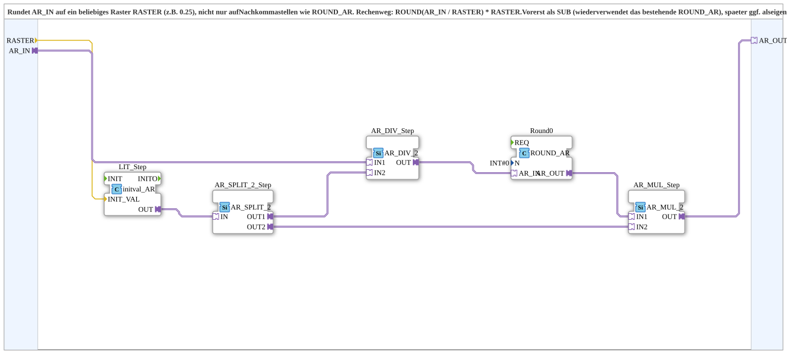

# ROUND_STEP_AR

* * * * * * * * * *

## Introduction

`ROUND_STEP_AR` rounds `AR_IN` to an **arbitrary grid** `RASTER` (e.g. 0.25), not only to decimal places like [`ROUND_AR`](./ROUND_AR.md). Calculation: `ROUND(AR_IN / RASTER) * RASTER`. The block is for now a SubApp that reuses the existing `ROUND_AR`; possibly a separate basic block later.

## Interface Structure

### **Event Inputs**

None.

### **Event Outputs**

None.

### **Data Inputs**

- **RASTER** (`REAL`): rounding grid, e.g. `0.25`. Placeholder default `1.0` (= rounding to an integer), can be overridden by parameter.

### **Data Outputs**

None.

### **Adapters**

- **AR_IN** (socket, `adapter::types::unidirectional::AR`): input signal (`REAL`)
- **AR_OUT** (plug, `adapter::types::unidirectional::AR`): value rounded to `RASTER` (`REAL`)

## Function Blocks (FBs) Used

- **`LIT_Step`** (`adapter::types::unidirectional::AR::initval::initval_AR`): creates a constant `AR` value from `RASTER`
- **`AR_SPLIT_2_Step`** (`adapter::events::unidirectional::AR_SPLIT_2`): fans `RASTER` out to the division and the multiplication (adapter fan-out is strictly 1:1)
- **`AR_DIV_Step`** (`adapter::iec61131::arithmetic::AR_DIV_2`): `AR_IN / RASTER`
- **`Round0`** (`OSCAT_adapter::Mathematical::ROUND_AR`, `N = 0`): rounds the quotient to an integer
- **`AR_MUL_Step`** (`adapter::iec61131::arithmetic::AR_MUL_2`): multiplies back by `RASTER`

## Functionality

- `RASTER` → `LIT_Step.INIT_VAL`; `LIT_Step.OUT` → `AR_SPLIT_2_Step.IN`
- `AR_IN` → `AR_DIV_Step.IN1`; `AR_SPLIT_2_Step.OUT1` → `AR_DIV_Step.IN2`
- `AR_DIV_Step.OUT` → `Round0.AR_IN`
- `Round0.AR_OUT` → `AR_MUL_Step.IN1`; `AR_SPLIT_2_Step.OUT2` → `AR_MUL_Step.IN2`
- `AR_MUL_Step.OUT` → `AR_OUT`

## Technical Details

- Rounding to a grid instead of decimal places
- `RASTER` is set by parameter at instantiation
- Example: `RASTER = 0.25` rounds to quarters

## Application Scenarios

- Rounding setpoints or display values to step sizes (e.g. 0.25, 0.5, 5)

## ⚖️ Comparison with Similar Building Blocks

- [`ROUND_AR`](./ROUND_AR.md) only rounds to `N` decimal places and is used internally here.

## Summary

`ROUND_STEP_AR` rounds an `AR` signal to a freely selectable grid.

---

### 🌐 Related topic pages on ms-muc-docs.de

- [🌐 Eclipse 4diac IDE & color reference on ms-muc-docs.de](https://www.ms-muc-docs.de/iec-61499/eclipse-4diac/)
