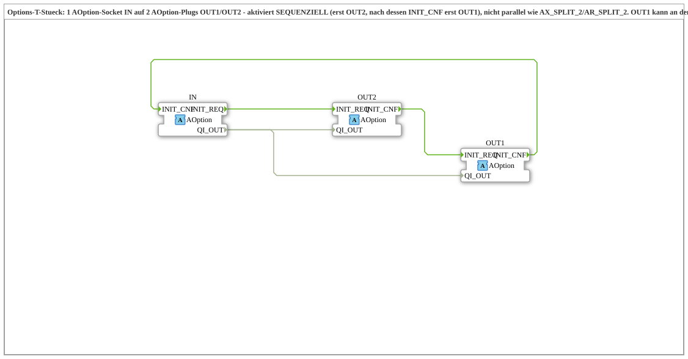

# AOption_T_2

* * * * * * * * * *

## Introduction

`AOption_T_2` is a composite FB that serves as a sequential **T-piece** for the option adapter [`AOption`](../AOption.md): it receives a single option request via the socket `IN` and activates two downstream option consumers (plugs `OUT2` and `OUT1`) **one after the other**, not in parallel. `OUT2` is addressed first, and only after its `INIT_CNF` does `OUT1` follow. `IN` is confirmed only once both outputs have confirmed.

## Interface Structure

### **Event Inputs**

None (the events travel via the adapters).

### **Event Outputs**

None.

### **Data Inputs**

None.

### **Data Outputs**

None.

### **Adapters**

| Adapter | Type | Direction | Comment |
|---------|------|-----------|---------|
| `IN` | `Option::AOption` | Socket | Fed by an AOption output (e.g. `DEMUX.OUTn`). |
| `OUT2` | `Option::AOption` | Plug | Activated first (`INIT_REQ` with `QI_OUT=TRUE`) or deactivated last (`QI_OUT=FALSE`). |
| `OUT1` | `Option::AOption` | Plug | Activated only after `OUT2.INIT_CNF`, or deactivated first; can be connected to the socket `IN` of another `AOption_T_2` for cascading. |

## Functionality

The internal network consists of connections only (no further FBs, no algorithms, no ECC):

Events:

- `IN.INIT_REQ` -> `OUT2.INIT_REQ`
- `OUT2.INIT_CNF` -> `OUT1.INIT_REQ`
- `OUT1.INIT_CNF` -> `IN.INIT_CNF`

Data:

- `IN.QI_OUT` -> `OUT2.QI_OUT`
- `IN.QI_OUT` -> `OUT1.QI_OUT`

A request at `IN` therefore triggers the chain `IN.INIT_REQ` -> `OUT2` -> (waits for `OUT2.INIT_CNF`) -> `OUT1` -> (waits for `OUT1.INIT_CNF`) -> `IN.INIT_CNF`. Deactivation uses the same wiring in the same order; `QI_OUT` then carries `FALSE` instead of `TRUE`. The event chain itself does not distinguish between activation and deactivation.

## Technical Features

- **Sequential instead of parallel:** The `*_SPLIT_2` blocks (e.g. `AX_SPLIT_2`, `AR_SPLIT_2`) forward an event or value in parallel to several outputs. `AOption_T_2` deliberately serializes the activation so that a group that depends on a previously activated group only starts once that group is actually done.
- **Cascadable:** `OUT1` can be connected to the `IN` socket of another `AOption_T_2`, so any number of groups can be started strictly one after another without each option group having to provide its own forwarding plug (cf. the daisy-chain style in [`OptionalGroup_001a`](../../MyLib_AX_Option/sys/OptionalGroup_001a.md)).
- **Composite instead of ECC basic FB:** No state logic of its own is needed; the plain chaining of the events already enforces the order.

## Application Scenarios

- One option request (e.g. from an `AOption` demultiplexer) is to activate two option groups in sequence, where the second may only start after the first has finished.
- Several cascaded `AOption_T_2` for longer chains of option groups.

## Summary

`AOption_T_2` distributes an `AOption` request sequentially to two outputs (`OUT2`, then `OUT1`) without logic of its own and confirms `IN` only after both confirmations.

## 🛠️ Related Exercises

- [Uebung_094b3d_AX](https://meisterschulen-am-ostbahnhof-munchen-docs.readthedocs.io/projects/4diac-exercises-docs/en/latest/Uebungen/test_AX/Uebungen_doc/Uebung_094b3d_AX/)

---

### 🌐 Related topic subpages on ms-muc-docs.de

- [🌐 Eclipse 4diac IDE & color reference on ms-muc-docs.de](https://www.ms-muc-docs.de/iec-61499/eclipse-4diac/)
