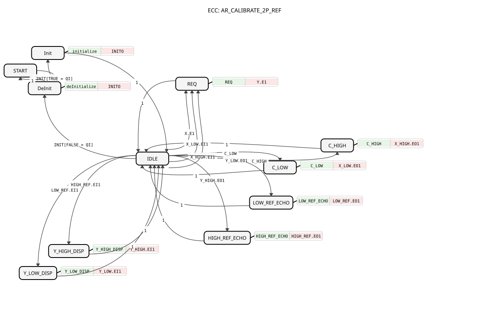

# AR_CALIBRATE_2P_REF

* * * * * * * * * *

## Introduction

`AR_CALIBRATE_2P_REF` is an adapter-based 2-point calibration (Low/High). Both points are stored independently of each other, so there is no ordering dependency as with `AR_CALIBRATE_SQ_REF`. The reference targets (`Y_LOW`/`Y_HIGH`) are live `AR2` sockets and are persisted via two additional `AR2` plugs (`LOW_REF`/`HIGH_REF`). Interpolation happens live on every `X.E1`.

## Interface Structure

### **Event Inputs**

- `INIT`: Initialization or deinitialization. Associated data: `QI`, `xClipping`.
- `C_LOW`: Atomic trigger to calibrate the low point (VT button, OPC UA method or remote toggle after merge).
- `C_HIGH`: Atomic trigger to calibrate the high point.

### **Event Outputs**

- `INITO`: Initialization confirmation. Associated data: `QO`.

### **Data Inputs**

| Name | Data type | Default | Comment |
| :--- | :--- | :--- | :--- |
| `QI` | `BOOL` | | Input qualifier (TRUE = enable, FALSE = disable). |
| `xClipping` | `BOOL` | `TRUE` | TRUE: output is clamped to `LOW_REF..HIGH_REF`; FALSE: no clipping, extrapolation beyond the calibration points allowed. |

### **Data Outputs**

- `QO` (`BOOL`): Output qualifier.

### **Adapters**

| Direction | Name | Adapter type | Comment |
| :--- | :--- | :--- | :--- |
| **Plug** (output) | `Y` | `adapter::types::unidirectional::AR` | Calibrated output. |
| **Plug** (output) | `X_LOW` | `adapter::types::bidirectional::AR2` | Persisted raw value at the low calibration point. |
| **Plug** (output) | `X_HIGH` | `adapter::types::bidirectional::AR2` | Persisted raw value at the high calibration point. |
| **Plug** (output) | `LOW_REF` | `adapter::types::bidirectional::AR2` | Persisted low-point target (Y_LOW). |
| **Plug** (output) | `HIGH_REF` | `adapter::types::bidirectional::AR2` | Persisted high-point target (Y_HIGH). |
| **Socket** (input) | `X` | `adapter::types::unidirectional::AR` | Raw input. |
| **Socket** (input) | `Y_LOW` | `adapter::types::bidirectional::AR2` | Target output at the low point: live edit in via `EO1`/`DO1`, the persisted/restored value is echoed back out via `EI1`/`DI1` for VT/web display. |
| **Socket** (input) | `Y_HIGH` | `adapter::types::bidirectional::AR2` | Same as `Y_LOW`, for the high point. |

## Functionality

The block is a basic FB. In state `IDLE` it reacts to the following events:

| Event | State | Action |
| :--- | :--- | :--- |
| `X.E1`, `X_LOW.EI1`, `X_HIGH.EI1` | `REQ` | Computes the calibrated value and emits `Y.E1`. |
| `C_LOW` | `C_LOW` | `X_LOW.DO1 := X.D1`, emits `X_LOW.EO1`. |
| `C_HIGH` | `C_HIGH` | `X_HIGH.DO1 := X.D1`, emits `X_HIGH.EO1`. |
| `Y_LOW.EO1` | `LOW_REF_ECHO` | `LOW_REF.DO1 := Y_LOW.DO1`, emits `LOW_REF.EO1` (persist). |
| `Y_HIGH.EO1` | `HIGH_REF_ECHO` | `HIGH_REF.DO1 := Y_HIGH.DO1`, emits `HIGH_REF.EO1`. |
| `LOW_REF.EI1` | `Y_LOW_DISP` | `Y_LOW.DI1 := LOW_REF.DI1`, emits `Y_LOW.EI1` (display after boot and after every change). |
| `HIGH_REF.EI1` | `Y_HIGH_DISP` | `Y_HIGH.DI1 := HIGH_REF.DI1`, emits `Y_HIGH.EI1`. |

All action states return to `IDLE` immediately. Initialization runs `START` → `Init` (`INIT` with `QI = TRUE`, `QO := QI`, `INITO`) → `IDLE`; `INIT` with `QI = FALSE` leads from `IDLE` via `DeInit` (`QO := FALSE`, `INITO`) back to `START`.

**Calculation in state `REQ`:**

1. `QO := QI`. The calculation is only performed when `QI = TRUE`.
2. Internal latched flags: `xLowCal` / `xHighCal` become TRUE as soon as `X_LOW.DI1` / `X_HIGH.DI1` differs from the default `0.0`.
3. If both points are calibrated: `Y.D1 = LOW_REF + (X - X_LOW) * (HIGH_REF - LOW_REF) / (X_HIGH - X_LOW)`; if `X_HIGH = X_LOW`, `LOW_REF` is output.
4. If only low is calibrated, `LOW_REF` is output; if only high is calibrated, `HIGH_REF`; if nothing is calibrated, `LOW_REF`.
5. Clipping to `[LOW_REF, HIGH_REF]` only if `xClipping` is TRUE and both points are calibrated.

## Technical Details

- **No ordering dependency:** `C_LOW` and `C_HIGH` store their raw value independently; each point can be re-calibrated individually at any time.
- **Partial calibration:** As long as only one point is calibrated, the block does not interpolate against the other point still at `0.0` but outputs the known REF value.
- **Persistence:** `X_LOW`, `X_HIGH`, `LOW_REF` and `HIGH_REF` are bidirectional `AR2` plugs; permanent storage is done by a downstream block (e.g. `INI_AR2`/`NVS_AR2`). Values read back at boot reappear at `Y_LOW`/`Y_HIGH` via `LOW_REF.EI1`/`HIGH_REF.EI1`.
- **Atomic triggers:** `C_LOW`/`C_HIGH` are plain event inputs, not an `AX` adapter with an edge guard.

## Application Scenarios

- Calibrating an analog sensor at two reference points (e.g. zero and end value) with the target values entered on the VT.
- Re-trimming a drifted zero point later without re-calibrating the high point.

## Summary

`AR_CALIBRATE_2P_REF` calibrates an `AR` signal using two independently stored raw values and two live-editable, persistable reference targets, and outputs the linearly interpolated (optionally clamped) result via `Y`.

---

### 🌐 Related topic pages on ms-muc-docs.de

- [🌐 Eclipse 4diac IDE & color reference on ms-muc-docs.de](https://www.ms-muc-docs.de/iec-61499/eclipse-4diac/)
