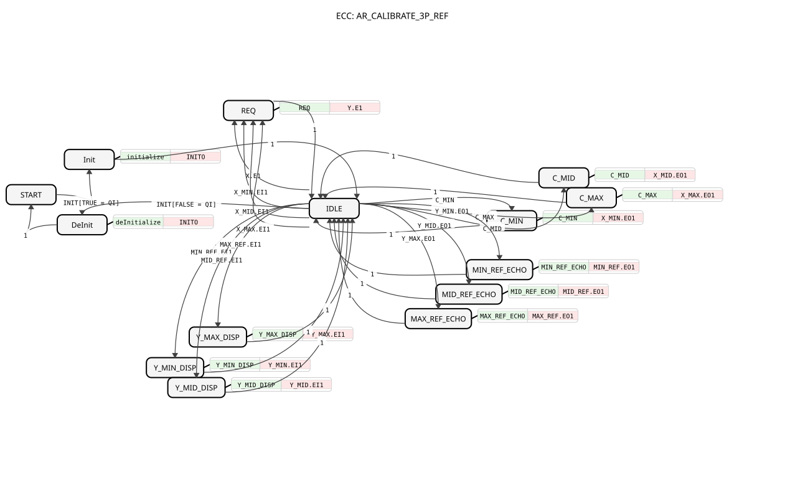

# AR_CALIBRATE_3P_REF




* * * * * * * * * *

## Introduction

`AR_CALIBRATE_3P_REF` is an adapter-based three-point calibration for joysticks and sensors with a centre position (Min, Mid, Max), in free order like [AR_CALIBRATE_3P](AR_CALIBRATE_3P.md). The reference targets (`Y_MIN`/`Y_MID`/`Y_MAX`) are **live `AR2` sockets** and are persisted via three additional `AR2` plugs (`MIN_REF`/`MID_REF`/`MAX_REF`). The same live-echo pattern as in `AR_CALIBRATE_SQ_REF` and [AR_CALIBRATE_2P_REF](AR_CALIBRATE_2P_REF.md) applies.

## Interface Structure

### **Event Inputs**

- **INIT** (`EInit`): initialisation request. Associated with `QI`, `xClipping`.
- **C_MIN**: calibrate the min point, atomic trigger.
- **C_MID**: calibrate the mid point (centre), atomic trigger.
- **C_MAX**: calibrate the max point, atomic trigger.

### **Event Outputs**

- **INITO** (`EInit`): initialisation confirm. Associated with `QO`.

### **Data Inputs**

- **QI** (`BOOL`): event input qualifier
- **xClipping** (`BOOL`, default `TRUE`): `TRUE` = output is clamped to `MIN_REF..MAX_REF`; `FALSE` = no clipping, extrapolation beyond the calibration points allowed

### **Data Outputs**

- **QO** (`BOOL`): event output qualifier

### **Adapters**

Plugs:

- **Y** (`adapter::types::unidirectional::AR`): calibrated output
- **X_MIN**, **X_MID**, **X_MAX** (`adapter::types::bidirectional::AR2`): persisted raw input value at the min/mid/max calibration point
- **MIN_REF**, **MID_REF**, **MAX_REF** (`adapter::types::bidirectional::AR2`): persisted target reference (`Y_MIN`/`Y_MID`/`Y_MAX`)

Sockets:

- **X** (`adapter::types::unidirectional::AR`): raw input
- **Y_MIN**, **Y_MID**, **Y_MAX** (`adapter::types::bidirectional::AR2`): target output `Y` at the min/mid/max point. Live edit in via `EO1`/`DO1` (socket-side swap); the persisted/restored value is echoed back out via `EI1`/`DI1` for VT/web display.

## Functionality

The block starts in state `START`; `INIT` with `QI = TRUE` leads via `Init` to `IDLE` (`QO := QI`), `INIT` with `QI = FALSE` leads via `DeInit` back to `START` (`QO := FALSE`). From `IDLE` the following action states are reachable, each returning immediately to `IDLE`:

- **REQ** (on `X.E1` or an event `X_MIN.EI1`/`X_MID.EI1`/`X_MAX.EI1`): calculates `Y` and fires `Y.E1`
- **C_MIN**/**C_MID**/**C_MAX**: store the raw input `X.D1` in `X_MIN.DO1`/`X_MID.DO1`/`X_MAX.DO1` and fire `X_MIN.EO1`/`X_MID.EO1`/`X_MAX.EO1`
- **MIN_REF_ECHO**/**MID_REF_ECHO**/**MAX_REF_ECHO** (on `Y_MIN.EO1`/`Y_MID.EO1`/`Y_MAX.EO1`): transfer the live reference `Y_xxx.DO1` to `xxx_REF.DO1` (persistence)
- **Y_MIN_DISP**/**Y_MID_DISP**/**Y_MAX_DISP** (on `MIN_REF.EI1`/`MID_REF.EI1`/`MAX_REF.EI1`): echo the persisted/restored reference back to `Y_xxx.DI1` (after boot and after every change)

Formula: piecewise linear interpolation between `(X_MIN, MIN_REF)`, `(X_MID, MID_REF)` and `(X_MAX, MAX_REF)`, clipped to `MIN_REF..MAX_REF` unless `xClipping = FALSE`.

**Partial calibration (before all three points are set):** each point is tracked internally (`xMinCal`/`xMidCal`/`xMaxCal`, latched TRUE once its raw value differs from the INI default `0.0`; stays correctly set across restarts because the boot restore returns the persisted value). Until all three are calibrated, `REQ` falls back cleanly instead of pivoting on a still-uncalibrated `X_MID.DI1` (which would sit at `0.0` and make the MIN branch permanently unreachable):

- Only one point calibrated: `Y` = that point's own REF value (no interpolation possible)
- Two points calibrated: two-point line between exactly those two, the third is ignored
- All three calibrated: full piecewise interpolation
- None calibrated: `Y := MID_REF`

Clipping only takes place if `xClipping` is set and both MIN and MAX are calibrated; otherwise the still-uncalibrated bound at its INI default `0.0` would corrupt the partial-calibration fallback. MID is irrelevant for this.

**Calibration (three-point, free order):**

1. **Min (`C_MIN`)**: move to minimum, set `Y_MIN`, trigger `C_MIN` → `X_MIN := X`
2. **Mid (`C_MID`)**: move to centre, set `Y_MID`, trigger `C_MID` → `X_MID := X`
3. **Max (`C_MAX`)**: move to maximum, set `Y_MAX`, trigger `C_MAX` → `X_MAX := X`

## Technical Details

- **Free order** as with `AR_CALIBRATE_3P`: each point is stored independently and can be recalibrated on its own (e.g. only re-trimming the centre), with no data dependency between the calibration actions.
- **References as live sockets:** `Y_MIN`/`Y_MID`/`Y_MAX` are bidirectional `AR2` sockets fed from an external VT/web reader, mirrored outward via the `AR2` plugs `MIN_REF`/`MID_REF`/`MAX_REF` for persistence (`INI_AR2`/`NVS_AR2`) and echoed back via `MIN_REF.EI1`/`MID_REF.EI1`/`MAX_REF.EI1`, so that a value restored after boot appears on screen without the operator re-entering it.
- Degenerate points (`X_MID <= X_MIN` or `X_MAX <= X_MID`) yield the respective REF value instead of a division by zero.

## State Overview

```text
START --INIT[QI]--> Init --1--> IDLE
IDLE --INIT[!QI]--> DeInit --1--> START
IDLE --X.E1 / X_xxx.EI1--> REQ --1--> IDLE
IDLE --C_MIN / C_MID / C_MAX--> C_xxx --1--> IDLE
IDLE --Y_xxx.EO1--> xxx_REF_ECHO --1--> IDLE
IDLE --xxx_REF.EI1--> Y_xxx_DISP --1--> IDLE
```

## Application Scenarios

- Steering angle sensor: Min = full lock left, Mid = straight ahead, Max = full lock right. `MIN_REF`/`MID_REF`/`MAX_REF` hold the desired calibrated angle values (e.g. -30.0 / 0.0 / 30.0 degrees), `X_MIN`/`X_MID`/`X_MAX` the raw sensor values actually measured.
- Joysticks with a centre position and persisted reference values editable on the VT

## ⚖️ Comparison with Similar Building Blocks

- [AR_CALIBRATE_3P](AR_CALIBRATE_3P.md): three-point calibration without `*_REF` sockets
- [AR_CALIBRATE_2P_REF](AR_CALIBRATE_2P_REF.md): two-point variant with the same live references

## Conclusion

`AR_CALIBRATE_3P_REF` calibrates three points in free order, keeps raw values and references persisted via `AR2` adapters and falls back cleanly on partial calibration.
