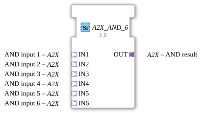

# A2X_AND_6

* * * * * * * * * *

!!! warning "Not released yet"
    The block is defined as a type in the library (as of 2026-11-13). The matching firmware side (C++ and ELF libraries) has not been released yet. Do not assume it is runnable yet.

## Introduction

`A2X_AND_6` combines 6 [A2X](../types/unidirectional/BOOL/A2X.md) adapters with AND, **UP and DOWN separately**. The block is generic (`GEN_A2X_AND`), the number of inputs is part of the name.

## Interface structure

### **Event inputs**

No direct events.

### **Event outputs**

No direct events.

### **Data inputs**

No direct data.

### **Data outputs**

No direct data.

### **Adapters**

| Role | Name | Type | Description |
| --- | --- | --- | --- |
| Socket | IN1 | adapter::types::unidirectional::A2X | AND input 1 |
| Socket | IN2 | adapter::types::unidirectional::A2X | AND input 2 |
| Socket | IN3 | adapter::types::unidirectional::A2X | AND input 3 |
| Socket | IN4 | adapter::types::unidirectional::A2X | AND input 4 |
| Socket | IN5 | adapter::types::unidirectional::A2X | AND input 5 |
| Socket | IN6 | adapter::types::unidirectional::A2X | AND input 6 |
| Plug | OUT | adapter::types::unidirectional::A2X | AND result |

## How it works

The adapter output `OUT` is updated **only when the value changes**, the event is only sent on an actual change. For the variant without change detection there is `A2X_AND_6_UNGATED`.

## Technical notes

- Generic block (`GenericClassName` = `GEN_A2X_AND`), no network definition of its own in the type.
- UP and DOWN are combined separately.
- The implementation is in the firmware (C++), not in the type.

## ⚖️ Comparison with similar blocks

- Same block with another operation: [A2X_OR_6](A2X_OR_6.md), [A2X_XOR_6](A2X_XOR_6.md).
- Same operation with another number of inputs: [A2X_AND_2](A2X_AND_2.md), [A2X_AND_3](A2X_AND_3.md), [A2X_AND_4](A2X_AND_4.md).
- Single-channel predecessor: [AX_AND_6](AX_AND_6.md).
