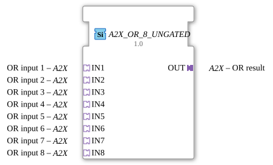

# A2X_OR_8_UNGATED

* * * * * * * * * *

!!! warning "Not released yet"
    The block is defined as a type in the library (as of 2026-11-13). The matching firmware side (C++ and ELF libraries) has not been released yet. Do not assume it is runnable yet.

## Introduction

`A2X_OR_8_UNGATED` combines 8 [A2X](../types/unidirectional/BOOL/A2X.md) adapters with OR, **UP and DOWN separately**. The block is generic (`GEN_A2X_OR`), the number of inputs is part of the name.

## Interface structure

### **Event inputs**

No direct events.

### **Event outputs**

No direct events.

### **Data inputs**

No direct data.

### **Data outputs**

No direct data.

### **Adapters**

| Role | Name | Type | Description |
| --- | --- | --- | --- |
| Socket | IN1 | adapter::types::unidirectional::A2X | OR input 1 |
| Socket | IN2 | adapter::types::unidirectional::A2X | OR input 2 |
| Socket | IN3 | adapter::types::unidirectional::A2X | OR input 3 |
| Socket | IN4 | adapter::types::unidirectional::A2X | OR input 4 |
| Socket | IN5 | adapter::types::unidirectional::A2X | OR input 5 |
| Socket | IN6 | adapter::types::unidirectional::A2X | OR input 6 |
| Socket | IN7 | adapter::types::unidirectional::A2X | OR input 7 |
| Socket | IN8 | adapter::types::unidirectional::A2X | OR input 8 |
| Plug | OUT | adapter::types::unidirectional::A2X | OR result |

## How it works

The `_UNGATED` variant has **no change detection**: every newly calculated result is passed to the output `OUT` unconditionally. It is meant for consumers that need a periodic cadence regardless of value changes, for example derivative or frequency calculations.

## Technical notes

- Generic block (`GenericClassName` = `GEN_A2X_OR`), no network definition of its own in the type.
- UP and DOWN are combined separately.
- The implementation is in the firmware (C++), not in the type.

## ⚖️ Comparison with similar blocks

- Same block with another operation: [A2X_XOR_8_UNGATED](A2X_XOR_8_UNGATED.md).
- Same operation with another number of inputs: [A2X_OR_2_UNGATED](A2X_OR_2_UNGATED.md), [A2X_OR_3_UNGATED](A2X_OR_3_UNGATED.md), [A2X_OR_4_UNGATED](A2X_OR_4_UNGATED.md), [A2X_OR_5_UNGATED](A2X_OR_5_UNGATED.md), [A2X_OR_6_UNGATED](A2X_OR_6_UNGATED.md), [A2X_OR_7_UNGATED](A2X_OR_7_UNGATED.md), [A2X_OR_9_UNGATED](A2X_OR_9_UNGATED.md), [A2X_OR_10_UNGATED](A2X_OR_10_UNGATED.md).
- Single-channel predecessor: [AX_OR_8_UNGATED](AX_OR_8_UNGATED.md).
